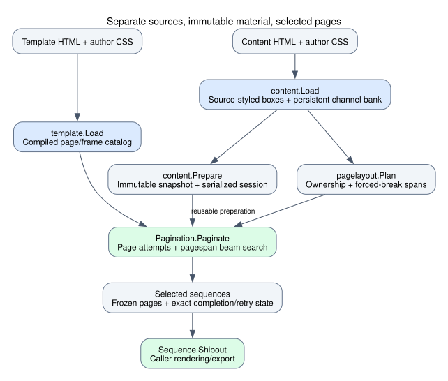

# Template-based page layout: first design proposal

Date: 2026-11-20. Status: design discussion, before implementation.

This document separates agreed direction from observations about existing
packages, proposed architecture, and unresolved questions. Proposals below are
not commitments to a public Go API or authorization to begin implementation.
We will refine the design first.

The concrete template examples are in [SKETCH.md](SKETCH.md). Background research
is in [TEMPLATES.md](TEMPLATES.md) and [REGIONS.md](REGIONS.md).

## Agreed decisions

- The module will provide a Go framework for template-based page layout, using
  HTML/CSS content and the author's existing typesetting packages.
- A collection of page templates lives in one HTML file. Each definition uses
  `<template id="..." data-type="page">`, containing an inner page DIV and child
  frame DIVs. The custom XML approach is historical exploration.
- CSS describes page properties and frame geometry on the instantiated DIVs.
  The `<template>` element is a storage wrapper, not the page box.
- Frames are top-level boxes directly under the page DIV and must use
  `position: fixed`. Nested template frames and other frame positioning schemes
  are outside this profile. This restriction does not apply to ordinary boxes
  within the content that later flows into a frame.
- Each page supplies the viewport for its fixed frames. Content flows into the
  frames' resolved content rectangles.
- CSS controls content assignment through the Regions-inspired `flow-into` and
  `flow-from` properties. Within a page, receiving frames form a chain in template
  document order. Content does not duplicate the template's frame elements.
- Frame classes allow repeated page instances without duplicate element IDs.
- `w3c-dom` provides the basis for HTML/CSS loading and styling;
  `css-box-layout` provides fixed-box layout. Template handling, page selection,
  and flow orchestration belong to `pagelayout`.

This direction does not imply general browser compatibility, complete CSS
support, or a settled pagination algorithm.

## Existing package capabilities

These are source-review findings from the current sibling checkouts, not features
implemented in this module. Recheck the contracts when implementation begins.

### `w3c-dom`

| Area | Available foundation | Boundary |
| --- | --- | --- |
| HTML tree | W3C-like navigation over styled `golang.org/x/net/html` nodes | Parsing begins with an HTML parse tree; this is not a full browser DOM. |
| Stylesheets | Embedded CSS extraction, selector matching, cascade and inline declarations | External resource loading and our template stylesheet policy remain application concerns. |
| Properties | Defaults, inheritance, display, position and dimension helpers | Relative lengths and layout-dependent values still require a layout context. |
| Region properties | `flow-into` and `flow-from` have non-inherited `none` defaults | The package stores/resolves properties; it does not execute region flow. |
| Ownership | Styled nodes expose underlying HTML and mutable property maps | They are not detached, immutable compiled-template results. |

[`dom.FromHTMLParseTreeWithError`](../../w3c-dom/dom.go) constructs a styled DOM
and reports extraction/styling errors. The lower-level
[`cssom.CSSOM`](../../w3c-dom/style/cssom/cssom.go) allows explicit stylesheet
registration and styling. Prefer property lookup with defaulting over reading
local declaration maps as though they were complete computed styles.

Template handling needs an application layer. The styled-tree builder traverses
the supplied HTML tree; it does not instantiate selected templates. The
[embedded stylesheet extractor](../../w3c-dom/style/cssom/douceuradapter/douceuradapter.go)
also scans recursively. We cannot rely on the collection's storage wrappers
alone to isolate active page styling from unused definitions.

Styling is restricted to an element allowlist that includes DIVs. Invalid
selectors can be logged and skipped, so a strict template validator cannot assume
every unsupported construct will surface as a construction error. The supported
CSS profile and its diagnostics require deliberate adapter policy.

### `css-box-layout`

[`BuildLayoutTrees`](../../css-box-layout/layout/build.go) returns separate
normal-flow and fixed branches. Fixed roots retain source preorder and share
the build's BoxID space. The builder also extracts nested fixed elements, so
our stricter top-level restriction must be checked before this normalization.

[`FixedLayout`](../../css-box-layout/layout/fixed_layout.go) resolves fixed roots
against one caller-supplied viewport and lays out their interiors. Root geometry
is viewport-local, with `RelativeTo == 0`; descendants remain relative to their
parent's content. The caller adds the viewport origin once during composition.
The result distinguishes the outer frame rectangle from its content rectangle.

Its input is typed: `ComputedStyle.Position`, width and box edges, plus
[`FixedStyle`](../../css-box-layout/layout/position.go) for height and insets.
`DefaultFixedStyle()` supplies auto constraints; a zero-valued `FixedStyle`
instead specifies zero insets and zero height. Each axis currently needs at
least one non-auto inset. Static-position fallback is unsupported.

An explicit or stretched height stays fixed even when contents overflow.
This API does not split overflow into another frame, choose pages, repeat
content, clip, or determine paint order. It is also not a dedicated geometry-only
API: the [empty-frame example](../../css-box-layout/layout/position_example_test.go)
uses an inline adapter to handle normalized empty groups.

### Existing paragraph flow

[`Document.LayoutFlow`](../../tytui/documentlayout/flow.go) is an integration
reference for flowing one direct paragraph group through a finite ordered list
of content rectangles. It supports width changes and reports unplaced material.
The first frame's width must match the initial paragraph callback's content
width after source box edges. Its returned remainder is frozen diagnostic
material, not a resumable checkpoint for adding more frames later.

This is useful for a first experiment, but does not supply general multi-block
pagination. Its lower-level continuation machinery lives in
[`typography/glyphing/paragraph`](../../typography/glyphing/paragraph/flow.go).
The eventual dependency on, or extraction of behavior from, the integration
package remains a design question.

The following responsibility map distinguishes the selected foundations from
integration choices still under discussion. Arrows describe intended use, not
an implemented Go import graph; dashed arrows mark unsettled integration choices.


[Graphviz DOT source](diagrams/design-packages.dot)

## Proposed architecture

The central proposal is to resolve template geometry before laying out incoming
material. This keeps frame construction independent of the amount of content.

The proposed pipeline keeps reusable template sources and incoming content
separate until the receiving geometry is resolved. Each stage must succeed
before its result is published; error exits are omitted from the diagram.



[Graphviz DOT source](diagrams/design-pipeline.dot)

### 1. Load and index the collection

**Proposal:** load a reusable source collection first; construct a styled DOM
only when a template is selected. The loading and instantiation details in these
two sections refine the proposal, not the list of agreed decisions.

Use `golang.org/x/net/html.Parse` to read the collection into the HTML tree that
`w3c-dom` consumes. Index `<template data-type="page">` elements by their exact,
nonempty `id` attribute. Selection is a map lookup, not a CSS selector assembled
from an ID. Reject duplicate template IDs and report an unknown requested ID.

For an initial collection profile, propose page definitions directly under
`body`, each containing exactly one page DIV, apart from comments and whitespace.
Reject nested page definitions and additional template roots. Check this source
structure before styling; validate the selected page's CSS and fixed frames
after styling. Parsing HTML can repair markup, so successful parsing alone is
not validation of our template profile.

At this level, extraction is an application-owned traversal of `*html.Node`.
The current parser represents template contents as child nodes, and `w3c-dom`
does not expose browser-style `HTMLTemplateElement.content` or an instantiation
operation. Do not style the whole collection and then detach one page: selector
matching and inheritance would have used its storage ancestors.

#### Collect stylesheets once, in source order

Propose accepting ordinary CSS `<style>` elements directly in the collection's
`head`, plus inline `style` attributes on the active elements. Enumerate those
head children explicitly and call
[`douceuradapter.ExtractStyleElementsWithError`](../../w3c-dom/style/cssom/douceuradapter/douceuradapter.go)
on each accepted style element. Keep the resulting sheets in document order,
with source associations for diagnostics. On any extraction error, fail loading
the collection rather than retaining the extractor's partial successful result.

Do not call the extractor on the entire collection or indiscriminately on its
head: it recursively visits descendants, including stored templates. For the
initial profile, propose rejecting styles elsewhere, external stylesheet links,
`@import`, conditional rules, and style-element attributes that require sheet
selection, such as a nonempty `media`. Accept absent/empty or `text/css` type
values; diagnose other types. These restrictions need our own checks; the
extractor does not enforce them or evaluate media conditions.

Retain all accepted rules, including those for other page variants or content
flows. Selector matching will determine which rules apply to a particular
instance. Do not prune rules by class-name searches or rewrite selectors with a
template-ID prefix.

The loaded collection owns the original tree, template index, ordered sheets,
and document-context attributes. Treat them as read-only after loading. This
is an ownership convention, not an immutability guarantee from `w3c-dom`:
`cssom.StyleSheet` includes mutating operations such as `AppendRules`.

### 2. Instantiate before styling

**Proposal:** give each page instance a fresh HTML document and a fresh CSSOM,
while reusing the collection's read-only sheets.

#### Construct a predictable active document

Deep-clone the selected inner page DIV and its descendants, retaining child
order, tag atoms, namespaces, text, and copied attribute slices. Rebuild all
parent/sibling links; neither detach the original subtree nor shallow-copy its
tree links. Record clone-to-source associations for diagnostics.

Put the clone in this minimal document context:

```html
<html lang="en">
  <head></head>
  <body>
    <div class="page two-column">
      <div class="frame heading"></div>
      <div class="frame body body-left"></div>
      <div class="frame body body-right"></div>
    </div>
  </body>
</html>
```

This illustrates selecting `two-column-article` from [SKETCH.md](SKETCH.md).
The implementation creates a document node and the `html`, `head`, and `body`
elements; programmatically created elements must have correct `DataAtom` values
because `w3c-dom` uses atoms in its styling allowlist.

Propose copying the collection's `html` and `body` attributes onto these fresh
elements, including `lang`, `dir`, classes, IDs, and inline styles. Their other
children are absent. The head is empty because sheets are registered separately.
The storage template's ID remains selection metadata; its attributes are not
copied onto the page and do not become inherited page context. Put page-specific
classes, language, or inline styles on the inner page DIV itself.

Selectors consequently see `html > body > .page > .frame`. For example,
`.page.two-column > .body-left` matches, while
`#two-column-article .body-left` and `template .frame` do not match the example.
Supported ancestor selectors and inherited properties can use `html` and `body`.
Structural selectors see just this instance: `.page:first-child` does not mean
the first output page. The context is not shared with other page instances or
incoming content, and it does not itself establish the fixed-layout viewport;
that remains an explicit input to `css-box-layout`.

#### Register the collection CSS, then style the whole active document

Use the lower-level CSSOM path to make sheet selection and order explicit:

```go
// Proposed internal helper, using existing sibling-package APIs.
// activeDoc is the fresh document above; sheets are in collection source order.
func styleInstance(activeDoc *html.Node, sheets []cssom.StyleSheet) (*dom.W3CNode, error) {
    engine := cssom.NewCSSOM(nil)
    for _, sheet := range sheets {
        if err := engine.AddStylesForScope(nil, sheet, cssom.Author); err != nil {
            return nil, err
        }
    }
    root, err := engine.Style(activeDoc)
    if err != nil {
        return nil, err
    }
    return dom.NodeFromTreeNode(root)
}
```

Here `html` is `golang.org/x/net/html`; `dom` is the root `w3c-dom` package, and
`cssom` is its `style/cssom` package. The helper is illustrative, not a settled
public API. Collection validation and cloning precede it; frame validation
follows it.

Use a **nil scope** for these sheets: they apply throughout the active document,
including its `html` and `body` elements. Scoping them to the page clone would
prevent rules from styling those ancestors. `AddStylesForScope` is a rule
applicability mechanism, not an isolated selector tree or CSS `@scope` boundary.

`CSSOM.Style` collects inline declarations itself; do not register them a second
time. Registration order preserves sheet order, with later declarations winning
when importance and specificity tie. Inline declarations participate in the
existing cascade; they are not unconditional overrides of `!important` rules.
Use `cssom.Author` consistently, without assuming the package implements a full
browser origin model.

[`dom.FromHTMLParseTreeWithError`](../../w3c-dom/dom.go) is a convenient alternative
when embedded sheets should be discovered automatically. It extracts recursively
and registers an optional supplied sheet after the extracted sheets. Explicit
CSSOM registration better fits our already-selected, ordered collection sheets.
Do not both copy style elements for automatic extraction and register the same
sheets manually.

#### Keep the styled context alive through geometry resolution

Locate the styled page and frame nodes by their `HTMLNode()` identities against
the cloned nodes, retaining source order. The result of `Style` is the styled
document, with a synthetic default-bearing parent; it is not the page itself.
Keep that ancestor context intact while reading styles. Use
[`css.GetProperty`](../../w3c-dom/style/css/cascade.go), or the DOM
`ComputedStyles().GetPropertyValue` wrapper, for inherited/defaulted values;
`Styles()` contains local declarations and can be nil. Prefer the error-returning
lookup in validation, since the DOM convenience accessor logs lookup errors and
returns `NullStyle`.

Validate each frame's resolved `position` as `fixed`, then project the selected
page subtree into typed layout input. CSS property lookup does not resolve all
relative lengths or produce page geometry. Keep that distinction at the adapter
boundary described in steps 3 and 4.

Create a new CSSOM per instantiation because styling registers node-specific
inline sheets in the engine. Reusing a mutable engine across instances could
retain prior node references; sharing engines or mutable property maps is not a
proposed concurrency contract. Publish detached geometry and flow bindings only
after styling, validation, and geometry resolution succeed. Caching styled pages
can wait until context and ownership policies are settled.

CSS parse success and a successful `Style` call are insufficient for strict
validation: unsupported selectors may be logged and skipped, and not every CSS
construct is implemented. A proposed preflight must inspect supported rule forms
and selectors, and the geometry adapter must validate relevant property values.
Whether diagnostics need additional support in `w3c-dom` remains open. Separate
content styles are not injected into this geometry pass; how collection and
content sheets combine when styling flow sources remains a separate decision.

### 3. Validate a bounded template profile

**Proposal:** validate the styled template into a small, typed geometry input
before building layout boxes. Then validate the returned rectangles before
publishing a compiled page. The top-level `position: fixed` requirement is
agreed; the more restrictive profile below is proposed for the first iteration.

#### Validate source structure and effective CSS separately

Treat each direct element child of the page DIV as a frame, regardless of its
classes. Require at least one frame, all DIVs, and empty frame interiors. Permit
comments and HTML whitespace used for indentation; omit these from the geometry
projection. Reject other text, nested elements, generated content, or ordinary
page-level flow material. In particular, a nested fixed element must fail here:
`BuildLayoutTrees` would otherwise extract it as another fixed root and obscure
the template-profile violation.

Read effective values with `css.GetProperty` and normalized display with
[`css.GetDisplay`](../../w3c-dom/style/css/get_display.go). Validate those values
after cascade and defaulting, not just inline styles or declarations on `.frame`.
Never turn a failed conversion into zero or an unknown position into `static`.

| Property or constraint | Page DIV | Frame DIVs |
| --- | --- | --- |
| `display` | `block flow` (including its `block` spelling) | Same initial restriction; reject hidden or boxless frames before normalization. |
| `position` | `static` | `fixed`. |
| `width`, `height` | Definite positive absolute lengths; these define the viewport. | Definite positive absolute **content** dimensions. |
| Physical insets | All `auto`; the page starts at its own origin. | Exactly one of `left`/`right` and one of `top`/`bottom` is definite; the opposite inset is `auto`. |
| `box-sizing` | `content-box` | `content-box`; border-box conversion is deferred. |
| Margins | Zero | Zero; auto margins are deferred. |
| Padding and borders | Zero effective edges | Nonnegative absolute padding and effective border widths, as described below. |
| Geometry direction | Horizontal, left-to-right | Same; logical properties and other writing modes are deferred. |
| Visibility and floating | Visible, `float: none` | Same. |
| Region properties | `flow-into: none`, `flow-from: none` | `flow-into: none`; one named `flow-from`, preserving the name's case. Unbound/decorative frames are deferred. |

The size/inset rule deliberately avoids both content-dependent sizing and
overconstraint. `FixedLayout` supports more combinations, including opposing
insets with auto size, but those are not admitted by this first profile. Both
insets being `auto` would require unsupported static-position fallback. Keep
these failures distinct in diagnostics: unsupported by our profile versus
unsupported by the underlying layout engine.

Propose accepting `px`, `pt`, `in`, `cm`, and `mm`, plus unitless zero where
zero is valid. Reject other unitless lengths, percentages, font/viewport-relative
units, `calc()`/`var()`, and content-based sizes initially. Insets may be signed;
their resulting border rectangles must still pass the page-bounds check below.
Parse magnitudes with checked conversion, reject overflow/non-finite values, and
recheck positive dimensions after conversion to the layout representation.

For each border side, resolve style before width: `none` or `hidden` contributes
zero geometry even when the default width is `medium`. Propose initially allowing
`solid` with an explicit nonnegative absolute width; other visible border styles
and width keywords can follow. Padding and border widths occupy space outside
the declared content dimensions. Keep colors and border paint information in
page-layout metadata; the box-layout engine receives widths, not paint commands.

#### Make unsupported CSS visible

Use an explicit adapter policy for geometry-affecting properties, including
min/max sizing, transforms, aspect ratios, logical insets, and multi-column or
flex/grid layout. Reject nontrivial unsupported effects on the active page or
frames, including effects inherited from or established by their document
context. Do not silently omit them while claiming their geometry was honored.
Clipping, non-default stacking, rounded regions, and paint effects need separate
policies; accepting a rectangle is not an implementation of those features.
Rules for other template variants or separate content remain outside this
selected page's value validation.

The CSS registry is partial: for example, `box-sizing` and `writing-mode` do not
currently have registry defaults, while min/max dimensions use a `none` sentinel.
Define the adapter's absent-value policy explicitly (`content-box` and
`horizontal-tb` for those first two properties), and recognize the package's
no-constraint sentinel without treating it as a complete CSS sizing model.
Unknown or explicit unsupported values must not take the absent-value path.
Do not add guessed values to `w3c-dom` or infer support from a nonempty property
string.

Shorthand support also needs a stated boundary. The current
[`SplitCompoundProperty`](../../w3c-dom/style/property.go) expands `margin`,
`padding`, `border-width`, `border-style`, and `border-color`; consume the
resulting longhands. It does **not** expand the sketch's `border: 0` or
`background: #ffffff`. Propose using `border-width: 0; border-style: none` and
`background-color: #ffffff` in the first executable fixture. Broader shorthand
support would need deliberate CSS-layer work, potentially a registered splitter
before styling, not a second cascade in the geometry adapter. Reject unexpanded
geometry shorthands, including logical insets, rather than leaving them in an
ignored metadata map. The earlier declaration preflight must cover constructs
discarded by styling; post-cascade value checks cannot diagnose declarations
that the CSS layer has already dropped.

Report the template ID, frame ordinal/classes or source path, property, offending
value, and expected constraint. Retain the underlying error when wrapping a
conversion or layout failure. A failed page publishes no partial geometry;
validating all templates eagerly can be a separate collection-check operation.

### 4. Resolve fixed geometry through the existing API

**Proposal:** `pagelayout` owns CSS adaptation and page policy;
`css-box-layout` owns box normalization and fixed-position equations. There is
no need for a second position solver or for running normal content layout to
discover empty frame geometry.

#### Project validated values, not CSS strings

Convert accepted absolute lengths to CSS pixels at this boundary. Reuse
[`dimen.ParseAbsolute`](../../w3c-dom/dimen/dimen.go) after checking our allowed
syntax/units; its compatibility extensions are not automatically template
features. Convert its fixed-point result with `float64(value) / float64(dimen.PX)`
before the checked conversion to `float32`. CSS pixels are layout units, not
output-device pixels. Do not round to whole pixels or treat `dimen.DU` as pixels.

Build one [`layout.RenderNode`](../../css-box-layout/layout/render.go) for the
static page and one for each empty frame, in source order. Keep the clone's HTML
node identity and assign distinct source `NodeID`s, with a lookup back to the
styled node and diagnostic source. Only the page subtree is projected: `html`
and `body` provide style context, not additional layout boxes or page offsets.

| Validated input | Typed layout field |
| --- | --- |
| Block/flow display | `RenderNode.Display = layout.Display{Kind: layout.DisplayBox, Outer: layout.OuterBlock, Inner: layout.InnerFlow}` |
| Frame `position: fixed` | `ComputedStyle.Position = layout.PositionFixed` |
| Content width | `ComputedStyle.Width = layout.Length{Kind: layout.LenPx, Value: widthPx}` |
| Content height | `FixedStyle.Height`, using `LenPx` |
| `top`, `right`, `bottom`, `left` | `FixedStyle.Insets`, using `LenPx` or `LenAuto` |
| Resolved margins, padding, effective borders | `ComputedStyle.Margin`, `.Padding`, `.Border` |
| Page width and height | The supplied `layout.Rect` viewport; also set the page's typed width. |
| Flow names, paint and source associations | Separate `pagelayout` metadata keyed by source identity. |

Start each style from `layout.DefaultComputedStyle()` and each frame's fixed
constraints from `layout.DefaultFixedStyle()`, then set validated values. A zero
`ComputedStyle` means width `0px`; a zero `FixedStyle` means four zero insets and
zero height, not `auto`. The page uses `PositionStatic` with `Fixed == nil`;
its height is kept as page metadata/viewport height because the core's height
field belongs to fixed roots.

Do not send CSS strings through `RenderNode.Styles`: the builder rejects display
and box-value strings there. The existing
[`documentlayout` adapter](../../tytui/documentlayout/policy.go) is useful for
typed lengths and effective borders, but its static-flow policy cannot be reused
unchanged for fixed frames.

#### Build once, then invoke the fixed branch

Call [`BuildLayoutTrees`](../../css-box-layout/layout/build.go) with the projected
page root. Verify that `trees.Fixed` contains exactly the validated frame sources,
once each and in source order. Retain the `NodeID` to `BoxID` association from
those roots; do not assume the two IDs are equal. BoxIDs are unique across both
branches of this build, not across page instances.

`trees.Flow` should contain only the static page and empty normalization
scaffolding. A remaining source content node is an adapter error, not something
to discard silently. Do not call `BuildLayoutTree`, `ResolveUsedValues`, or
`FlowLayout` on the fixed branch: `FixedLayout` performs the required resolution
itself. The page rectangle comes directly from validated page dimensions; its
empty normal-flow branch does not determine the page height.

The call sequence, after projection and the branch checks, is:

```go
viewport := layout.Rect{X: 0, Y: 0, W: pageWidthPx, H: pageHeightPx}
fixed, err := layout.FixedLayout(
    trees.Fixed, viewport, emptyFrames, nil, layout.FixedLayoutOptions{},
)
if err != nil {
    // Discard this invocation, including any callback state.
    return nil, err
}
// Validate fixed.Geometry, then copy page/frame results for publication.
```

This is an illustrative call fragment, not a proposed public API. `emptyFrames`
is an application-owned `layout.InlineLayouter`. Even empty DIVs acquire an
anonymous inline group during normalization, so the adapter must handle those
callbacks. It should verify that a request belongs to a known frame and a truly
empty `BoxAnonymousInline`, then return zero extent, no atomic placements, and
`AllowsMarginCollapse: true`. Unexpected content is an error; a blanket zero-size
callback could conceal a broken projection. No paragraph preparation is needed.
The existing [fixed-layout example](../../css-box-layout/layout/position_example_test.go)
demonstrates this callback boundary.

The intrinsic measurer is nil because admitted frame sizes are definite and
their interiors empty. The zero font-size fallback is valid here because the
geometry contains no `em` lengths; it does not specify a font size for later
content. If the profile expands, font-relative dimensions require resolved
font metrics, and content-dependent sizes would conflict with this stage's
purpose. Keep those changes explicit.

#### Check and publish page-local rectangles

For each fixed root, read `fixed.Geometry[root.BoxID]` and check it is present
with `RelativeTo == 0`. `Frame` is the **border box**, excluding margins;
`Content` is the receiving rectangle inside padding and borders. Both root
rectangles already use viewport-local coordinates. Do not add the frame's
origin again to `Content.X/Y`. With the proposed zero-origin viewport these are
page-local coordinates; add an external page origin once, during composition.
Any future ordinary descendants would instead be relative to parent content.

For example, in a `300px` by `200px` viewport, a frame with `right: 20px`,
`top: 10px`, content size `80px` by `30px`, `padding: 3px`, and a `2px solid`
border has `Frame = (190, 10, 90, 40)` and `Content = (195, 15, 80, 30)`.
Without padding or borders, both are `(200, 10, 80, 30)`. Those receiving
dimensions stay fixed when material is later flowed into them.

Propose rejecting missing/non-finite results, nonpositive content dimensions,
border boxes outside the page, and positive-area overlaps between frame border
boxes; touching edges are allowed. Check containment of content within its
border box as an adapter invariant. Boundary comparisons need a documented
tolerance for unit-conversion and float32 rounding, without silently clamping
substantive errors. The core intentionally permits zero sizes, negative positions
and overlaps; these stricter checks are our proposed page policy. Bleed and
intentional overlays would require an explicit later policy.

Publish detached page dimensions, border/content rectangles, flow bindings,
and source identities only when every frame passes. Do not expose mutable core
tables as a compiled template contract. Preserve frame source order for region
chains; it does not establish paint order. `FixedLayout` neither clips nor
fragments incoming material, and these geometric checks do not prove that any
particular content will fit.

An extension can later admit percentages or opposing-inset stretch without
changing this ownership split. Percentage width/horizontal insets use viewport
width; height/vertical insets use viewport height, while percentage padding and
margins in the current core use viewport width. `LenPercent` stores a fraction
(`50%` becomes `0.5`). Do not enable that path using a conversion that clamps
percentages or rounds them to integers. `border-box`, min/max constraints and
font-relative geometry need their own validated adaptation; the typed core does
not infer those CSS semantics for us.

### 5. Publish a compiled page description

Conceptually, retain page dimensions and paint, frames in source order, outer
and content rectangles, resolved `flow-from` names, and source associations for
diagnostics. This is a description of needed information, not a proposed public
Go type declaration.

Group frames by flow name while preserving their order. Use content rectangles
as destinations so borders and padding are accounted for. Keep flow order
distinct from paint order. Page-instance identity must distinguish repeated
uses of a template from the local BoxIDs of one layout build.

### 6. Flow content in a separate stage

Keep source styling attached to the content as it moves through frames. Do not
assume reparenting HTML under a receiving frame preserves its selectors and
inheritance. The content-to-flow extraction contract needs separate design.

Use the frame rectangles as constraints on content layout, not merely as clips
on a fully laid-out article. Report completion, unplaced material, and failure
to make progress explicitly. The existing bounded paragraph-flow path can
exercise this boundary before generalized pagination is designed.

The schematic below applies the agreed within-page flow model to the two-column
example. It is not to scale. The page outline groups three sibling frames;
arrows represent content movement, not DOM reparenting or paint order. The
heading's separate flow does not imply repetition. The dashed continuation
marks the unresolved cross-page policy.


[Graphviz DOT source](diagrams/design-flows.dot)

## Open questions

- **Loading and CSS scope:** Adopt the proposed head-only sheets, one-instance
  document, and copied `html`/`body` attributes, or narrow that context further?
  Which stylesheet features should follow the initial profile? How should
  collection rules and content sheets combine when styling flow sources?
- **Loading diagnostics:** Can preflight provide useful errors for unsupported
  selectors and rule forms through current interfaces, or does `w3c-dom` need
  an explicit diagnostic API? What source locations should the loader retain?
- **Supported profile:** Adopt the proposed absolute content sizes, one anchor
  per axis, block/flow display, and zero margins? Which of percentages, stretch,
  border-box sizing, additional units, or CSS shorthands should follow first?
  Should the initial border/paint profile be smaller or broader?
- **Frame policy:** Adopt rejection of hidden, zero-sized, unbound, overlapping,
  or out-of-page frames, or introduce explicit exceptions? What numeric tolerance
  should bounds checks use? Who owns clipping and paint order when those features
  are added?
- **Content assignment:** How are source elements collected into named flows?
  What happens when a flow has no destination or a frame names a missing flow?
- **Fragmentation:** How do multiple paragraphs and blocks, margins, unbreakable
  objects and break constraints participate? Which existing contracts can be
  reused, and which need extension?
- **Page sequencing:** How are first, facing, continuation and blank-page
  templates selected? How are new destinations supplied to live continuations?
- **Repeated content:** How do running headings and folios differ from streams
  that are consumed once?
- **API and ownership:** What is compiled once versus instantiated per page?
  What can be cached, and what identities and diagnostics must survive into
  rendering? No public API is fixed yet.

## Proposed first experiment, after design refinement

Load the two-column collection example with the supported shorthand replacements
noted in step 3, select one template, validate its fixed frames, and inspect the
resolved content rectangles and flow assignments. Then feed the body rectangles
into the existing bounded single-paragraph flow path.

For loading and instantiation, check selection of both variants, repeated
instantiation without source mutation, stylesheet source order, inline versus
important declarations, and inherited styles from the copied document context.
Verify that storage-wrapper selectors do not match, and that missing/duplicate
template IDs, rejected stylesheet forms, and malformed CSS produce diagnostics.
These are proposed acceptance checks for later implementation.

For geometry, check equivalent `25.4mm`, `1in`, and `96px` lengths; top/left and
bottom/right anchoring; and the padded/bordered numeric example in step 4. The
zero-edge A4 sketch should retain its declared `20mm`/`110mm` column origins and
`80mm` by `231mm` receiving sizes after conversion. Include auto sizes, missing
or double anchors, hidden/nested frames, unexpanded shorthands, and unexpected
content as rejected inputs. Check frame-to-source identity, touching versus
overlapping rectangles, page containment, and that translating a completed page
adds its external origin exactly once. A failed callback or rectangle check must
leave no published partial page. These checks should exercise the integration
contract rather than duplicate the core's fixed-position solver tests.

This would check the integration without requiring a general paginator. Include
an invalid non-fixed or nested frame and a paragraph that leaves a remainder,
so validation and incomplete placement are observable. Implementation and its
checks should start only after the design has been refined further.

## Diagram sources

The editable diagram sources are the `.dot` files in `doc/diagrams/`; the adjacent
SVGs are rendered previews for Markdown readers. After changing a source,
regenerate its preview with Graphviz, for example from the repository root:

```sh
dot -Tsvg doc/diagrams/design-pipeline.dot -o doc/diagrams/design-pipeline.svg
```

Use the same command with `design-packages` or `design-flows` for the other
diagrams. The diagrams illustrate the decisions and proposals above; they do not
add implementation commitments.
