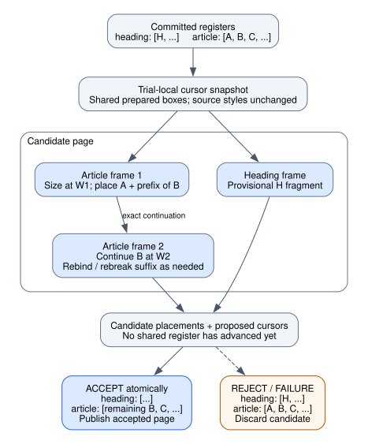
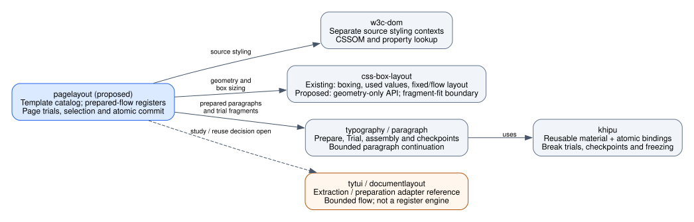

# Template-based page layout: implemented architecture and remaining design

Date: 2026-11-23. Template loading (TPL-01–05), content loading (CONT-00–05),
preparation (PREP-00–05 and sibling milestones), and BOX-PREP-02 are implemented.
Whole-subtree measurement/layout is available; frame fitting, page selection,
continuations across boxes and multi-channel page commits remain design work.

---
## REMARKS

We will change the fundamental decision on what's flow material is. According to your
proposal the flow material is essentially DOM fragments, which are then put into an
empty page (with frames) and then layed out. This is not what we are going to do.
Flow material will already be boxed, but their dimensions not yet frozen. Styling is
exclusively dictated by the location of the flow material's ancestor in the DOM. The
region/frame onyl influences layout, i.e., sizing.

W3C: The region influences layout without replacing the original styling ancestry.

### Reading in the Source and Building Trees

We find 2 documents:

  1. HTML/CSS for page templates: Templ-Doc
  2. HTML/CSS for the content: Cont-Doc

We will read in all page templates (Templ-Doc) at once. For each page template, we will perform
the boxing step, including sizing. The result is (conceptually) a sequence of render-trees,
each one identified by an ID.

The parser of Cont-Doc produces a box-tree. It then identfies all the branches which denote
flow material. This flow-material is put into a register each (per flow-"channel"). 
The flow material is not yet sized, but "prepared" (see below).
At the end of this phase, conceptually there are

  1. a box-tree of the main content
  2. several registers filled with flow material, which has been split from the content
  3. still a sequence of page render-trees

I am unsure about the main content. Possibly we have to have a "default flow channel" where
it flows into and each page template needs to provide a target for it. This is to be 
discussed.

### Preparation of Flow-Material

Flow-material will go through a non-standard phase, which we will call "preparation" for
lack of a better term right now. The process will traverse the box-tree top to bottom,
like for layout/sizing. Style properties will be in effect and known. As soon as the
traversal encounters horizontal material (e.g. a paragraph of text), the horizontal material
will be put to the shaper and something like a TeX `\hlist` will be produced. In our
world, this will be called a `khipu` (see sibling package `khipu`). A khipu is prepared
for line-breaking, and all the styling information affecting the sizing has been processed
(i.e., font selection, etc). However, atoms (inline-block) are not yet sized, and line-breaking
will only by possible later with the width information known. Applying the sizing
multiple times (for trials) will be much more efficient on prepared material than it
would be for a box-tree.

### Trial of a Template Page

A template page is tried. How and in which sequence templates are selected for trial is to
be discussed. Flow-material is read out from a register and attached as a branch of
the corresponding frame. Then the sizing algorithm will travel down from the attachment
point, providing width information for the prepared flow-material. For each top-level
element, the sizing will result in a height. This is repeated until the sum of the heights
of the tried out top-level boxes is equal or greater than the sum of heights for a region
(comprised of the heights of its frames). The rest of the flow-material stays in the
register. The typesetter tries to find suitable breakpoints and split points for each 
filled frame. Continuations are put into the following frame. This way, all frames of
a region get filled. Unused Flow-material will be prepended back in the register again.

(End of Remarks)

---

## Revised direction

The remarks above define the new process. This discussion replaces the previous
linear outline. The implemented boundaries below supersede its conceptual data
structures; sections on page fitting and commit remain proposals.
The source remarks are preserved verbatim. Template examples are in
[SKETCH.md](SKETCH.md); background is in [TEMPLATES.md](TEMPLATES.md) and
[REGIONS.md](REGIONS.md).

**Design freedom across sibling modules:** `css-box-layout`, `w3c-dom`, `khipu`,
`typography` and the other sibling typesetting packages are under our control.
Their designs and APIs will be influenced and shaped by the needs of page layout.
None of their existing restrictions should prevent page-layout ideation. Design
the desired process first, then identify appropriate changes and responsibilities
across the modules. References below to current limitations describe integration
work to be addressed, not fixed boundaries of the intended design. Distinguish
those facts from deliberate page-layout policies and proposed implementation
stages; do not turn a temporary module limitation into a product requirement.
The [upstream simplification review](#opportunities-to-simplify-through-sibling-changes)
below identifies concrete consequences of this principle.

**The layout engine tries already-sized page templates against registers of
prepared, unsized box material.** A trial supplies containing geometry, resolves
used dimensions, breaks paragraphs, and chooses fragments. Choosing a page
commits its consumption of the registers. Rejecting a trial consumes nothing.

The earlier outline already kept source styling separate and proposed fixed
frame geometry independent of content. Those parts survive. It did not make
boxed content, preparation, registers, or competing page trials the organizing
concepts. Those are now central:

| Earlier proposal | Revised treatment |
| --- | --- |
| Style and compile a template when selected | Compile **all** templates before page trials; selection chooses a compiled page tree by ID. |
| Supply separate HTML content to a later flow stage | Style Cont-Doc, build source-associated boxes, extract flow branches, and prepare their horizontal material before trials. |
| A compiled page chiefly described rectangles and bindings | Retain a reusable page/frame tree with geometry, paint and bindings; rectangles are part of that result. |
| Flow assignment and continuation largely left open | Registers, trial snapshots, per-frame fitting and atomic page commit are explicit proposed contracts. |
| Empty-frame geometry resolver as the main integration concern | Keep it as one service used by the template compiler; it does not size or paginate content. |
| A general future content-flow call | Separate reusable preparation, trial-specific sizing/breaking, fragment selection, and accepted output. |

### Direction established by the remarks and earlier decisions

- Templ-Doc and Cont-Doc are separate HTML/CSS inputs. Templ-Doc contains
  `<template id="..." data-type="page">` definitions with an inner page DIV and
  direct fixed-position frame DIVs. All template trees are boxed and sized at
  loading time. Content box dimensions are not frozen at that point.
- Source DOM ancestry exclusively determines content styling. The frame changes
  layout constraints, not selector matching, inheritance, fonts, or paint styles.
  Attaching material during a trial is a **layout attachment**, not DOM reparenting.
- CSS `flow-into` assigns source branches to channels; `flow-from` binds template
  frames to channels. Frames for one channel are visited in template document
  order. Content does not duplicate the template's frame elements.
- Preparation traverses flow box material and turns horizontal groups into
  reusable khipus. It resolves source-dependent text preparation while deferring
  line breaking and the used geometry of inline atoms until constraints are known.
- Page trials size and fragment material into frames, retaining unplaced material
  and continuations for subsequent frames and pages.
- `w3c-dom`, `css-box-layout`, typography and `khipu` remain collaborators. We can
  propose changes to their APIs, but this document does not implement them.

**Adopted terminology:** use *frame* for one physical rectangle, *flow channel*
for a named content stream/register, and *region chain* for the ordered frames
receiving that channel on a page. The remarks use “region” for a collection of
frames, whereas earlier documents used it as a synonym for one frame. These
terms are used by the implemented catalog, content loader and guides.

## Process and ownership: implemented stages and proposed page trials


[Graphviz DOT source](diagrams/design-pipeline.dot)

There are two loading pipelines followed by a repeated trial/commit cycle. The
pipelines can be developed independently; no parallel execution is implied.
The objects have the following current boundaries:

| Object | Contents and ownership |
| --- | --- |
| Template catalog | Ordered, ID-indexed immutable page/frame descriptions, resolved geometry, paint, and channel bindings. Shared by all trials. |
| Source content model | Original styling context, source identities and box structure. Retained wherever property lookup or borrowed text/font services require it. |
| Prepared material | Immutable `content.PreparedSnapshot` metadata over unchanged source boxes, paired with a separate serialized `PreparationSession` owning executable group handles. |
| Channel register | Implemented persistent `RegisterBank[content.Box]` stores unchanged branch roots. `Take` advances a derived bank by a whole item. Within-box continuation and page commit are not register payloads or implemented APIs. |
| Page trial (proposed) | A template instance, private cursor snapshots, temporary sizing/atomic results, candidate breaks and placements. It never mutates catalog geometry or shared box styles. |
| Accepted page (proposed) | Detached placed fragments and their frame/page coordinates, paint and source references; paired with the committed register advances. |

“Immutable” here is a publication/ownership rule. Some upstream services retain
memoized discovery state or borrowed fonts. A discarded trial may warm such a
cache, but may not alter source meaning, accepted geometry, or register positions.
Serialize calls sharing a paragraph preparation until stronger upstream
concurrency contracts exist.

### 1. Compile the entire template collection

See [TEMPLATE-LOADING.md](TEMPLATE-LOADING.md) for the implemented package/API,
loading stages, diagnostics, and completed PR plan across `pagelayout`,
`w3c-dom` and `css-box-layout`.

Template loading is encapsulated in `pagelayout/template`, including its source
model, styling, validation and compilation stages. The root package
will consume compiled catalogs for page composition; the template package does
not depend on the root package. TPL-05 completes reader/filesystem loading and
initial repository discovery, with executable examples and integration tests.
The `pgtmpl` CLI implements load, find and a compiled-geometry browser viewer.
Load/serve accept additional CSS. Configuration-driven shared repositories and
page trials remain separate work.

Parse Templ-Doc once, index unique nonempty template IDs, collect its stylesheets,
and compile every definition. Publish the catalog only when all definitions
pass the selected template profile. This replaces deferred compilation at page
selection. A source/style revision requires a new catalog; a trial never restyles
or resizes its template.

For each definition, clone the inner page/frame tree into a fresh styling
document, preserving source order and copied attributes. The implemented context is
`html > body > .page > .frame`, with the collection's `html`/`body` attributes.
The storage `<template>` is absent from that ancestry. Use correct HTML tag atoms
when constructing nodes programmatically. This happens once per definition,
not once per trial or output page.

The implementation uses the following `w3c-dom` CSSOM route. A reusable
stylesheet program and isolated styling sessions, proposed below, could replace
the repeated setup without changing each template's styling context:

1. Inspect accepted direct head styles in order with `cssom.InspectStylesheet`
   and active nodes' inline declarations with `InspectInlineStyle`. Retain source
   declarations and reject reported errors before styling. External sheets,
   conditional rules and template-local sheets are outside the initial profile.
   Caller-supplied additional CSS is accepted as ordered author stylesheets;
   this does not enable linked-sheet or import fetching.
   Scan accepted style elements explicitly; recursive whole-document extraction
   would cross stored template boundaries.
2. Create a fresh `cssom.NewCSSOM(nil)` per definition. Register each sheet with
   `AddStylesForScope(nil, sheet, cssom.Author)` and call `Style(activeDocument)`.
   Inline declarations are collected by the engine. Nil scope also styles the
   `html`/`body` context needed for inheritance. Do not register sheets twice.
3. Validate source declarations against the template profile, including losing
   and unmatched declarations. Adapt effective values through the checked
   `css.GetBoxLength`, `GetColor`, `GetFlowName`, `GetBoxKeyword` and `GetBorder`
   APIs, with `GetDisplay` for display. Keep the styled context alive until all
   required properties have been adapted. Local `Styles()` maps are not complete
   computed-style snapshots; HTML identities link styled nodes back to source.
4. Validate structure and CSS, construct the page/frame box description, resolve
   fixed geometry, then publish the compiled template tree.

The published result preserves the meaningful box hierarchy even though the
geometry service needs only typed constraints. Conceptually it is the remarks'
page render-tree; it need not be exactly a `css-box-layout.LayoutNode` tree.
Keep page paint, frame border/content rectangles, channel names, source order and
identities alongside that structure. Normalized empty inline groups from a
fallback implementation are not part of its public meaning.

The preferred `ResolveFixedGeometry` operation, implemented in BOX-01, fits this phase.
It sizes each fixed frame; it does **not** substitute for constructing the
template's box description. The existing `BuildLayoutTrees` / `FixedLayout`
route remains a fallback. Their contracts and the initial CSS profile are
summarized below.

### 2. Style, box and route the content document

The implementation sequence, sibling changes and later open questions for this
phase are detailed in [CONTENT-LOADING.md](CONTENT-LOADING.md). CONT-00's loading
contract and initial profile are adopted, with acceptance fixtures and expected
results. CONT-01's private source parser/inspector/styler is implemented; the
public `content.Load`, typed projection, routing, normalization, copied inspection
and generic Box registers are also implemented, along with all required sibling
text-style, font-relative border and builder-error services.

Parse and style **all of Cont-Doc in its original context**, then construct
source-associated box material with computed style inputs but no final widths,
heights, line breaks or page positions. “Parsing produces a box tree” describes
this pipeline, not a capability of the HTML parser alone. `w3c-dom` supplies the
styled tree; a content adapter and `css-box-layout` supply boxing.

Template CSS is not applied to Cont-Doc. Any shared stylesheet must explicitly
be an input to each document. The executable collection sketch now puts `.story`
and `.page-heading` source-flow rules in its separate Cont-Doc fixture; frame
geometry and `flow-from` rules belong to Templ-Doc. Neither trial attachment nor
the output tree triggers another CSS cascade.

Preserve two different relationships: **source ancestry for style** and
**layout containment for used-value resolution**. For example, a paragraph keeps
its Cont-Doc font and line-height while its percentage width is resolved in the
receiving layout context. Retain source context or detached effective style
inputs; do not inherit missing styles from a frame after routing. Unknown or
width-dependent typography needs an explicit preparation policy, not silent
restyling on a later trial.

Implemented routing and normalization:

1. Identify the source box roots whose effective `flow-into` names a channel.
   Append their branches to that register in source document order. A branch has
   one flow owner; it must not also produce material in its former content parent.
2. Keep the residual main-content box tree with those branches excluded from its
   layout projection. Preserve ancestry and source IDs for style/diagnostics;
   no mutation of the source DOM is needed. Retain meaningful container boxes
   and their edges rather than flattening all descendants into paragraphs.
3. Normalize box structure for each extracted branch and the residual tree,
   then index their horizontal groups. Explicit `content.Prepare` runs separately.
   Routing precedes normalization that
   merges source siblings into anonymous groups or loses extraction boundaries.

This refines what “box-tree, then split branches” means at the API boundary:
create a source-associated box projection first, route its branches, then perform
final flow normalization. The private typed `RenderNode` projections
are partitioned in `content` before independent calls to the core builder.
No builder partition hook is required or implemented. Source identity must survive any normalization or rebuild.

**Adopted initial loading profile (CONT-00):** extract non-nested block branches
only. Reject nested `flow-into` roots, inline source extraction, and unsupported out-of-flow
content with source diagnostics. These are tractability limits, not a claim
about the Regions model. In particular, no text or branch may disappear merely
because it has no selected receiver yet.

#### Deferred direction: floats into designated template frames

Author direction (2026-11-22): content authors should eventually be able to
author images and tables as CSS floats in their HTML document. In paged output,
the template designer may provide frames intended for particular kinds of flow
material, such as illustrations or tables. A floated item could then flow into
an appropriate frame, with the template determining its page placement. Float
support is explicitly postponed; this records the intended use case, not a
settled routing API or an implemented feature.

For example, a page design may have a narrow body-text area and a wide outer
margin. An illustration frame can extend beyond the body-text area's horizontal
bounds into that margin. The content author expresses the illustration's float
intent in Cont-Doc; the template designer supplies the receiving frame's
position and extent in Templ-Doc. The illustration keeps its source styles and
identity while its receiving constraints come from the frame. It need not be
confined to the body-text frame's rectangle.

This extends the channel/register idea to material with a placement purpose.
It does not yet decide that every CSS float is extracted, that element names
alone select receivers, or that authors must add an explicit `flow-into` name.
Those are future authoring and routing choices. In particular, distinguish
ordinary local float layout from floats assigned to page-template frames.

Questions for that later design work:

- How does float intent, material kind or an explicit channel select eligible
  frames, and what happens when no suitable frame is available?
- How is the source anchor retained so placement respects reading order and
  proximity to the referring text, including deferral to a later page?
- How do image sizing, captions, table layout and possible table fragmentation
  interact with the receiving frame and its fit policy?
- If illustration and text areas geometrically overlap, how are text exclusion,
  clearance and paint order represented? Extending into a margin does not by
  itself require overlap, but the current template profile rejects overlapping
  frame border boxes; any exception needs an explicit future design.
- How do placement and deferred items participate in register trial/commit
  behavior without duplicating or losing material?

For now, the content-loading milestone retains its no-floats scope. This use case
also does not introduce image/table loading, new frame-kind metadata or changes
to template overlap validation. Revisit those contracts together when float
support is designed; source styling must remain independent of frame placement.

### 3. Decide how residual main content participates

**Recommendation, still open:** route the residual main-content tree to a reserved
default channel, instead of maintaining a second page-layout algorithm beside
the named registers. At the end of loading, the main tree still exists, but its
layout ownership belongs to that channel. Named-flow branches have already been
excluded, so they are not duplicated there.

The reserved channel's public name or configuration mechanism is undecided; do
not invent a CSS keyword yet. A template opts into receiving it through an
explicit binding. For ordinary body pages, require a receiver whenever default
material remains. A cover or a page serving only another channel could be an
explicit policy exception. Thus every template need not always have a default
frame, but the scheduler must not endlessly choose pages incapable of advancing
pending content.

An alternative first mode is to require all content to be explicitly named and
reject nonempty residual material. Silently dropping residual content is not an
option. Keep this choice configurable or unsettled until a concrete document
example establishes the desired authoring convention.

An empty register leaves its frames empty; a nonempty register with no receiver
on one candidate remains unchanged. Before pagination, diagnose channels that
have no receiver anywhere in the permitted catalog. Later selection must also
detect starvation or lack of progress among otherwise receivable channels.

### 4. Prepare boxes without fixing their dimensions

See [PREPARATION.md](PREPARATION.md) for the implemented contract: where preparation
sits between CSS box-layout phases, a sibling typography callback returning
reusable material, nested atomic preparation, and ownership across trials.

Traverse each flow branch top down, carrying its already-established source
styles and formatting context. At each horizontal group, normalize/project text
as required, perform font selection/itemization, preserve source and bidi mapping,
then prepare reusable paragraph material. Preparation is an explicit loading
phase, not a side effect of the first frame's final-layout callback. In the
implemented profile all document groups, including residual material, are prepared before layout; lazy loading
would be a later resource-policy change.

The original box tree retains its block and inline-box structure unchanged.
`PreparedSnapshot` stores copied source/paint/policy inputs; a matching
`PreparationSession` holds private executable handles keyed by qualified groups.
No paragraph handle or readiness flag is written into a node or register. An inline-block contributes a stable atomic occurrence anchor to the
parent paragraph and retains its own prepared subtree. It is **not** sized during
parent preparation. Nested text can be prepared recursively without resolving
the atomic box's eventual width or height.

Unsized does not mean that all dimensions are unknown: an authored absolute
width and shaped glyph advances can already be known. It means used box geometry,
line selection and placement have not been fixed for a receiving frame.

Distinguish three kinds of result:

| Reusable preparation | Per-trial work | Accepted output |
| --- | --- | --- |
| Source styles, selected fonts, base shaping, bidi context, khipu material, atomic IDs, box constraints | Used dimensions, atomic advances and interiors, line-break decisions, vertical assembly, candidate splits | Placed frozen fragments, geometry and paint; live continuation only for unfinished material |

Fonts and shaping-affecting style must be stable across trials. Geometry-dependent
typographic choices cannot be hidden inside this cache; initially reject them
or require resolution against the source context before preparation. Width-dependent
box lengths remain unresolved and are expected. Hyphenation alternatives may be
discovered and shaped lazily by existing services, so “prepare once” means reuse
base material, not a promise of zero subsequent shaping calls for every policy.

### 5. Try a page from register snapshots (proposed)

The page scheduler chooses candidate template IDs. **Initial policy proposal:**
the caller supplies a finite ordered candidate list for the current document
position; try those from the same committed register state. Start with first
feasible selection and explicit required-channel/progress rules. Later scoring
may consider unused space, breaks and template preference. No scoring formula,
global optimum or facing-page sequence is agreed yet.

For a candidate, instantiate a lightweight page result from the compiled tree.
Open a trial snapshot covering all channel cursors. Conceptually attach branches
read from each register under the corresponding frame. Implement that attachment
as a trial-owned reference or wrapper carrying the containing rectangle; do not
reparent shared boxes, modify catalog nodes, or rerun CSS.

For each channel's region chain, visit frames in source order:

1. Supply the current frame's content width and remaining height. Resume the
   register's leading unfinished branch, or start its next branch. Resolve box
   used values downward from this layout attachment; retain internal parent-child
   containing relationships and source style inputs.
2. When a horizontal group is reached, size its atomic children under the actual
   containing constraints, recursively laying out their prepared interiors.
   Bind their horizontal advances to the prepared paragraph and supply their
   heights, margins and alignment to vertical assembly. Keep each atomic interior
   paired with the trial that produced its metrics.
3. Break the prepared paragraph at the available inline width, assemble enough
   vertical geometry to evaluate fitting, and expose legal line boundaries.
   Whole blocks provide block-boundary candidates; splittable containers need
   continuation state for their children and edges.
4. Accept a fitting prefix provisionally in the trial. A paragraph may split at
   an allowed line boundary; an indivisible box moves intact to a later frame.
   Continue with the next block if space remains, or carry the unfinished branch
   into the next frame. Changed width means a new suffix layout, not clipping
   lines previously broken at another width.
5. At the end of the chain, retain the exact unplaced tail followed by untouched
   register entries. Record proposed cursor advances and diagnostics; do not yet
   change the committed registers.

The sizing walk supplies width downward and obtains height upward, as in the
remarks. However, **the sum of frame heights is only a look-ahead heuristic**.
Different widths produce different line counts; even equal-width frames have
individual fit limits, unbreakable items, margins and legal breakpoints. Two
100-unit-high frames cannot contain a single indivisible 150-unit-high box just
because their total height is 200. Evaluate actual frames to certify a fit.

Similarly, summing independent block heights is insufficient when margin collapse,
container padding/borders or break rules apply. A fragment fitter must account
for these effects at each boundary. Propose initially using simple block stacks
with zero inter-block margins/edges, ordinary paragraphs and indivisible inline
atoms. General nested-block splitting, decoration at fragment boundaries,
widows/orphans and keep-with-next remain explicit extensions, not silently ignored
CSS. Existing ordinary box layout still provides sizing; it is not itself a
general fragmenting block-layout service.

Use bounded look-ahead and retain candidate break records if a later break choice
can move provisional material back. Stopping on the first legal greedy fit is
a workable first strategy. Choosing a breakpoint must preserve the exact source
suffix; rebreaking later must not lose bidi context, duplicate lines, or alter
already committed prefixes.

A branch continuation should identify its source tree and open-container path,
the next child or paragraph position, accepted line checkpoint, and any pending
boundary state. Keeping only a height or a DOM offset cannot resume a partially
filled container. Reuse prepared text across widths, but reuse measured heights
or atomic interiors only when their constraints and style/font inputs match.

### 6. Commit one trial, or consume nothing



[Graphviz DOT source](diagrams/design-flows.dot)

**Proposal:** registers behave transactionally. A trial reads through a private
cursor; its result includes candidate placements and a replacement cursor for
every channel it would advance. The scheduler commits one complete page and all
of those cursor updates together. A rejected candidate or any sizing/assembly
failure leaves every committed register unchanged. Do not consume a heading in
one register merely because a body-flow trial later failed.

This implements the remarks' “prepend unused material back” without destructively
popping and reconstructing shared queues. Logically, if a trial reads `[A, B, C]`
and places all of A and a prefix of B, committing leaves
`[continuation-of-B, C, ...]`; rejecting leaves `[A, B, C, ...]`. Read-ahead after
B is never accidentally consumed. A continuation references prepared source
material and accepted decisions, not merely the height or a frozen diagnostic
remainder.

Competing page trials start from the same committed checkpoints. Within a trial,
advancing to another frame may create new checkpoints, but those become durable
only on page commit. Previously committed lines and consumed atomic geometry
remain locked. Unsized suffix atoms can receive new geometry for a new width;
changes must not retroactively alter consumed atoms or their interiors.

Return explicit outcomes: usable candidate (possibly with remaining material),
no progress, unsupported input, or operational error. If no permitted candidate
can place a pending indivisible item, report its identity and required/available
geometry rather than generating empty pages indefinitely. Allow deliberate blank
pages only through a bounded scheduler rule. Completion means all participating
registers are exhausted, not just the default channel.

Retain preparations, discovery state and checkpoints while their material may
still be retried or continued. Release completed/abandoned working material once
no live candidate needs it. Accepted pages retain frozen fragments and stable
rendering dependencies, not the entire mutable trial state. A repeated heading
requires an explicit copy/repetition policy; a consumable heading channel alone
does not repeat it.

## Existing services and remaining integration work

These observations come from the current sibling sources; they are not proof
that the full new pipeline is already implemented or that all checkouts build
together without integration work. The limitations listed here are changeable
under the design-freedom principle above.



[Graphviz DOT source](diagrams/design-packages.dot)

| Package | Existing capability | Work still proposed here |
| --- | --- | --- |
| [`w3c-dom`](../../w3c-dom/doc/architecture.md) | CSS inspection/diagnostics, checked box values, shared detached text styles and source-font border resolution; isolated CSSOM styling. | Reusable compiled stylesheet/session separation remains optional work. Profile and routing policy already live in pagelayout. |
| [`css-box-layout`](../../css-box-layout/layout/README.md) | Unsized normalized boxes via builders; used-value resolution, ordinary/fixed layout and the BOX-01 geometry-only resolver. Typed styles and structural nodes are separate from output geometry. | Resumable box-fragment fitting. Projection partitioning is implemented in pagelayout; core also supplies group enumeration and generic persistent registers. |
| [`khipu`](../../khipu/doc/PREPARED_PARAGRAPHS.md) | `PrepareParagraph` yields immutable `Khipu` plus `Discovery`; `BindParagraph` supplies atomic advances; immutable `Tikray` trials, `Checkpoint`, first-fit continuation and `Freeze`. | No page scheduler, channel register or vertical box fragmentation is supplied by these operations. |
| [`typography/glyphing/paragraph`](../../typography/glyphing/paragraph/README.md) | `Prepare`, independent `Prepared.Trial` / `Trial.Assemble`, checkpoints, and `StartFlow` / `Continuation.Fit`; source styles and bidi context remain stable. | Compose these paragraph operations with block continuation and trial-specific atomic interiors across a page/register transaction. |
| [`tytui/documentlayout`](../../tytui/documentlayout/preparation.go) | Source extraction, font itemization and invocation-local prepared groups demonstrate the adapters. `LayoutFlow` serves a finite frame list for one paragraph group. | Reuse appropriate contracts; its invocation lifetime and bounded flow result are not a persistent register implementation. |

`khipu` already distinguishes an unbound atomic occurrence from a bound zero
advance. Widths belong to bindings; vertical dimensions and object payload stay
with the client. This directly supports preparing the parent paragraph before
sizing an inline-block. Preserve occurrence identity and source coordinates
through every trial.

Current paragraph continuation is bounded: `NoHyphenation`, whole-line prefix
fitting, and first-fit suffix search after a width change. `Continuation.Fit`
does not implement widows/orphans or general height optimization. Its existing
`StartFlow` path fixes other layout inputs, including atomic boxes. For atoms
whose geometry changes between frames, use the lower-level independent trial /
checkpoint design or extend the integration; do not assume that convenience
path already supports rebinding them. The
[`TrialCheckpoint`](../../typography/glyphing/paragraph/trial_checkpoint.go)
checks consumed atomic geometry and line-height inputs; the caller must also
preserve the matching atomic interiors.

The missing major service is a **resumable box-fragment fit operation**. Its
conceptual input is a prepared branch, a continuation, a containing width and
height budget, and break policy. Its output is placed fragments, candidate/legal
breaks, updated continuation and progress/overflow diagnostics. No exact Go
signature is proposed yet. `css-box-layout` should own box sizing and structural
fragment rules; typography/khipu own paragraph search and assembly; `pagelayout`
owns frame traversal, channel ordering and page selection/commit. First implement
only the simple block-stack profile rather than claiming a complete CSS paginator.

Keep the box core independent of khipu and DOM types by supplying paragraph
measurement/fitting services through an adapter. That adapter associates box
group identities with prepared paragraph handles. Today's `InlineLayouter`
returns a complete group's extent and atomic placements, not a partial block
continuation; the fragmentation boundary would be a new contract, not an
unannounced change to that callback's meaning.

## Opportunities to simplify through sibling changes

Review dated 2026-11-21. These are **recommendations for refinement**, not agreed
API changes or implemented capabilities. The two loading pipelines and page
trial/commit model remain useful. The main simplification is to move layout
mechanics into reusable sibling services, leaving `pagelayout` to coordinate
templates, channels and page choices.

### 1. Fit a prepared box sequence through one resumable operation

The largest opportunity is in `css-box-layout`. The process above describes a
recursive sizing walk, child positions, paragraph checkpoints, container edges
and pending margins. If `pagelayout` implements those details, it becomes a second
box-layout engine even when it calls existing sizing helpers.

Extend the proposed branch fitter to accept an **ordered sequence of prepared
box roots**, with an immutable, opaque continuation. A sequence is generic layout
input; the core need not know its channel name. It should preserve meaningful
containers and account for boundaries between roots as well as within them.
Fitting independent roots and adding their heights would leave inter-root margin
and break behavior in the page scheduler.

Conceptually, the new operation would be:

```text
fit(prepared sequence, cursor, receiving constraints, break policy)
    -> placed fragments, next cursor, fit status and diagnostics
```

The core owns open-container paths, pending edges, child positions and nested
paragraph continuation tokens. `pagelayout` retains a prepared sequence and a
committed cursor per channel; a trial replaces private cursors as it traverses
frames. The old cursor remains usable after every success or failure. Local
fragment coordinates become page coordinates only when composing the result.

This refines the current proposed branch boundary; it is **not** supplied by
[`FlowLayout`](../../css-box-layout/layout/layout.go) or
[`InlineLayouter`](../../css-box-layout/layout/interfaces.go).
Add a separate fragment-fitting service rather than changing the whole-group
callback's meaning. Paragraph fitting remains a supplied service, so the box core
does not acquire khipu types or page-selection policy. The new contract must
define progress, exhaustion, oversized material and unsupported input explicitly.
It simplifies the client, but still requires real fragmentation work upstream.

### 2. Unify paragraph fitting around existing prepared trials

The desired building blocks largely exist in `khipu` and
`typography/glyphing/paragraph`: immutable preparation, atomic binding, independent
trials and accepted-prefix checkpoints. Reuse them; another page-layout-specific
prepared paragraph representation would add synchronization and ownership work.

The useful upstream addition is a typography fitting operation that accepts a
prepared paragraph, an optional continuation, receiving dimensions, break policy
and **current atomic realizations**. It would perform binding, breaking, vertical
fitting and checkpoint creation together, returning a fragment and reusable
continuation. It could extend or complement `Continuation.Fit`; its exact API
should follow the box fitter's needs.

This removes the present choice between the convenient
[`StartFlow` path](../../typography/glyphing/paragraph/flow.go), whose atomic inputs
stay fixed, and manually composing
[`Trial` / `Assemble`](../../typography/glyphing/paragraph/trial.go) and
[`Checkpoint`](../../typography/glyphing/paragraph/trial_checkpoint.go).
Unconsumed atoms may be resized for a different frame width. Consumed geometry
must stay locked, and the adapter must retain the matching atomic interiors.
An immutable realization handle pairing metrics with interior output would make
that obligation easier to enforce than unrelated maps of dimensions and payloads.

Return trial-owned fragment handles with fit results. Today's inline callback
retains paragraph output in invocation-local storage keyed by group ID; one group
can now have several candidates and several placed fragments. A single mutable
"latest result" slot per group cannot represent that. The box core can carry
opaque handles while the typography adapter owns their rendering data.

Supporting hyphenated continuation or alternative suffix breakers would require
corresponding `khipu` work. Those are capabilities to develop, not reasons to make
`NoHyphenation` or first-fit a permanent page-layout restriction. Preserve the
accepted-prefix guarantee whichever breaker is selected.

### 3. Give styling a reusable program and detached effective inputs

The original proposal has two different statuses:

- **Separate reusable CSS from a styling session.** Compile ordered stylesheets
  and selectors once, then style each active template tree in an isolated session.
  Currently [`CSSOM.Style`](../../w3c-dom/style/cssom/cssom.go) registers inline
  declarations against HTML nodes in the rules tree, and selector caches belong
  to that tree. An explicit separation would allow shared compiled rules without
  retaining another template's inline declarations or node identities. Selector
  matching still runs in each template's own context; combining all active pages
  into one DOM would change sibling and structural selector behavior.
- **Detached effective inputs are implemented for the admitted profile.**
  `textstyle` supplies source typography/HTML semantics; checked CSS APIs supply
  lengths, colors, keywords and source-font border resolution. Both loaders
  inspect losing/nonmatching declarations and retain source-located diagnostics.
  Content stores detached computed styles with percentages/auto values unresolved.
  The published catalog and content snapshots retain no mutable DOM/CSSOM.
  A broader universal effective-style snapshot would be an extension.

Reusable stylesheet compilation could reduce repeated registration. It is an
optimization opportunity, not a missing correctness boundary in today's loaders.

Keep template selection, accepted stylesheet locations and strictness policy in
`pagelayout`. `w3c-dom` should expose general styling and diagnostic facilities,
not a page-template loader. Shorthand expansion, property defaults and typed CSS
value parsing belong there too; add missing support there instead of permanently
requiring template authors to spell out library-specific longhand workarounds.

### 4. Source partitioning: implemented adapter ownership

The earlier builder-hook suggestion was superseded by CONT-00. `content` owns
flow semantics and partitions detached typed projections before normalization.
CSS core builds each independent root with structured errors; source styles and
text identities are explicit inputs, not recovered from anonymous boxes.
The resulting `content.Box` handles qualify snapshot, tree and local BoxID.

Non-nested block extraction, residual wrappers and suppressed/empty material
have tested contracts in [CONTENT-LOADING.md](CONTENT-LOADING.md). A generic
builder partition API is not a prerequisite left outstanding by this design.

### 5. Keep direct fixed geometry, and share the integration adapter

BOX-01 implements `ResolveFixedGeometry`. It
removes normalization scaffolding, synthetic empty-inline callbacks and fixed-root
identity matching from template compilation. It shares typed constraint setup,
axis equations and rectangle construction with ordinary fixed layout.
Typed `box-sizing` and additional definite length forms could remove authoring
limits without making frame geometry depend on content.

The second-client integration is now implemented in `content` and the optional
`preparation/typography` bridge. Shared source-style resolution lives in
`w3c-dom/style/textstyle`; normalized group traversal lives in CSS core.
Pagelayout performs source extraction and qualified identity mapping, then uses
typography's existing mapper/itemizer and paragraph APIs. It has no tytui dependency.

`MeasureIntrinsic` and `Layout` reuse one preparation/session pair at different
widths. CSS core supplies `RealizedAtomic` geometry via `RealizedAtomicsView`;
checked conversions preserve CSS-pixel versus typography-DU/big-point units.
Whole-tree results retain copied geometry/source/paint and immutable paragraph
output after session release. PREP-05 supplies real-font and GC lifetime proofs.
A further general shared document adapter is optional refactoring, not missing
functionality required to complete preparation.

### 6. Avoid assembling unused paragraph output on every trial

This is an optimization opportunity after the fitting contracts are proven.
[`Trial.Assemble`](../../typography/glyphing/paragraph/trial.go) assembles the whole
paragraph; the current
[`changed-width continuation`](../../typography/glyphing/paragraph/flow_reflow.go)
freezes/assembles the complete path before selecting its tail. Competing page
templates can therefore repeat work for accepted prefixes and unused suffixes.

Typography could expose line metrics and legal breaks for fitting, then materialize
only the required fragment, reusing frozen accepted prefixes. `khipu` would need
a range-freezing operation if its present whole-plan freeze prevents that reuse.
The metrics and final fragment must come from the same captured plan and atomic
realizations: line height needs real font and object metrics, not an estimate
from advances. Paragraph-wide optimization may still inspect the entire suffix;
partial assembly does not imply bounded line-breaking work.

### Consequences for the proposal

The preferred direction for further discussion is **generic prepared sequences
and opaque fit continuations below the page scheduler**. Preparation stays eager,
source styles stay stable, and page commit remains an all-channel operation.
The scheduler need not know which container child or paragraph line a cursor
represents. This is the strongest reduction in page-layout-specific machinery.

Treat the restrictions in the earlier stages in three different ways:

| Kind | Examples | Treatment |
| --- | --- | --- |
| Established direction | Fixed template frames, original source styling, preparation before trials | Preserve through upstream changes. |
| Current capability or staging limit | No hyphenated continuation, fixed atomic inputs in the convenience flow path, zero-edge initial block stacks, richer CSS shorthand support | Record as implementation work or a temporary test profile; do not make it the desired final model. |
| Product/design choice | Default channel, nested extraction semantics, overlaps, repetition, template selection and break policy | Discuss explicitly; a more capable sibling API does not decide these. |

Refine the box-fit and paragraph-fit contracts together first, using one ordinary
paragraph, one nested box and one width-dependent atom as examples. Align source
partitioning and stable identities with that contract. The direct geometry service
and CSS diagnostics are implemented; reusable stylesheet compilation remains
an optional loading optimization. Optimize partial assembly once measurements show
where competing trials spend time. No sibling changes are made by this review.

## Template geometry contract retained from the earlier proposal

The changed process moves this work to eager catalog construction. It preserves
the principle that template geometry is independent of future content. TPL-03 now
implements the initial CSS validation and typed adaptation subset described in
[TEMPLATE-LOADING.md](TEMPLATE-LOADING.md#c-validate-source-declarations-and-effective-styles).
BOX-01 implements fixed geometry; TPL-04 now compiles the catalog and enforces
the initial rectangle policy below. Further profile extensions remain proposals:

| Area | Implemented initial restriction |
| --- | --- |
| Structure | One page DIV, direct fixed frame DIVs, initially empty receivers; indentation/comments are not content. |
| Page | Positive absolute dimensions, static block/flow box, zero margins/padding/effective borders; page-local origin. |
| Frames | Block/flow, fixed, content-box sizing, zero margins; positive content sizes determined by explicit dimensions or opposing-inset stretch. |
| Lengths | Start with `px`, `pt`, `in`, `cm`, `mm` and valid unitless zero; percentage/font-relative authoring deferred. |
| Insets | At least one definite inset per axis; auto size requires both. Reject content-dependent sizing and both-auto static-position fallback. |
| Edges and effects | Nonnegative absolute padding/effective border widths; initially none/hidden or solid borders. Explicit policies required for transforms, min/max sizing, clipping and unsupported effects. |
| Result checks | Finite positive receiving rectangles; reject out-of-page border boxes and border-box overlaps. Touching edges are allowed under the documented TPL-04 precision tolerance. Bleed/overlay exceptions remain open. |

Source input validation complements effective-property checks: unsupported
declarations can otherwise be discarded by styling. DOM-02/03 now provide the
checked values, defaults and selected shorthand support, including the sketch's
`border: 0` and `background: #fff`. TPL-03 applies the source profile to all
declarations, then validates effective box roles, paint and content-independent
sizing prerequisites. Unsupported syntax is diagnosed rather than interpreted
as successful layout.

Adapt values to CSS pixels using checked conversion, e.g. the allowed absolute
units through [`dimen.ParseAbsolute`](../../w3c-dom/dimen/dimen.go), then divide
by `dimen.PX` before conversion to the core's float representation. Keep source
identities and useful diagnostics. Initialize `ComputedStyle` and `FixedStyle`
with their default constructors; their zero values mean explicit zero sizes or
insets rather than `auto`.

### Preferred service: geometry-only API

**Implemented in BOX-01:** the public `css-box-layout/layout` service is:

```go
func ResolveFixedGeometry(
    style ComputedStyle,
    viewport Rect,
    opts FixedLayoutOptions,
) (LayoutGeometry, error)
```

It resolves one non-replaced fixed box without a DOM/layout tree, BoxID,
inline callback or intrinsic measurer. It returns complete viewport-local border
and content rectangles, `RelativeTo == 0`, without mutating inputs. Both axes
must have a definite size or opposing-inset stretch. `ErrFixedContentDependency`
reports content-dependent sizing, `ErrInvalidFixedGeometry` reports invalid input
or arithmetic overflow, and `ErrUnsupportedPosition` reports non-fixed positioning
or both-auto static-position fallback. Errors return zero geometry.
The typed service handles definite viewport percentages and `em` with supplied font size
even if our initial authoring profile is smaller.

It shares the typed kernel and equations in [`fixed_sizing.go`](../../css-box-layout/layout/fixed_sizing.go)
and rectangle construction in
[`fixed_geometry.go`](../../css-box-layout/layout/fixed_geometry.go) with existing
`FixedLayout`. The tree path retains its measurement, interior-layout and ownership
behavior. Zero sizes and finite overflow outside the viewport remain valid core
results; positive receiving sizes, bounds and overlaps are TPL-04 policy.
Typed `box-sizing` support would be a separate possible upstream improvement.

### Fallback using existing APIs

Project the page/frame boxes to typed `RenderNode`s and call `BuildLayoutTrees`.
Verify the fixed roots correspond exactly to the validated direct frames, in
source order; keep source `NodeID` and generated `BoxID` distinct. The normal
branch should contain only the page and empty normalization scaffolding.

Call `FixedLayout(trees.Fixed, viewport, emptyFrames, nil, options)`, with a
zero-origin page viewport. The checked `emptyFrames` inline adapter handles only
truly empty normalized groups, returning zero extent and no atomics. Explicit
or stretched geometry needs no intrinsic measurement. A nonempty group is a
projection error. This fallback is an integration alternative, **not** recovery
from a content-dependency error in the implemented direct resolver. The loader
uses the direct resolver; this tree-based alternative is not a second loader path.

Both routes yield border-box `Frame` and receiving `Content` rectangles. Their
origins are already viewport-local: do not add a frame origin again to its
content origin. For a `300px` by `200px` viewport, right `20px`, top `10px`, content
size `80px` by `30px`, padding `3px` and border width `2px` yield border rectangle
`(190, 10, 90, 40)` and content rectangle `(195, 15, 80, 30)`. Add the external
page origin once when composing accepted output. Content descendants use their
own containing-box coordinates; make those transforms explicit.

Template geometry remains fixed when trial material is attached. Lay out the
content branches against the receiving rectangles; do not rerun fixed sizing
with attached material as a way to enlarge the frames. Paragraph APIs use
different dimension representations: convert CSS pixels to their DU/big-point
inputs explicitly (`1px = 0.75bp`), and convert results back at the adapter boundary.

## Open decisions

- **Residual content:** default channel or require explicit flow names? How is
  the default receiver declared, and which page types may omit it?
- **Routing:** what should nested flow declarations, inline extraction and
  non-rendering/empty source branches mean beyond the first restricted profile?
- **Fragment continuation ownership:** where does the resumable box-fit contract
  live? The current normalized trees, qualified Box handles and separate
  preparation/session representation are settled.
- **Fragmentation:** container edges, margins at frame boundaries, kept blocks,
  widows/orphans, forced breaks, tables and floats need explicit supported policies.
- **Float placement (deferred):** route authored image/table floats into frames
  intended for their material kind, including illustrations extending into wide
  margins. Matching, anchors, exclusion and deferral remain open; see the
  [deferred float direction](#deferred-direction-floats-into-designated-template-frames).
- **Trials:** caller-driven candidate order versus scoring; look-ahead limits,
  page-to-page backtracking, first/facing-page rules, and required-channel progress.
  The initial proposal locks committed pages and does not backtrack across them.
- **Atomic continuation:** preserve consumed interiors while resizing suffix
  atoms for another frame. Whole-tree layout already supports fixed/auto atomics,
  intrinsic measurement, nested interiors and bottom-margin-edge alignment.
- **Preparation lifetime:** eagerly preparing a large document has a memory cost;
  decide later whether staged preparation can preserve the same logical contracts.
- **Template extensions:** decorative/overlapping frames, richer paint and
  repetition remain open. Resource policy, geometry types and numeric tolerances
  for the implemented profile are specified in TEMPLATE-LOADING.md.

## Completed evidence and next experiments

1. **Template loading:** catalog tests cover multiple definitions, fixed geometry,
   paint, ordered frame chains, CSS overrides, discovery and source lifetime.
2. **Content loading:** fixtures cover exclusive named branches, residual content,
   original-source styling, normalization, qualified handles and persistent banks.
3. **Preparation and whole-tree layout:** PREP-00–05 cover nested unsized atomics,
   source maps, policy admission, independent preparations, repeated measurement,
   two widths without repeated base shaping, failures and retained real-font output.
   See the [two-width proof](../preparation/typography/testdata/two-widths.svg).
4. **Next: page fitting design.** Trial two catalog templates against one bank and
   preparation/session pair. Define finite-height box fitting, exact continuation,
   source-coordinate composition and acceptance of all channel advances together.
5. **Next: progress and rollback.** Cover an indivisible item larger than every
   receiver, absent/exhausted channels, rejected multi-channel candidates and
   changed-width continuation without duplicated or missing source ranges.

Default residual-channel binding, repeated headings and page selection are still
open. Whole-tree `Layout` is not a finite-height fitting operation.

## Diagram sources

Editable `.dot` files and rendered `.svg` previews live in `doc/diagrams/`.
Regenerate a changed preview from the repository root, for example:

```sh
dot -Tsvg doc/diagrams/design-pipeline.dot -o doc/diagrams/design-pipeline.svg
```

Use the same command with `design-packages` or `design-flows` for the other
diagrams. Loading/preparation nodes identify implemented ownership; the page
trial/commit diagram and explicitly marked fitting nodes describe future work.
