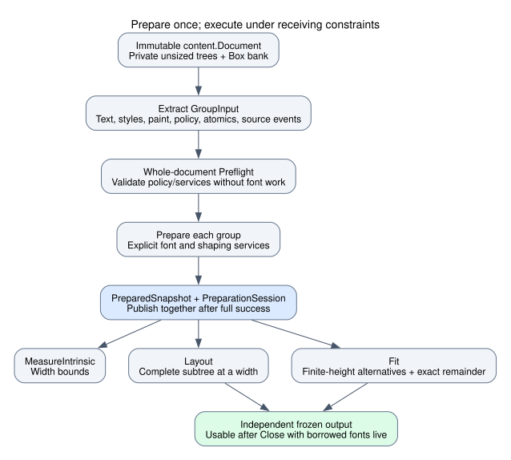

# Preparation, measurement and fitting

Preparation turns normalized inline groups into reusable paragraph material
without fixing widths, atomic interiors or line breaks. `content.Prepare`
publishes an immutable `PreparedSnapshot` and a separate `PreparationSession`.
The optional `preparation/typography` backend connects this neutral protocol to
font and paragraph services. See its [usage guide](../preparation/typography/README.md).



## Placement in the pipeline

Content loading retains original source styles and builds private unsized box
trees. Pure `layout.InlineGroups` enumeration identifies each normalized group,
its block owner and enclosing atomic. Preparation consumes detached group input;
measurement, whole-tree layout and finite-height fitting reuse the same prepared
handles under receiving constraints.

The register payload remains `content.Box` throughout. Preparation does not turn
a box into a mutable prepared node or replace a register version. This preserves
the CSS core's functional ownership: each execution owns fresh scratch, used
values and result collectors, while source trees and prepared input remain
reusable.

## Detached group input

Extraction visits the residual tree first, then named branches in global source
order. A `GroupInput` retains qualified group/owner identities, owner defaults,
processed text, style/paint/policy spans, isolate scopes, source maps, atomic
occurrences and source events. Public accessors return independent copies;
backend callbacks never receive mutable source trees.

`text.NormalizeNormal` supplies normal whitespace processing. All processed
ranges use UTF-8 bytes. A collapsed whitespace byte takes style, paint, policy
and isolate ownership from its first contributing source byte; source maps
retain every contributor. Omitted bytes remain represented in source mappings.
Processed policy spans exclude atomics and omitted bytes.

An inline atomic marker has atomic occurrence provenance, not invented text-node
bytes. Authored U+FFFC remains text. Atomic interiors have their own groups and
are measured/laid out separately. Empty groups retain the block owner's defaults
for their strut. Group ownership never comes from an arbitrary first run.

Source events remain out of band. Source decoded bytes, processed paragraph
bytes, atomic occurrences and structural boundaries are not interchangeable.
Fitting maps actual rendered cluster coverage back to these records; advancing
a logical byte coordinate alone does not establish placement of an event.

## Neutral preparation protocol

1. Extract and validate all group input and coverage before invoking the backend.
2. Call whole-document `Preflight` with independent copies. It admits policy and
   services without font, coverage, scale, stream, shaping or layout work.
3. Call `PrepareGroup` eagerly, with a fresh copy per group. Each result must match
   the qualified group and owner and return an exclusively owned GroupHandle.
4. Publish both snapshot and session only after every group succeeds.

A failure publishes neither object. Completed handles release in reverse order;
cleanup continues after errors and preserves both original and cleanup causes.
`PreparationError` reports stage, qualified handles and source/range where known.
There is no default backend or fallback that silently changes authored policy.

Each successful pair has a distinct opaque PreparationID. Snapshot Groups/Input
return copied metadata; Covers checks source identity. Session.WithGroup checks
pair/group/owner before borrowing a backend handle for one callback. The callback
must not retain or release the handle. Typed execution results stay with the
backend or caller, not in CSS nodes.

## Session ownership and lifetime

Serialize execution and shared services, including Close. Reentrant access is
rejected; there is no concurrent-execution promise or implicit mutex. Copies of
a session wrapper share one lifecycle. Close is idempotent, drops owned handles
even when cleanup fails, and returns the same error on repetition. Borrowed
fonts, resolvers and other services are never closed by the session.

Foreign source/preparation handles and closed/busy sessions fail before backend
execution. No readiness flag or session pointer belongs in `content.Box`.
Retained source handles and immutable results may outlive preparation. Rendering
still requires their borrowed font resources to remain valid.

## Typography services and admitted policy

`typography.New(Config)` requires an explicit preconstructed glyphing.StyleMapper
and a factory returning a fresh shaping stream. Uniform hyphens:none and
hyphens:manual groups are admitted; manual requires an explicit-marker Hyphenator
even when no marker is present. Mixed/auto policies fail preflight with source
ranges. Omitted bytes and atomic markers do not create mixed policy.

The bridge resolves owner typography separately, retains paint independently and
passes ItemizeInline's styles unchanged to paragraph preparation. It converts
physical units with checked finite bounds: CSS DOM DU and typography DU are not
interchangeable constants. Base encoding/shaping occurs once per group. Manual
replacement alternatives may legitimately discover or shape lazily during
execution; intrinsic measurement retains upstream restrictions on such cases.

The bidi callback can represent only one open and one close at a byte offset.
Coincident nested boundaries fail preflight instead of changing text or narrowing
the loader's accepted source profile. Positive fonts, normal whitespace and normal
line height remain required. There is no installed-font discovery or network
access in this backend.

## Intrinsic measurement

`typography.MeasureIntrinsic` uses the matching snapshot/session pair for a
covered block container's CSS-pixel border-box width bounds, excluding its own
margins. Definite width includes padding and borders; auto width recurses through
the CSS core's intrinsic pass with fresh scratch and no used geometry.

`content.MeasureIntrinsic` reserves the session through traversal and exposes
qualified group handles plus borrowed value views for edges and atomics. Missing
groups never trigger re-preparation. The bridge adds horizontal atomic margins
once to border bounds, checks signed sums and rounding, and calls the retained
paragraph. Widths are not cached solely by group identity: percentage contexts
and changed atomic requests remain inputs. Unknown auto percentage dependencies
and unsupported manual alternatives return errors without poisoning the session
or older results.

## Whole-tree layout

`typography.Layout` produces a complete independent subtree at a requested width.
`content.Layout` validates subtree coverage before core or service work, reserves
the matching session and keeps normalized trees private. ResolveUsedValues and
FlowLayout share prepared measurement/layout handles but use fresh invocation
tracking, used values and collectors.

Atomic interiors are completed before outer paragraph delegation. The core's
RealizedAtomic values contain invocation-specific border sizes; signed margins
and physical dimensions convert exactly once. Paragraph layout uses explicit
FirstFit, CSS normal line height, zero side skips and bottom-margin-edge atomics.

Publication includes CSS geometry, frozen paragraphs and copied source/paint
records only after full success. Failed layout returns nil; previous output,
source and bank versions remain usable. Accessors copy mutable envelopes, maps
and slices. Immutable VLists/FrozenKhipus can share stable borrowed font resources
without retaining session or trial workspace.

## Finite-height fitting


A reusable `content.Fitter` binds a covered root to preparation identity and the
core structural program. Its opaque continuation is the only authority to
resume; logical source positions are for inspection and comparison. Fitter
identity is distinct even for two fitters over the same root.

`typography.Fit` enumerates admissible paragraph prefixes and their exact
continuations under width/height constraints. Already consumed atomic interiors
remain frozen. Unconsumed interiors may be realized at a new receiver width.
Manual discretionary carry preserves the exact shaped right side; a processed
byte offset cannot reconstruct that state.

Fragments retain geometry, source coverage, paragraph facts, placed events and
paint edges. Top edges belong to the first fragment, bottom edges to the last,
and side edges to every fragment. Whole children keep their own edges. Closing
edges must fit with the final content. Core composition can defer vertical bounds
for an intermediate fragment, but publication requires a checked fitting result.
The [pagination contract](SHIPOUT.md) governs local arrangement selection and
page/state publication.

## Validation and open extensions

[Preparation fixtures](../content/testdata/preparation/README.md) pin processed
text, source maps, atomic relationships and policy outcomes. Backend tests check
whole-document preflight, service counts, reverse cleanup, identity checks,
reentrancy, failure/retry and independent output. The
[two-width real-font proof](../preparation/typography/testdata/README.md) and
[pagination proofs](../testdata/pagination/README.md#real-font-document-proofs)
use explicitly loaded pinned fonts, never installed fonts or a network source.
Weak-reference checks distinguish retained output/font resources from released
execution handles, factories, streams and rejected alternatives.

Broader hyphenation, whitespace, line-height and inline-edge policies require
explicit backend contracts. Floats, general replaced content and incremental
preparation are deferred. Concurrent execution requires guarantees from shared
services; it cannot be inferred from immutable source or output.

```sh
go test ./content ./preparation/typography
```
