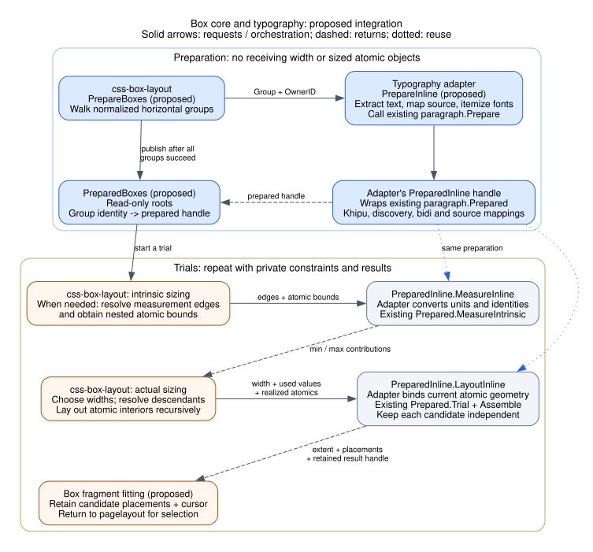

# Preparation between CSS box construction and layout

Date: 2026-11-23. Status: PREP-00 contract/fixtures and BOX-PREP-01 shared group
enumeration complete; preparation runtime not implemented. PREP-01 is next.

This note develops the preparation phase introduced in [DESIGN.md](DESIGN.md).
Preparing reusable content before page trials is established direction. The
first-slice ownership and policy decisions in sections 11–12 are now pinned by
PREP-00. BOX-PREP-01 implements shared structural enumeration; preparation runtime
APIs and the subsequent milestones remain unimplemented. Earlier
conceptual sketches yield to those decisions. The sibling modules are under our control;
their current limitations identify integration work rather than permanent limits
on this design.

The preceding content-input phase is implemented as documented in
[CONTENT-LOADING.md](CONTENT-LOADING.md): source styling, named-branch routing,
residual preservation and normalized group indexing. Its output is unsized box
material with source context, not prepared paragraphs. CONT-00 has adopted that
loading contract and its fixtures; CONT-01/02/03 implement private source loading,
typed projection and route partitions. **Content loading chunk 1 is complete:**
BOX-CONT-01's builder diagnostics/independent-tree contracts and BOX-CONT-02's
generic registers are implemented. CONT-04 now supplies normalization/group
indexing and public immutable material. CONT-05 supplies
[executable examples](../content/example_test.go) and the
[published material handoff](../content/README.md#handoff-to-preparation).
Sections 11–14 specify the register/session model, scoped extensions, PR sequence
and acceptance tests. PREP-00 establishes the implementation contract; it does
not add a preparer, font service or layout operation. These sections
refine the earlier callback/driver sketch where functional ownership requires it.

## Recommendation

Introduce an explicit preparation stage **after box normalization and before
used-value resolution**. Reuse the result for both intrinsic measurement and
layout. Keep group enumeration in the CSS core and effectful preparation in an
explicit orchestrator/session, as detailed in sections 11–13.

This establishes a prepared-material lifetime spanning many layout trials.
The box core identifies horizontal groups; the typography adapter prepares them;
`pagelayout` decides when to prepare flow material and which trials consume it.
Registers keep their immutable content.Box payloads throughout.

This need not depart from CSS formatting semantics. CSS does not prescribe this
particular implementation architecture. CSS Text explicitly permits a different
processing order when the resulting layout is equivalent. Our distinctive choice
is to expose preparation as a first-class, reusable stage.
[CSS Text processing order](https://www.w3.org/TR/css-text-3/#order).

## 1. What the existing pipeline already provides

The current `css-box-layout` sequence is approximately:

```text
BuildLayoutTrees
    -> ResolveUsedValues
    -> FlowLayout
        -> intrinsic measurement where needed
        -> resolve remaining widths
        -> lay out atomic interiors
        -> delegate paragraph layout
        -> stack blocks
```

There are already two typography-facing callbacks:

| Existing callback | Inputs and responsibility |
| --- | --- |
| `IntrinsicMeasurer.MeasureInline` | Measure a group's intrinsic contributions using resolved measurement edges and atomic intrinsic bounds. No final paragraph geometry is published. |
| `InlineLayouter.LayoutInline` | Lay out a group using a definite content width, used values and completed atomic dimensions; return extent and atomic placements. |

The layout callback's inputs make it too late to serve as our preparation
boundary. See the [existing interfaces](../../css-box-layout/layout/interfaces.go)
and [layout orchestration](../../css-box-layout/layout/layout.go).

The `tytui` adapter already calls a private `prepareGroup` from both callbacks.
It extracts text, selects fonts, constructs bidi information and calls
`paragraph.Prepare`, caching the result for that layout invocation. The proposed
pass would promote this hidden, lazy operation into an explicit phase and extend
its lifetime beyond one invocation.
See [the preparation adapter](../../tytui/documentlayout/preparation.go),
[measurement](../../tytui/documentlayout/measure.go) and
[layout](../../tytui/documentlayout/layout.go).

## 2. Where preparation belongs

Preparation follows structural normalization. At that point we know which text
and inline boxes form each actual horizontal group. Anonymous wrappers, block
children inside inline elements and extracted flow branches have already been
accounted for.

Preparing individual DOM text nodes, `<span>` elements, or blindly preparing each
`<p>` would be too early: those units need not match the groups that box layout
eventually delegates. The preparation callback should receive normalized groups.


[Graphviz DOT source](diagrams/preparation-pipeline.dot)

The diagram separates reusable loading results from each trial's private sizing
and placement work. Its trial stages show dependencies: laying out an atomic
interior itself invokes paragraph layout for the groups inside that atomic box.
Used-value resolution and intrinsic sizing are grouped together because they
interact recursively. The coordinator advances private cursors while traversing
frames and commits only a selected complete page. CSS-level fragment fitting remains proposed; typography now has paragraph
continuation/fitting APIs, which do not by themselves implement page composition.

Preparation also precedes intrinsic measurement: measurement should consume the
same shaped material that subsequent layout uses.

The remaining layout work need not become a rigid sequence of independent
passes. Used-value resolution and intrinsic sizing depend on one another. An
auto-width inline-block needs intrinsic bounds before its final width can be
chosen, and its descendants then need that chosen width. Preparation supplies
reusable material to this process without choosing its geometry.

## 3. What preparation establishes

| Concern | Preparation establishes | A trial determines |
| --- | --- | --- |
| Source text | Processed logical text and source mapping | Which source range fits |
| Typography | Font selection, shaping inputs and base shaped material | Line-dependent adjustments and selected alternatives |
| Bidi | Paragraph context and resolved logical information | Ordering within the resulting lines |
| Breaks | Opportunities and preparation policy | Selected line and fragment boundaries |
| Inline atoms | Stable occurrence identity and separately prepared interior | Width, height, margins and placement |
| Box structure | Normalized hierarchy and style constraints | Used dimensions and positions |
| Continuation | Material against which continuation is meaningful | Accepted prefix and remaining position |

Preparation can know glyph advances and authored absolute dimensions. “Unsized”
means that the material has not been laid out for a particular receiver.

Source-dependent font information must be settled at this boundary. A paragraph
must not acquire its font size from the frame's later resolution context. Both
typography and box-length resolution must use consistent source font inputs.
A percentage box width can remain unresolved until containing geometry is known.
This follows CSS's distinction between computed values and layout-dependent used
values. [CSS value processing](https://www.w3.org/TR/css-cascade-5/#computed).

## 4. Explicit preparation and execution handles

The earlier sketch proposed a `PreparedInline` object with measurement and layout
methods stored in `PreparedBoxes`. Review of the current functional and typography
contracts refines this: executable handles belong to a separate session, not an
immutable bank payload or structural tree. See section 11 for the lifetime model.

A neutral preparer receives detached group input and returns an executable engine
handle plus immutable metadata to the orchestrator. Its request contains source
text/styles, paragraph owner context and atomic identities, but no receiver width,
height budget, used-value table or realized atomic dimensions. A typography bridge
can wrap `paragraph.Prepared` privately; the core and loader need no khipu or
concrete font types. Exact public signatures are PREP-00 work.

The operations remain distinct:

- Preparation establishes reusable horizontal material and source correspondence.
- Measurement uses that material with explicit atomic contribution ranges.
- Layout uses it with definite width and realized atomic geometry, returning an
  independent candidate rather than replacing a current result on the handle.

The existing `InlineLayouter` and `IntrinsicMeasurer` interfaces can remain.
Each trial supplies fresh callback adapters that look up the same session's
prepared group and collect typed paragraph results privately. Publish those
results alongside CSS geometry after whole-invocation success. There is no need
to put an opaque paragraph payload in core `InlineResult` or geometry tables.

Whole-group layout and partial fitting remain separate contracts. Typography's
`Prepared.Trial`, `Trial.Assemble`, checkpoints and `Continuation.Fit` already
supply paragraph-level pieces. CSS-level `FitInline`, block fragmentation and
transactional multi-channel page fitting still need a later plan.

## 5. Group enumeration and the preparation driver

The structural traversal lives in `css-box-layout`: `layout.InlineGroups`
enumerates normalized horizontal groups, owners and atomic boundaries
deterministically, including interior groups. It is a pure operation with no
shaping or geometry work. Content's normalized group index now uses it.

Place the effectful driver in pagelayout's orchestration layer. Conceptually:

```text
layout.InlineGroups(root) -> iter.Seq[layout.InlineGroup]  // implemented
Prepare(content document, explicit services/policy)
    -> immutable prepared snapshot + separate serialized execution session
```

The snapshot shares the existing immutable source trees and stores copied side
data. The session owns executable preparation handles. Qualified group identity
includes the content snapshot and tree; a bare BoxID is not unique across branches.
No pass adds readiness, glyphs, selected geometry or execution handles to nodes.

Each trial receives its own used-value tables, atomic realizations, paragraph
choices and placements. Preparation provides reusable data without choosing
geometry. This is a refinement of the earlier proposal to put the entire
`PrepareBoxes` driver in css-box-layout: the core retains group semantics, while
external services and their caches stay outside the pure passes.



[Graphviz DOT source](diagrams/preparation-interactions.dot)

The diagram shows the earlier conceptual preparation-handle interaction, not a
final API or an assertion that executable handles are immutable payloads. For the
planned ownership and driver placement, sections 11–13 take precedence. The
measurement/layout dependencies remain valid, including recursive atomic sizing.

## 6. Nested inline-blocks demonstrate the boundary

Consider:

```html
<p>
  Before
  <span style="display: inline-block; width: auto">
    Some text inside the inline-block.
  </span>
  after.
</p>
```

There are two independent horizontal groups: the outer paragraph and the text
inside the inline-block.

During preparation:

1. The outer group becomes prepared text containing an unresolved atomic
   occurrence.
2. The inline-block's interior gets its own prepared paragraph.
3. The association between that atomic occurrence and its box subtree is retained.
4. Neither paragraph receives a target width, and the inline-block has no final
   height.

The outer paragraph's preparation does not need the inner paragraph's dimensions
or even its preparation result. It needs the atomic identity.

Enumeration can therefore walk top down, as envisaged in the author's remarks.
Outer-group extraction stops at the atomic boundary; enumeration continues into
the atomic subtree so the orchestrator prepares its separate groups.
The current [extraction code](../../tytui/documentlayout/extract.go) already
distinguishes outer atomic occurrences from their interior groups.

During a trial, the dependency order changes:

1. The box core obtains intrinsic bounds for the inline-block using its prepared
   interior.
2. It chooses the inline-block's width under the receiving constraints.
3. It lays out the prepared interior at that width, obtaining its height.
4. The outer paragraph receives the resulting atomic dimensions.
5. Its line breaker and vertical assembly place the object among surrounding text.

A narrower trial can change both the inline-block's interior line breaks and the
outer paragraph's line breaks while reusing both preparations.

This exposes a naming problem: the existing `prepareAtomics` performs actual
layout of atomic interiors and returns completed border dimensions. It is trial
work, not the preparation phase described here. Rename it to something such as
`layoutAtomicInteriors`, and similarly clarify `PreparedAtomic`, to avoid two
materially different meanings of “prepared.”
See [the current atomic operation](../../css-box-layout/layout/atomic.go).

## 7. Intrinsic measurement remains separate

A text-only paragraph might have reusable intrinsic bounds. A paragraph
containing objects needs the objects' intrinsic contributions, including
applicable horizontal edges. Those contributions are not automatically known
when the outer paragraph is prepared.

Preparation should therefore produce **material that can be measured**, without
requiring every paragraph to have final min/max-content widths already.

`khipu` already reflects this separation. `MeasureIntrinsic` operates on prepared
material and accepts atomic contribution ranges without binding final object
geometry or breaking lines. See its
[measurement and binding contracts](../../khipu/doc/PREPARED_PARAGRAPHS.md).

## 8. What must remain deferred

Ordinary inline-box edges can contribute to line width. Some contributions may
depend on containing geometry. Supporting them generally requires preserving
inline boundaries and binding resolved contributions later. Extend the prepared
representation where necessary rather than requiring used dimensions before
preparation. The current `tytui` profile rejects nonzero ordinary-inline edges;
that integration has not yet solved the general case.

Not every text operation can be completed independently of line selection.
Line-edge whitespace treatment, justification and some glyph decisions interact
with wrapping. Preparation must retain reusable base material and information
needed for deferred operations. CSS Text's processing model explicitly includes
these interactions. [CSS Text processing order](https://www.w3.org/TR/css-text-3/#order).

`khipu` provides a useful model: base preparation is reusable, while hyphenation
alternatives can be discovered and shaped lazily. The guarantee should be reuse
of stable preparation across trials, rather than an unconditional promise that
no shaping service can ever run again. See the
[paragraph preparation contract](../../typography/glyphing/paragraph/prepared.go).

## 9. Ownership and lifetime rules

PREP-00 ownership rules for the new phase (with the split in section 11):

- A successful pass publishes a complete snapshot/session pair for the document.
  Failure publishes no partially ready set. Internal completed caches need not
  be erased merely because a later operation fails.
- Prepared snapshots contain no execution state. Sessions contain no mutable
  current width, selected page or accepted register cursor.
- Every layout trial returns independent results. Rejecting it leaves preparation
  usable and does not consume any channel material.
- Continuations identify their preparation and accepted prefix. Width changes
  reuse preparation; changes to text, shaping styles, fonts or preparation policy
  require new preparation.
- Memoized discoveries may be shared, but concurrency is a separate contract.
  Current typography preparations require serialized use.
- Trial requests must not leave borrowed used-value or atomic tables inside the
  prepared handle.
- Source/style/font services remain stable for the lifetimes in which they are
  borrowed. Accepted output must retain its rendering dependencies without
  requiring the entire mutable trial state.

These rules make preparation an architectural boundary rather than a cache
optimization that callers must understand.

## 10. First contract experiment and remaining decisions

Start from one `content.Load` snapshot, following the
[CONT-05 handoff](../content/README.md#handoff-to-preparation). Its `Groups(tree)`
identifies normalized groups, owner context and atomic boundaries. Source-child
lists describe original DOM ancestry, not extracted paragraphs; the planned
PREP-01 bridge must read the private normalized structure. Keep bank payloads and
source styles unchanged, and choose `hyphens:none` explicitly in the experiment's
input rather than overriding retained policy during preparation.

Prepare an outer paragraph and a nested auto-width inline-block, then lay them
out at two receiving widths. Both groups should be prepared before any
measurement or layout callback. Both candidates should coexist; rejecting either
must leave published material unchanged and the session reusable, although complete
memoized discoveries may persist. Base text should not be reshaped for
the second width, while explicitly deferred alternatives remain permitted.

This experiment would establish the phase and its lifetime before adding the
harder fragmentation contract. The direct geometry-only path for empty template
frames remains separate: it has no horizontal content to prepare.

PREP-00 pins the initial choices in section 12. Implementation must preserve:

- The prepared-handle interface and compatibility with the existing callbacks.
- The representation and ownership of retained paragraph trial results.
- Driver scope, tree/group identities and failure publication behavior.
- Deferred inline contributions and the supported initial text/box profile.
- Record `FitInline` for partial results and continuation as a later decision,
  not a prerequisite for the whole-group experiment.

Sections 11–13 establish the first-slice choices and sequence implementation.
Wider policies and page-level fitting remain separate decisions. Completing
PREP-00 does not implement or authorize all subsequent sibling changes at once.

## 11. Registers, prepared snapshots and functional ownership

**PREP-00 decision (2026-11-23): keep the register payload
`content.Box` throughout preparation.** That is the adopted content-loading
payload, not a new mixed interface or a box with a mutable readiness flag.
BOX-CONT-02 implements generic registers; CONT-04 now supplies content.Box and
the initial branch bank, with copied group/source inspection.

A register stores immutable branch-root handles. A branch may own many horizontal
groups, including groups inside atomics; it is not interchangeable with one
paragraph. Preparing those groups does not change the branch's identity,
structure, source styles or position in its channel. Publish a separate prepared
snapshot keyed by qualified group identity. The same bank can then be consumed
with either of two independently prepared snapshots of the same content.

```text
Content Document D ─── immutable normalized trees + source/group indices
       │
       └── Bank B: RegisterBank[content.Box] ─── references D only

Prepare(D, explicit services and policy)
       ├── PreparedSnapshot P: D + immutable group/atomic/source metadata
       │                      + preparation identity and coverage manifest
       └── PreparationSession S: matching execution handles/services
                                  (serialized use; never a register payload)

Trial(B, P, S, receiver constraints)
       └── independent candidate output + derived bank B′
           choosing the candidate publishes B′; rejecting it keeps B
```

The last line describes a future page coordinator, not a preparation API that
already implements page fitting. Within-box continuations remain separate from
whole-item `Take`; neither preparation nor measuring consumes a bank.

Use `(content snapshot, TreeID, BoxID)` for group identity and a new
`PreparationID` for each successful preparation session/snapshot pair. Bind the
session to exactly that snapshot and reject cross-document or cross-preparation
calls before invoking services. Atomic occurrence IDs are local to a group;
associate them with qualified box handles, not raw BoxIDs across trees.

Prepare the whole document in the first implementation: residual tree first,
then branch trees in global source order, visiting groups in deterministic tree
preorder. This includes empty and atomic-only groups. Validate complete coverage
before publishing either result. A bank assembled from another document is not
implicitly compatible. Selected-subset and incremental preparation are deferred.

`PreparedSnapshot` does not point to its session. It can retain immutable source,
processed-text/source-map/paint values and stable resource identity, but no
mutable discovery cache, stream, current result, used-value table or cursor.
`PreparationSession` owns the adapter's `paragraph.Prepared` handles, which retain
immutable Khipu plus mutable Discovery. Dropping the session releases working
preparation without invalidating source material or previously frozen results.
The snapshot alone is an inspection/coverage value, not an executable paragraph.
Do not reopen fonts or silently reprepare if the matching session is absent.

This fits the current sibling API rather than assuming an immutable
`paragraph.Prepared`: its [contract](../../typography/glyphing/paragraph/prepared.go)
requires serialized operations and retains Discovery. Khipu already separates
[immutable material, binding and plans from discovery](../../khipu/doc/PREPARED_PARAGRAPHS.md).
The first bridge can use those APIs unchanged; exporting the private base Khipu
from paragraph.Prepared is not required just to create a public manifest.

This deliberately avoids placing `*paragraph.Prepared` in a register or a field
reachable through `content.Box`: persistent queues share payloads, not deep
copies. Calling such a handle could update discoveries visible through old bank
versions. A private mutable field would not become functional merely because it
is unexported. See the [register contract](../../css-box-layout/registers/doc.go).

The split follows [css-box-layout's functional rules](../../css-box-layout/doc/Functional.md):

- Structural trees, source records, register versions and published geometry are
  immutable values. Preparation adds side data without decorating existing nodes.
- Core group enumeration and geometry transforms are deterministic with explicit
  inputs. Font selection/shaping and memoized discovery live in an explicit
  orchestration/session layer, not hidden core state.
- Each measurement/layout invocation has fresh scratch, used values, atomic
  realizations and a private result collector. Publish copied results only after
  complete success. A rejected trial never overwrites another candidate.
- Session calls, including calls sharing a resolver or services across sessions,
  are serialized initially. Persistent-bank concurrency does not imply concurrent
  typography execution. Failed calls may leave complete memoized discoveries,
  but cannot mutate published material or earlier results.

Strict referential transparency of every font-service call is not claimed by
this contract. The functional guarantee applies to material, banks and published
results; the effectful service layer is explicit. Requiring discovery itself to
be a persistent value would be additional khipu work, not necessary for this
milestone or a reason to weaken the register payload contract.

## 12. PREP-00 decisions and deferred extensions

The following choices are the implementation target for the first preparation
slice. They do not claim that the APIs already exist. Exact method/type spelling
can be finalized in the assigned PR without reopening ownership or policy.

| Decision | Pinned first implementation | Deferred boundary |
| --- | --- | --- |
| Register payload | Keep `RegisterBank[content.Box]`; readiness belongs to a separate snapshot/session pair | No mixed raw/prepared queue items or destructive conversion |
| Preparation scope | Eager, whole-document, atomic publication, including residual and nested groups | Partial/lazy preparation and bounded working sets later |
| Tree access and package boundary | A backend-neutral `content.Prepare` entry point owns private tree access and extraction; the optional `pagelayout/preparation/typography` bridge implements its preparer protocol | No mutable LayoutNodes in public inspection and no typography import in content/core; exported signatures arrive in PREP-02 |
| Core traversal | Shared group enumeration in css-box-layout; effectful driver in pagelayout orchestration | Refines the earlier proposal to put the entire preparation driver in the box core |
| Font selection | Caller supplies preloaded selection/resolver and matching shaper services; reuse `khipu/contracts.FontFace` and `FontInstance` inside the bridge | Discovery/configuration remain application concerns; no new font wrapper or default OpenType backend |
| Trial result ownership | Retain typed paragraph trials/results in a fresh adapter invocation collector; return them alongside fresh CSS geometry | No `any` paragraph payload in core geometry; no last-result map on a prepared group |
| Initial text/box profile | Normal whitespace and CSS normal line height; zero ordinary-inline edges; nested auto/fixed-width atomics in the trial experiment | Loading/preparation retain percentages; unsupported intrinsic dependencies fail explicitly in the trial, not by rewriting material |
| Breaker and alignment | Start the experiment with explicit FirstFit, zero side skips, CSS line boxes and bottom-margin-edge atomic alignment | Additional breaker policies can follow without changing bank payloads |
| Hyphenation | Experiment uses source `hyphens:none`; bridge admits uniform none and uniform manual with an injected explicit-marker hyphenator. Mixed/auto groups fail whole-document preflight | Manual intrinsic measurement can still reject multiple eligible splits/variants; retain that upstream failure and do not silently downgrade policy |
| Partial fitting | Defer CSS-level fitting and whole-page transactions to a later plan | Reuse existing paragraph Trial/Checkpoint/Continuation APIs where their restrictions fit; general block fragmentation is unsolved |
| Concurrency/lifetime | Caller serializes session and shared-service operations, including Close; session owns executable handles and has idempotent Close; frozen output retains stable resources independently | No concurrent-trial promise, internal global lock, implicit reprepare or permanent cache |

The hyphenation boundary is substantive. Content loading preserves none/manual/
auto per source span, with manual as its default. Khipu currently fixes one
hyphenation mode per preparation; its intrinsic measurement supports none and
bounded explicit alternatives, but not automatic or arbitrary multiple explicit
splits per textbox. The bridge must retain all original policies and return
source/group-associated unsupported-policy errors where necessary. Do not split
one paragraph into separate paragraphs to simulate span-level policy. Broader
admission requires a separately scoped KHIPU-PREP extension and matching
paragraph tests; this is an integration limitation, not a permanent CSS rule.

### Policy admission and preflight

Extract and validate every group before any backend preparation/font work.
Determine group policy from nonempty processed **text** spans, using the source
of the first contributing byte for a collapsed space. Omitted whitespace does
not create a policy conflict. Structural atomic markers do not import interior
policy; interiors are checked as independent groups. With no text spans, use the
paragraph owner's policy. Owner strut style is always resolved separately.
Retain all source policies in the extracted records, including rejected inputs.

- Uniform `none` maps to `khipu.NoHyphenation`. Preserve soft-hyphen source bytes;
  disabling discretionary discovery is not permission to delete source mappings.
- Uniform `manual` maps to `khipu.ExplicitHyphenation` and requires an explicitly
  supplied hyphenator, even if this group has no markers. Its U+00AD request
  follows the sibling's [explicit-marker protocol](../../khipu/hyphenation.go).
  There is no implicit ASCII hyphen or dictionary.
- Mixed none/manual/auto within a paragraph, and uniform auto, fail before any
  group's engine preparation. Do not split paragraphs or silently choose none.
  Uniform policies may differ between independent groups.
- Manual preparation does not promise arbitrary intrinsic measurement. The
  sibling [MeasureIntrinsic contract](../../typography/glyphing/paragraph/measure.go)
  supports bounded explicit alternatives; multiple eligible positions/variants
  can fail later at measurement with the original unsupported-policy cause.
  Do not run intrinsic measurement during preparation to test eligibility.

Other deterministic preflight checks include supported inline edges/text policy,
valid UTF-8 source maps/style/isolate ranges, qualified group/owner/atomic
correspondence, complete group coverage, and explicit required service inputs.
Use the first failure in residual-first/global-branch/preorder traversal, then
processed-span order, for deterministic diagnostics. Validate all groups before
starting the first effectful group operation. A policy error in the last group
therefore has zero backend preparation calls.

### Services, failure publication and cleanup

`Prepare` targets a complete immutable snapshot plus a separate execution
session. The session retains the snapshot; the snapshot never retains the
session. Give each successful pair a new opaque preparation identity. Existing
content Boxes, source trees and banks remain unchanged. Reject a foreign source,
group/owner, preparation ID or closed session before service work. A retry of a
failed whole-document preparation starts fresh working state; there is no
published partial manifest or reusable half-built session.

The neutral preparer protocol has an all-input preflight followed by one
PrepareGroup operation per ordered group, including empty groups. Returned
execution capabilities belong privately to the session. Backend-specific typed
results stay in the optional bridge; no `any` paragraph payload enters core
geometry or a bank. PREP-02 implements the neutral protocol with fake services;
TYPE-PREP-01 adds the typography adapter. No target width, used-value table,
frame style, receiver height or live cursor is a preparation input.

Caller-supplied selected fonts/resolver, coverage, shaper factory and supported
hyphenator are borrowed and remain stable. Never select paragraph.Prepare's
synthetic zero-config backend implicitly. The caller retains ownership of font
resources needed by frozen output; session closure must not close shared faces,
resources, the resolver or factories. No new font representation is introduced:
the optional bridge reuses `contracts.FontFace`/`FontInstance` and typography's
selected-resource contracts, without concrete OpenType types in neutral APIs.

Preparation failures return neither snapshot nor session. The backend cleans up
its in-progress operation and returns no live handle on error. The orchestrator
releases successful owned handles in reverse creation order, including when
final coverage validation fails. Cleanup proceeds after a cleanup error; retain
the initiating error and any cleanup causes with `errors.Is/As` (for example,
through `errors.Join`). No callback panic recovery is promised. Borrowed services
may retain complete memoized work; rollback of their caches is not required.

Session `Close` is serialized and idempotent, releases owned handles once and
drops session/service references even if release reports an error. Repeated Close
does not repeat cleanup; subsequent execution fails as closed. Source inspection,
prepared metadata and earlier frozen outputs remain valid. The current
`paragraph.Prepared` has no Close method: its adapter release drops references.
Streams are operation-owned and obey `StreamingShaper.Finish`, not a newly
invented font/paragraph close API. Factories return fresh exclusive streams;
factory errors own their cleanup, and successful streams are finished after
producer/consumer completion, including unused preflight failures. Reuse
[the existing stream contract](../../khipu/contracts/shaping_stream.go) and
[StreamingConfig ownership](../../khipu/config.go).

Errors carry preparation stage (preflight, extraction, itemization/font,
preparation, measurement, layout or release as applicable), qualified group and
owner handles, source locator and the original cause. Use the offending span's
source/decoded range when available; otherwise use the owner's source context.
Anonymous groups get no fabricated source NodeID. Lifecycle/identity errors
without a valid source report that absence. Trial failure returns no candidate
and leaves previous results and the session reusable; a closed session is not
implicitly recreated. Exact exported diagnostic names arrive with PREP-02.

### Acceptance fixtures and scoped follow-up

The [PREP-00 fixture contract](../content/testdata/preparation/README.md) and
[`expected.json`](../content/testdata/preparation/expected.json) pin eight inputs:
text-only, nested auto-width atomics, empty/atomic-only groups, two branches in
one channel plus another channel and residual, manual markers, multiple manual
markers, mixed-policy rejection and auto rejection. Expected processed text,
source-byte mapping, atomic offsets, preparation order and service-call counts
are explicit. Current tests verify loading/structure and manifest consistency;
actual extraction, engine calls, cleanup and two-width results belong to later
PRs. No runtime preparation has been implemented by the fixture tests.

With BOX-PREP-01 implemented, no unresolved first-slice decision blocks PREP-01.
Wider span-level/automatic hyphenation and intrinsic support require KHIPU-PREP
work; ordinary-inline edges,
percentage-atomic sizing cycles, font discovery, concurrent sessions sharing
services, incremental preparation, residual receiver binding, floats, partial
box fitting and page transactions remain scoped extensions. None narrows the
loader's accepted unsized source material. PREP-00 changes no sibling APIs.

No w3c-dom change is currently required: its source-style snapshots already carry
font sizes, language, bidi and hyphenation policy. Convert DOM DU explicitly to
typography/khipu DU. Keep line-height and hyphenation beside typography.Style,
whose fields do not represent both. The bridge reuses
`glyphing.NewStyleMapper`/`ItemizeInline` and `paragraph.Prepare`; the application
may choose typography's OpenType adapter. No concrete `*ot.Font` enters
pagelayout's public/core types. Typography bundles adapters in its Go module,
so an indirect module-graph dependency is still possible even without OpenType
package imports; separate adapter modules would be independent packaging work.

## 13. Step-by-step PR plan

PREP-00 is complete as a contract/fixture milestone; BOX-PREP-01's shared
enumeration and content-index migration are implemented. PREP-01 and later entries
are unimplemented runtime work. Cross-module changes must follow each sibling's
instructions. Each PR has a narrow acceptance
boundary; do not label the full phase complete after the first preparation call.

### PREP-00 — Close prerequisites and pin the contract (complete)

**Owners:** pagelayout; prerequisite css-box-layout content work.

BOX-CONT-01 (structured builder errors) and BOX-CONT-02 (generic registers) are
complete, as are CONT-04 (normalization, group indexing, immutable public material)
and CONT-05 (executable handoff). Section 12 now pins snapshot/session ownership,
admitted hyphenation, service failure/cleanup and source error mapping. The
public content.Box remains the branch payload; preparation cannot publish a
partial pair or mutate source material.

Eight acceptance inputs and machine-readable future results live under
`content/testdata/preparation`. Run
`go test ./content -run '^TestPreparationAcceptanceInputs$' -v` for current
loading/group and coordinate checks. The nested experiment explicitly uses
`hyphens:none`.

**Exit satisfied:** prerequisites pass; first-slice choices are pinned or scoped
out, and fixtures distinguish existing source material from future extraction,
preparation and trials. No preparer/session runtime or sibling API is added.
The intentionally omitted CONT-03 routing fuzz target is not reopened.

### BOX-PREP-01 — Enumerate normalized groups without sizing (implemented)

**Owner:** css-box-layout, with consumer migration in pagelayout/content.

`layout.InlineGroups(root) iter.Seq[layout.InlineGroup]` yields descriptors with
`Group`, `Owner`, `Atomics` and `ParentAtomic`. It identifies actual
BoxAnonymousInline groups and their nearest block-container owners in structural
preorder, including anonymous owners and empty groups. Immediate atomic lists
stop at inline-block boundaries; nested interiors are independent later groups.
Replaced leaves are atomic boundaries without interior groups.

Node pointers borrow the normalized input tree and must remain read-only,
including styles/child slices. Each Atomics slice is caller-owned and independent
of other descriptors/iterations. BoxIDs remain tree-local. Nil yields nothing;
subtrees ignore external ancestors, and an inline-block root encloses its own
interiors. The iterator is repeatable after early termination and supports
concurrent reads. It is not a malformed-tree/cycle validator. No text processing,
measurement, shaping, style resolution or geometry operation occurs.

CONT-04's content index consumes this shared traversal for group ownership and
atomic relationships. Its separate source/identity validation walk remains;
paragraph source context is still resolved by content, including anonymous
owners. Public metadata retains copied values and qualified immutable Box
handles, with no borrowed raw nodes exposed.

**Exit satisfied:** core tests cover anonymous/split structure, empty owners,
nested atomics, replaced leaves, unchanged input and stable preorder. Independent
trees with colliding local IDs, descriptor slice ownership, subtree boundaries,
early termination and concurrent reads are covered. Existing content tests retain
their group/source-context results. No typography, DOM or font imports are added
by the iterator. PREP-01 extraction and effectful preparation remain separate work.

### PREP-01 — Extract detached group input and source mappings

**Owner:** pagelayout/content, consuming BOX-PREP-01.

Use private normalized trees and source snapshots to build copied group inputs:
processed UTF-8 text, source spans, computed text styles, separate paint, paragraph
owner context, bidi isolates, hyphenation policy spans and atomic occurrences.
Reuse `css-box-layout/text.NormalizeNormal`; follow tytui's established extraction
contract, not its application package dependency. Map collapsed/omitted bytes,
NBSP, soft hyphens and entities back to decoded source ranges. Insert one U+FFFC
only for a structural atomic occurrence; distinguish an authored U+FFFC. Keep
occurrence-to-qualified-box mappings and independent interior group identities.

**Exit:** extraction is a pure transform, returns copies, has no font calls, and
handles text adjacency after routing and owner defaults even with no text runs.
Isolate and style ranges address the same processed bytes as atomic anchors.

### PREP-02 — Publish preparation snapshots and isolated sessions

**Owner:** pagelayout/content; fake engine only at first.

Add the neutral entry point and preparer protocol with detached GroupInput values,
no raw public tree accessor and no typography imports. Implement whole-document
orchestration, stable preparation identity, an immutable coverage manifest and a
separate private session table of executable handles. Construct both privately;
publish only after every expected group succeeds. Validate returned group/owner
identity and completeness, and define disposal of failed working handles.

Preparation must not call bank.Take/Prepend or resolve receiving dimensions.
Keep bank handles pointing only to the content snapshot. Validate that trials
use the matching preparation/session and source handles, including when raw BoxIDs
happen to collide. No mutable session pointer is stored in a public value payload.

**Exit:** fake-engine tests prove one preparation per group, deterministic order,
no layout calls, unchanged original bank/tree, no partial publication after a
late failure, and two coexisting preparations of the same source. Foreign or
mismatched handles fail before service work.

### TYPE-PREP-01 — Implement the typography preparation bridge

**Owner:** optional pagelayout/preparation/typography package; typography/khipu
changes only if an identified contract gap requires them.

Map detached source styles to typography styles with checked unit conversion.
Accept caller-owned resolver, shaper factory and explicit supported hyphenation
services/policy. Resolve owner typography separately from the first text run.
Itemize, retain paint outside shaping, construct bidi markup and anchors, then
call paragraph.Prepare exactly once for each group. Store paragraph.Prepared
only in the session-owned engine handle. Retain source/atomic mappings as copied
immutable metadata. Do not discover fonts or choose an implicit backend.

Preflight unsupported policy combinations; preserve upstream causes/stages.
Keep borrowed source/font/service lifetimes explicit. Do not promise that lazy
discretionary work never runs again, only that base shaping is reused.

**Exit:** fake font/stream tests verify no receiver geometry, one base preparation,
independent atomic interiors, owner struts, paint/source correspondence and atomic
failure publication. Dependency checks forbid opentype/fontfind/tytui imports
outside explicitly optional integration tests or application examples. Tests for
manual/auto/mixed policies demonstrate admission or explicit rejection.

### PREP-03 — Consume preparation during intrinsic measurement

**Owners:** pagelayout typography bridge; css-box-layout only for a discovered
request-contract gap.

Adapt existing InlineMeasureRequest to the retained group handle. Supply ordered
atomic contribution ranges using core-provided border widths plus horizontal
margins exactly once. Keep signed arithmetic and range checks explicit. Call
Prepared.MeasureIntrinsic without final heights, line breaking, vertical metrics
or publication of paragraph geometry. Never fall back to preparing on a cache
miss; a missing group is an identity/coverage error.

**Exit:** repeated measurements reuse base preparation; requests are not retained;
nested auto-width dependencies work within the existing CSS profile; unsupported
percentage cycles and hyphenation policies report errors without poisoning the
session or prior outputs. Intrinsic answers are not cached solely by group ID.

### PREP-04 — Produce independent whole-tree trial results

**Owner:** pagelayout orchestration and typography bridge.

Reuse existing ResolveUsedValues/FlowLayout with fresh callback instances for each
trial. Route both measurement and layout to the same preparation session. Layout
uses prepared paragraph trials/assembly and core-completed atomic dimensions;
retain typed paragraph output, source/paint mappings and CSS geometry in a fresh
invocation collector. Publish that bundle only after the entire requested tree
succeeds. Failed late atomic/paragraph work returns no partial candidate.

Keep core InlineResult geometry-only; an opaque paragraph payload on LayoutNode
or LayoutGeometry is unnecessary. Each new invocation has its own callback
tracking, so the existing within-invocation no-repeat policy need not become a
shared "already laid out" flag. Retain accepted frozen results without their
session; trial constraints and tables must not remain borrowed in preparation.

**Exit:** lay out the same outer/nested-atomic preparation at two widths; both
candidates coexist and neither changes after another succeeds or fails. Counts
show no second base shaping. Trial geometry differs where expected while source,
bank, preparation manifest and immutable trees remain unchanged.

### BOX-PREP-02 — Clarify names for realized atomics

**Owner:** css-box-layout, with tytui and pagelayout consumer updates.

Rename the private prepareAtomics operation to layoutAtomicInteriors (or an
agreed equivalent). Rename/document PreparedAtomic and PreparedAtomicsView as
realized border-box geometry. This is terminology cleanup, not additional
preparation or a change to CSS geometry. If compatibility aliases are useful for
a staged migration, remove them after the known consumers migrate.

**Exit:** both consumer suites pass with unchanged geometry and clear distinction
between reusable horizontal preparation and trial-specific atomic realization.
This PR is independent of PREP-03/04 and must not block the contract experiment.

### PREP-05 — Prove lifetime, bank persistence and the handoff

**Owner:** pagelayout; cross-module regression checks for touched boundaries.

Add an executable two-width example and an integration test using caller-supplied
real font services. Document the initial policy limits and session serialization.
Exercise old/new bank versions during preparation, trial rejection and later
successful trials. Banks retain original content only; inspection is unchanged
and session release does not invalidate frozen output. Add lifecycle tests that
retained output does not keep discovery/preparation/workspaces alive, following
typography's existing lifetime regressions.

**Exit:** the acceptance matrix below passes. No automatic frame assignment,
page-template selection, bank commit, within-box remainder or general FitInline
is implied. Preparation is complete for its explicitly admitted profile; page
trials and wider policy support have their own milestones.

### Dependencies and optional extensions

```text
BOX-CONT-01 + BOX-CONT-02 -> CONT-04 -> CONT-05 -> PREP-00
PREP-00 -> BOX-PREP-01 -> PREP-01 -> PREP-02 -> TYPE-PREP-01
TYPE-PREP-01 -> PREP-03 -> PREP-04 -> PREP-05
BOX-PREP-02: independent terminology migration, before final handoff
```

No new khipu or w3c-dom feature is a prerequisite for the restricted experiment.
For wider hyphenation admission beyond PREP-00's restricted profile, schedule KHIPU-PREP-01 for
per-span policy and intrinsic-measurement support, with typography facade tests,
before claiming that wider preparation profile. Percentage-atomic layout and
CSS-level continuation are separate BOX/PAGE work; do not narrow the loader's
accepted unsized material to hide these integration limits.

## 14. Preparation acceptance matrix

| Test | Required observation |
| --- | --- |
| Load then prepare | No fonts during loading; no geometry during preparation; existing bank and source inspection unchanged |
| Two branches with colliding local BoxIDs | Qualified group identity keeps preparations and results distinct |
| Two preparations of one content snapshot | Same content.Box payloads, distinct preparation identities; session mixing rejected |
| Nested auto-width atomic | Outer preparation contains only occurrence; inner group prepared separately before any measurement |
| Empty/atomic-only paragraph | Owner source typography supplies strut context; first text run is never the default |
| Whitespace, NBSP, soft hyphen, literal U+FFFC, isolates | Exact processed-byte/source correspondence; supported policy preserved, unsupported policy diagnosed |
| Failure in last group | Neither prepared snapshot nor session published; original document/bank and previous preparation usable |
| Repeated measurement and two-width layout | Base shaping count unchanged; atomic contributions/realizations are explicit request inputs |
| Reject trial or fail a later callback | Earlier candidate, preparation metadata and bank version unchanged; no partial new output |
| Change fonts, source style or preparation policy | New preparation/session; old results remain stable; no HTML-only cache key |
| Release session while retaining frozen output | No preparation/discovery retention through results or bank; needed font resources remain usable |
| Dependency and concurrency boundaries | Neutral content/core imports; no hidden OpenType defaults; serialized session use documented and tested |

Run focused tests for each PR and the relevant full/race suites on changed
boundaries; test races under the supported serialization protocol rather than
asserting concurrent execution is supported. Add build/vet and the tytui
regressions for shared core/typography changes. Documentation-only planning does
not require running Go tests.

## Diagram sources

Editable Graphviz `.dot` files and their rendered `.svg` previews live in
`doc/diagrams/`. From the repository root, regenerate the previews with:

```sh
dot -Tsvg doc/diagrams/preparation-pipeline.dot -o doc/diagrams/preparation-pipeline.svg
dot -Tsvg doc/diagrams/preparation-interactions.dot -o doc/diagrams/preparation-interactions.svg
```

The diagrams illustrate the proposal, not implemented public APIs.
