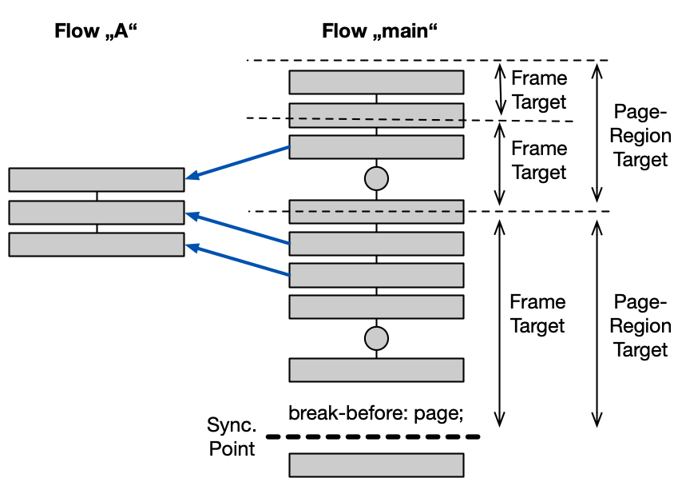

# Shipout

---

[**REMARKS**]

TeX uses the term "shipout" for the subroutine of completing a document-page and
writing it out on file (in print format). The shipout procedure collects vertical
material until the page box is (more than) full, then freezes the material and
puts it to the `output routine`.


## Local vs global Optimization

TeX does global optimization for paragraph breaks, but not for pages. In modern
times, documents fit into memory easily and we may think about solutions for
document-wide (or chapter-wide) optimal page-breaks. "Shipout" for global optimization
would then mean the output of a series of pages at once.

We will leave the decision about local or global pagination open for now, but we
will collect arguments for and against it in this document.

### Types of Media

For belletristic books, single page decision for breaks is usually good enough, as 
there is not much variety from page to page in terms of typesetting. For our intended
template-based page-layout this is not necessarily the primary target. Layout templates
would lend themselves well for magazines or scientific papers.


## Pagination Strategy

We will call locations in the document where a forced page-break sits "synchronisation
points". Examples may be chapters or the document end.

[**Revised**]
"Global optimization" means optimizing the selection of page-templates. Placing 
flow-material on a page is not subject to global optimization. The task of
the page-breaker is as follows:

- Find sequences of page-templates for a pagespan, in a dynamic search tree
- Each branch of the search owns a local copy of the flow-material registers
- A branch may split if more than one template is feasible when looking for the next one
- A trial consumes the flow-material and fills a page with a local paradigm
- Page-templates will be tried out with page construction, possibly creating a candidate page
- If a candidate page is created, append it to a sequence of page-templates (of this search tree branch)

Synchronisation points will force a decision for the best pagespan-result.
The sequence of pages will be shipped out.

When a trial fills the frames of a single page, the decision where to cut of the flow-material
is local. The decision will depend only on the current quality of the constructed page.
Measuring the quality of trial-results will be called "minimizing a loss function".
It may regard (for example):

  - Fitting / filling of text to frames
  - Distance of float material referenced on the page and their final location
  - Sizing factor for images
  - Widows / clubs

Deciding the cut-off is independent of the decision on successive page-templates.
There is not global (multi-page) decision about flow-material cut-offs to reach some
kind of best-fill optimum.

Each single candidate-page therefore carries a loss-factor. The optimization tasks is
to find the sequence of candidate-pages will the minimum loss-sum (sum of loss-factors).

For local optimization (one page per trial run) the decision point is always the current
page. (Global optimization: For very long books without forced page-breaks at chapters, an
artificial intermediate decision point would need to be introduced, if too much memory would
be consumed. Disregarded for now.)

### Paragraph-Breaking vs Page-Breaking

Horizontal material gets broken into line-boxes.
Material gets collected until a line is full, then broken apart. Remainder (e.g. the suffix of a
discretionary) stays with the material queue. This is done until end-of-par is reached.
Global optimization: loss function over paragraph-wide penalties.


Vertical material gets broken into page-boxes.
Material gets collected until a frame is full, then broken apart. Remainder (e.g., bottom halve of
a vbox) stays with the material queue. Inner loop continues until all frames stemming from a region
on a page are full. Outer loop continues until synchronisation point is reached (end-of-pagespan).
References may refer to material in other flow-channels and their synching is part of a loss-calculation.
Global optimization: loss function over pagespan-wide losses.



| | Paragraph | Page |
| --- | --- | --- |
| **Source** | khipu | prepared boxes in register |
| **Material** | boxes, glue, penalties | recursive CSS boxes (nothing prevents us from adopting glue + penalty) |
| **Breakpoint** [**New**] | feasible breakpoint, i.e. a penalty location | feasible pagebreak, i.e. a location in the flow material |
| **Sync.-point** | paragraph | forced page break (CSS: `break-before: page`) |
| **Splitting** | discretionary | vsplit |
| **Local strategy** | first-fit | single page shipout (like TeX) |
| **Global strategy** | Knuth+Plass | pagespan shipout - optimal range of selected templates |


## Template Selection

It is yet unclear how trial select templates for consideration. Strategies could
include:

  - Number of suitable flow-target boxes on the template (aside, table, …)
  - Chapter / section headings
  - ToC or other special material pages

[**New Remark (Search Tree)**]
Similar to line-breaking, finding feasible breakpoints for pages operates along a dynamic
search tree. For line-breaking, branches of the tree are merged at identical feasible 
breakpoints (with different costs) and the tree becomes a DAG. A feasible page-break is
identified by a location in the flow-material. Two feasible page-breaks are identical, if
their breakpoints for every flow-channel agree.

I have a feeling that branches of the search tree will rarely land on identical feasible
page-breaks. The search-tree will therefore stay a tree until a synchronisation point is
reached, possible fanning out extensively.

A page-breaker will manage a set of (a multitude of) "active search branches". We will 
define an "active search branch" through the following properties:

  - a register bank
  - cut-off material from the last page-break
  - a running loss sum
  - a sequence of selected page-templates
  - data-structures to reflect vsplit positions between frame-continuations per page
  - (possibly other information)

If feasible page-breaks indeed will turn out to be rare, then we will introduce a heuristic
to keep the number of branches in check. Just consider a text flowing over 100 pages, with
a fan-out of 2 page-templates. The number of "active search branches" will become very high
very quickly. We should therefore do something like the following heuristic
("cut our losses"-heuristic): Wie carry the most optimistic loss scalar and the most pessimistic
loss scalar through the process. Every "active search branch" which is in the lower percentile
(to be defined, e.g. in the lower 50%) will be abandoned at every iteration, i.e. we
consider them to be lost causes.
[**End of New Remark (Search Tree)**]

## Concurrency

[**Outdated**] Trial runs for sequences of pages offer a natural opportunity for concurrency.
Synchronisation points will collect goroutines and their trial-results. Then
the next bunch of trial-goroutines would start.

[**Revised**]
Line-breaking (K&P) is effectively a dynamic tree search. The same is true for searching a
globally optimal sequence of page-templates. We will postpone the idea of concurrency.
If anything, the pagespan optimization could be handled by a pool of workers.

---

## Design discussion: pagination and shipout

Discussion recorded on 2026-11-23 and revised through 2026-11-25 against the
author's remarks, preserved verbatim above, within this discussion and in the
closing answers. This revision also incorporates the subsequent clarification
that owning anchors establish placement relationships and never close pagespans.
It also incorporates the adopted source-order rule, fragment edges, out-of-band
markers, template-order tie preference and initial beam search without merging.
The latest adoption settles the within-template tie rule and the 32-candidate
beam policy. The other recommendations from that walkthrough are adopted as
working hypotheses, with their status and remaining details marked below.
Global optimisation here means choosing a sequence of page templates within a
pagespan; flow-material cut-offs are selected locally during page construction.
The earlier recommendation to expose cut-off alternatives to global search is
superseded.

Three statuses are used throughout this discussion:

- **Settled:** an agreed design rule, including previously adopted decisions.
- **Working hypothesis:** the adopted provisional approach to develop and test;
  it may be revised in light of concrete examples. It is not an unchosen option.
- **Open:** a detail still needing specification or a hypothesis needing further
  validation. Deferred work is identified separately.

These statuses describe design, not implemented pagination capabilities. The
four domain names are adopted API vocabulary; concrete Go declarations remain
open. The latest adoption does not downgrade previously settled rules.

### Agreed requirements

- Synchronisation points delimit **pagespans**, the optimisation spans. Each
  point closes the span since the preceding point, or since the document start
  for the first span. Forced page breaks, authored as `break-before: page`, and
  document end supply these boundaries.
- **Forced page-break variants of `break-before` are equivalent to `page`**
  for this profile, including `recto` and `verso`. Each requests a forced page
  break and synchronisation point. Their page-side distinctions are disregarded;
  they impose no parity constraint and do not request blank pages.
- **The default flow channel is `main`.** Residual content belongs to that
  stream, and body-text frames receive it through `flow-from: main`. After
  routing validation, a valid `flow-into: main` is redundant and is ignored as
  an extraction instruction. It does not create a separately ordered branch.
- **Owning links are explicit:** `<a href="#target" data-flow-anchor>` supplies
  a placement relationship; ordinary cross-references do not. Ownership is not
  inferred from the earliest ordinary link or the target's source position.
  Relationships may be transitive through separately routed material.
- **A flow anchor does not close a pagespan or force a page break.** Its target
  may be deferred with loss. Pagespan synchronisation points retain the distinct
  obligation to drain all related material before completing the span.
- **Missing receivers incur loss, not a mandatory-participation failure.**
  Requiring particular channels on every page is deferred. This does not waive
  material-progress or pagespan-completion requirements.
- **Registers retain authoring order.** Ownership references do not reorder
  material or permit skipping an unconsumed earlier item. The resulting delays
  affect loss; the typesetter does not repair the author's ordering.
- **Markers are out-of-band metadata.** Forced-break boundaries and owning-anchor
  positions do not introduce synthetic boxes or penalties into the material.
- **Split fragments retain their original outer edges.** The first fragment
  keeps top edges, the last keeps bottom edges, and middle fragments keep neither;
  left/right edges remain. The rule applies to boxes actually crossed by a split.
- **Page construction selects flow-material cut-offs locally**, using the
  quality of the current page. It does not choose a cut-off because of a
  prospective successor template or a better later-page fill.
- **Global optimisation searches template sequences for a pagespan.** Each
  search branch owns independent flow-material state and extends its sequence
  with the page candidate produced by a local construction attempt. Alternative
  cut-offs for the same input state and template are not global search branches.
- Each page candidate carries a scalar **page loss**. The pagespan objective is
  to select a complete feasible sequence with the **minimum sum of page losses**.
- Reaching a synchronisation point in the main flow is insufficient on its own.
  **All related material in other flows must be drained** before the point is
  complete. This is a requirement, not an optional policy allowing that material
  to spill into the next span.
- The overall phase order is fixed: **box tree -> preparation -> render tree**.
  These phases do not run concurrently. All page attempts and pagination
  searches start with prepared flow registers; they do not wait for a producer
  to load or prepare more source material concurrently.
- **API terminology is settled:** Page attempt, Page candidate, Pagination
  search and Pagination candidate name the distinct activities and results.
- **Local construction is deterministic**, including ties: identical state,
  template and policy produce the same selected candidate. Ordinary infeasibility
  remains distinguishable from operational errors.
- **Equal-loss choices between page templates prefer the earlier template** in
  template order. Equal-loss sequences use lexicographic template-ordinal order.
- **Within one template, ties prefer greater logical progress:** first in
  `main`, then in secondary channels in first-occurrence source order, then the
  first arrangement in deterministic frame/breakpoint enumeration.
- **The initial beam retains at most 32 unfinished candidates by default,**
  configurable, pruning after each complete page-depth round. Rank by accumulated
  loss then template sequence, with no remaining-cost estimate and no merging.
  Retain the best completed span separately and do not stop at first completion.
  Tests should establish whether future merging would meaningfully reduce work.
- **Page-breakpoint identity is a vector of material positions**, one for each
  flow channel. Two page breakpoints agree when every channel position agrees.
  Whether their full search states can safely be merged is a separate question.
- **Evaluation retains a component breakdown** for go/no-go criteria and can
  produce one scalar assessment at any point. Loss has feasible nonnegative
  finite values and an absorbing blocked value. Every feasible value ranks
  ahead of blocked; ordinary floating-point infinity ordering is not used.
- **The initial score includes a positive page cost, normalized underfill and
  explicit break penalties.** Numeric coefficients, representation and final-page
  treatment now have working hypotheses below; their calibration is provisional.
- **Carry-over charging starts on the owning-anchor page** when the target
  cannot be fully placed, and recurs on each following carrying page. The
  initial unit is one charge per distinct pending target per page; partial
  placement leaves the target pending. Ordinary references do not multiply
  charges. It is not deferred until the eventual placement page.
- **Concurrency is deferred.** A search branch is a logical candidate, not a
  goroutine. A worker pool may be considered later without overlapping the fixed
  overall phases.

The responsibility split below remains the basis for further discussion. The
initial beam policy and tie rules are settled; template eligibility, local
enumeration, scoring details and publication have working hypotheses below.
Their concrete APIs and validation details remain open. The meaning of
global optimisation and its sum-of-page-losses objective are specified above.

"Prepared flow registers" describes the readiness of their material. It does
not require replacing register payloads: the existing `content.Box` handles
remain source identities, with prepared metadata and execution resources held
separately. Preparation completes before the render-tree phase begins. Fitting,
line breaking, atomic sizing and candidate page construction belong to that
render-tree phase; their dependence on receiving geometry remains unchanged.

### Responsibilities

| Responsibility | What it does |
| --- | --- |
| **Fragment fitting** | Supplies legal fragments and exact continuations to the local page constructor. |
| **Page construction** | Applies one template, selects cut-offs using current-page quality, and returns a page candidate, successor channel state and page loss. |
| **Pagination search** | Explores template sequences and selects a completed pagespan with minimum accumulated page loss. |
| **Shipout** | Delivers the selected, frozen pages to an output consumer. |

Under this decomposition, shipout starts with selected pages. It does not choose
breaks or mutate flow registers. Selection can deliver one page or a sequence;
output format and rendering backend need not determine the search strategy.

The working ownership hypothesis is that `css-box-layout` owns structural box
fitting and fragmentation, with paragraph fitting supplied by an adapter.
Typography/khipu own paragraph breaking and continuation. `pagelayout` owns
frame traversal, channel coordination, template choices and page-sequence
selection. This extends the existing division without introducing another box
layout engine in the scheduler.

### Settled terminology

The following four names are agreed API vocabulary. Their Go declarations and
the particular supporting types or method signatures are not yet fixed.
[**Remark**] Let's consider these terms agreed and settles for API names.[**End of Remark**]

| Term | Meaning |
| --- | --- |
| **Page attempt** | One local construction attempt for a given pagination state and template. It may examine several cut-offs internally and selects a result using current-page loss. |
| **Page candidate** | The selected result of a successful page attempt: page fragments, successor state, scalar page loss and its component breakdown. |
| **Pagination search** | The operation that explores template sequences within a pagespan. |
| **Pagination candidate** | One competing, possibly incomplete page sequence, with its current state and accumulated sum of page losses. |

Thus a pagination search extends pagination candidates by making page attempts.
A page candidate can be attached to a sequence without being selected for
shipout. Its cut-offs are fixed within that candidate; the search may retain or
discard the candidate sequence, but does not reopen those cut-offs to improve
successor pages. Competing templates can still produce different cut-offs because
their receiving geometry differs.

Terminology is **settled**. These names describe responsibilities and results
without prescribing the deferred concurrency strategy. An active search branch
is a live Pagination candidate managed by the Pagination search, rather than
another competing API name.

### Pagination as a search over immutable states

The conceptual page-construction operation used by either template-selection
strategy is:

```text
pagination state + template + local construction policy
    -> chosen page candidate + successor state + page loss
    or infeasible / error
```

Cut-off selection is inside this operation. The pagination search invokes it
for eligible templates; it does not supply future-page objectives or request
alternative cut-offs as additional successors for one template.

**Settled:** local selection is deterministic, including ties, so the same
state, template and policy produce the same selected candidate.
Infeasibility under the local policy must remain distinguishable from an
operational error. [**Remark**] Agreed to the recommendation [**End of Remark**]
The within-template rule is now settled: compare logical progress in `main`,
then secondary channels, then deterministic enumeration order. The template-order
rule separately compares candidates from different templates. Concrete outcome
types remain open under the working failure-reporting contract below.

A pagination state needs more than a register bank. A branch may be only partly
placed, and later decisions can depend on page position. Conceptually it includes:

- A persistent bank state for the remaining whole branches.
- Per-channel continuation state for unfinished material, identifying the
  source branch and exact remaining position.
- The current optimisation span and progress towards its synchronisation point.
- Page number/parity and any other context that affects eligible templates or
  future costs, such as running-heading state when repetition is supported.

The candidate sequence retains its page results and accumulated loss alongside
that state. Pending referenced material contributes the state needed to assess
carry-over on the current page. Source positions or delay age are needed only
where the chosen component policy uses them. The precise representation remains
open; float placement remains outside the first fitting work.

The persistent registers already support independent derived banks sharing
immutable material. Copying a bank does not copy prepared trees or mean that a
partially consumed branch can be represented by an ordinary whole-box `Take`.
Continuations therefore remain separate from unchanged `content.Box` payloads.
The unchanged-box-plus-continuation model is adopted; concrete continuation
types, inspection and cross-module interfaces still need specification.

An attempt reads one state and returns another. It does not modify the starting
state, source styles, compiled template geometry or earlier page candidates.
Rejecting a candidate leaves competing candidates usable. Selecting a sequence
publishes its pages and final channel state together, so consumption of a
heading or note cannot escape from a page sequence whose body placement fails.
This is compatible with the functional-data-structure discipline.

### Active search branches

The author's active-branch property list specifies the logical contents of a
Pagination candidate. Its concrete representation and ownership details remain
open. The proposed mapping is:

| Branch property | Place in the candidate |
| --- | --- |
| Register bank | Current immutable pagination state. |
| Cut-off material from the last page break | Exact unplaced remainder, represented by the bank and its continuations; no duplicate mutable copy of source boxes. |
| Running loss sum | Accumulated page loss for the selected sequence so far. |
| Selected page-template sequence | Retained Page candidates, from which template identities are obtained. |
| Frame-continuation / `vsplit` positions | Split records in retained page results, with the resume cursor in the successor state. |

**Working hypothesis:** retain frozen Page candidates rather than only template
IDs, so earlier layout choices and output need not be reconstructed. Use an
immutable predecessor chain to share their common page sequence. This is output
prefix sharing, not search-state merging. The
search state needs the information required for future construction; historical
frame placements belong to retained output, not to a growing mutable resume
workspace. The interface for split records and sequence retention remains open.

### Default main flow and explicit owning anchors

**Settled (2026-11-25):** ordinary body material belongs to `main`. A body-text
receiver uses `flow-from: main`; this names its channel, not its HTML ID. A
template used to drain secondary material may omit a main receiver.

A valid `flow-into: main` is superfluous. Validate routing declarations first,
including the prohibition on nested flow sources, then leave this material in
the default stream instead of extracting it. Ignoring the declaration must not
hide an otherwise-invalid nested route. Its original position, ancestry and
resolved styles remain intact. There is no separate main/residual interleaving
policy to choose: the earlier ordering concern arose only from extracting main
branches and then attempting to recombine them.

The current [router](../content/route.go) treats all nonempty flow names as named
routes and rejects nested routes, including identical names. The current
[`Document`](../content/document.go) also exposes residual content separately.
Implementing the adopted main semantics requires changes to that integration;
these decisions do not describe an already implemented default channel.

**Settled authoring convention:** mark an owning link with `data-flow-anchor`.
The author's example distinguishes it from an ordinary cross-reference:

```html
<p>
    An ordinary reference to
    <a href="#note-17">Note 17</a>.
</p>

<p>
    The passage that introduces the note
    <a href="#note-17" data-flow-anchor>17</a>.
</p>

<aside id="note-17">
    The actual note text ...
</aside>
```

CSS independently assigns the target to a channel, for example:

```css
#note-17 { flow-into: notes; }
```

The attribute's presence identifies the owning link; `href` identifies its
target. The annotation does not extract the target or choose its channel.
Ordinary links neither establish ownership nor activate placement or carry-over
charges. The author's numbering choice, such as generating "Note 17", remains
separate and deferred. Ownership must be supplied by the author; proposals to
choose the earliest ordinary reference or manufacture an anchor from extraction
position are superseded.

The distinction between the two kinds of coordination is settled:

| Marker | Effect |
| --- | --- |
| Flow anchor (`data-flow-anchor`) | Establishes the target's placement relationship. Deferral with loss is permitted; no forced break, pagespan closure or immediate draining barrier is implied. |
| Pagespan synchronisation point (`break-before: page` or document end) | Closes an optimisation span and requires all related secondary material to drain before completion. |

An owning anchor in an aside may refer to a separately routed figure. This is
a transitive placement relationship, not nested source routing. Ordinary
descendants of a routed branch remain allowed; a descendant declaring another
named route is still rejected. Main-flow boundaries govern pagespans; secondary
flows need no independent markers to establish their span membership.

**Working validation hypothesis:** require one owning anchor for
each independently scheduled secondary branch, targeting a unique ID in the
same document and initially identifying the routed branch root. Diagnose missing
or duplicate ownership, unresolved/inactive targets, ownership cycles and chains
that do not reach `main`. Ordinary cross-reference cycles are unrelated to this
validation. These rules are the adopted provisional contract; concrete diagnostics
and treatment of suppressed source cases still need specification. Non-visible
anchors also need an explicit source position that
survives normalization; the author should not have to print a reference merely
to establish placement ownership.

**Settled:** every register retains source authoring order, including secondary
material. Do not derive reordered queues from owning anchors or skip an earlier
unconsumed item to reach a later target. Source order expresses the author's
intention; disagreement with reference order is not itself malformed input.

For a register containing `[A, B]`, B's owning anchor may occur before A's.
The register still yields A before B. If B remains pending while earlier material
prevents its placement, the ordinary carry-over loss reflects that delay. No
automatic repair or sorting takes place. If the ordering and other placement
constraints prevent a span from draining, report that failed completion; do not
reorder or silently consume material reserved for a later span to make it succeed.

**Working activation hypothesis:** a target may be placed on its owning-anchor
page or later, never on an earlier page. It may appear geometrically above the
anchor on that same page. For a visible link, activate once with the first
fragment containing its content; a link split across fragments does not activate
again. For an empty link, retain a zero-width source position with explicit
boundary affinity. The exact affinity and terminal-position rules remain open.

Transitive activation follows placement: a target owned from an aside becomes
eligible when the relevant part of the aside is placed. Its span affiliation
follows the ownership chain back to `main`. Earlier unconsumed material in the
same register still blocks later targets; under this hypothesis, an earlier item
whose anchor has not been reached waits for that anchor rather than being placed
early. None of this changes the settled source order.

An already prepared future target must not incur carry-over loss merely because
its box is present in a register. Its
pending status follows the owning relationship. Missing-receiver loss for due
material is settled. The working score uses the existing carry-over charge for
secondary targets without a second penalty, and a separate missing-main charge
when main material remains. Coefficients and detailed scoring facts are specified
as working hypotheses below. A page must still advance material, and a span
cannot complete while related material remains unplaced.

### Completing an optimisation span

The draining requirement applies to material **related to the closing span**,
not to every later item in every register. Since preparation precedes pagination,
registers may already contain material for subsequent chapters. That future
material must remain available for the next span.

Once the main flow reaches its boundary, the candidate must finish any remaining
related secondary material before admitting main-flow material from the next
span. Depending on permitted templates, that may require pages carrying only
secondary material. If the permitted templates cannot place it, the candidate
cannot complete the span; silently carrying it across the boundary or dropping
it would violate the draining requirement. At document end, all participating
material must be exhausted.

The remarks identify `break-before: page` as the authoring mechanism for a
synchronisation marker. **Decision (2026-11-24):** normalize all forced page-break
variants, including `recto` and `verso`, to the same effective `page` marker.
The rule applies to forced page-break values. Side-specific behaviour is deferred:
these values neither constrain the next page's side nor insert blank pages to
reach it. The resulting marker closes a pagespan and requires related material
in other flows to drain under the same rules as `break-before: page`.

The current [content CSS profile](../content/profile.go) does not admit
`break-before`. Admitting the property, applying this normalization and retaining
the effective marker through source styling, routing and preparation are
pagination prerequisites; recording the decision does not implement them.

Explicit owning relationships supply the basis for assigning secondary material
to the closing span; channel names and ordinary cross-references do not. The
draining obligation includes material related transitively through other
secondary branches, even if its own anchor will only be encountered while those
branches drain. Reaching a flow anchor alone never ends the span.

**Working boundary hypothesis:** honour forced breaks in `main`; report active
forced-break declarations in secondary flows as unsupported. Coalesce boundaries
at the same logical position. A boundary at document start creates no blank page,
and document end supplies the final draining boundary. **Open:** specify typed
positions, source-to-material propagation and precise transitive-assignment
validation. These questions are independent of implementing floats. The effective
`page` meaning and distinction from placement anchors remain settled.

Reaching the same source boundary does not necessarily make two successor
states interchangeable. Sequences with different page counts may leave different
parity, numbering or template context for the next span. Draining secondary
material removes one source of cross-span dependencies but does not remove
these others. **Working transition hypothesis:** select the lowest-loss completed
span using the settled sequence tie rule, then carry its exact next page number,
registers and other context into the next span. Do not reset numbering or reopen
the selected span to improve a later chapter's parity. Concrete carried-context
types remain open. The objective is pagespan-wide template optimisation; it does
not claim a document-wide optimum across those boundaries.

[**Remark**]
The paged-media approach would be something like:

```CSS
.chapter {
    break-before: page;
}
```

and the corresponding HTML:

```HTML
<section class="chapter">
    <h1>Chapter 1</h1>
    ...
</section>
```

The page break "marker" in the box-tree is a CSS property. We have to decide whether
to mark it in-band or out-of-band. And in-band solution would be a kind of fake-box
representing a marker or a new penalty type (similar to khipus). And out-of-band marker
would be a separate list of box IDs as synchronisation point markers.
[**End of Remark**]

**Settled:** use out-of-band immutable metadata for effective break-before
boundaries and owning-anchor positions. The earlier in-band marker/penalty
alternative is not selected. The ordinary material sequence receives no
synthetic layout boxes for these markers.

**Working position hypothesis:** the fitter supplies an ordered logical boundary
vocabulary for branch, structural and paragraph positions. Inspection identifies
the snapshot, branch ordinal and logical boundary within the branch, with source
correspondence. The opaque continuation separately retains open-container state,
paragraph checkpoints and accepted atomic geometry. Equal inspection positions
do not imply interchangeable continuations.

**Open:** specify concrete types and the mapping from source to normalized and
prepared positions. A bare numeric BoxID is insufficient because it is tree-local;
a boundary also needs a position such as "before this box" and source provenance.
Inline and non-visible anchors require positions that survive normalization and
splitting. Propagation through routing and suppression remains to be specified.
The effective CSS property remains the origin of forced-break metadata, and
explicit owning links remain the origin of placement metadata.

### Local cut-off selection and fragment fitting

Local means the **whole current page**, including its frame chains and related
channels. It need not mean independently taking the longest prefix that fits
each frame. A page constructor may compare legal cut-offs across that page and
select them using current-page loss, without evaluating successor templates or
later-page fill.

**Working enumeration hypothesis:** expose and enumerate the supported legal
fragment combinations across the current page, respecting register order, frame
chains and owning anchors. Evaluate complete arrangements and choose by page
loss and the settled tie rule below. This supplies a reference for later local
optimisation; beam width does not bound the work inside a Page attempt.

If a configured work limit interrupts local enumeration, report a limit outcome,
not `NoFit` or a claimed minimum. **Open:** define the alternative-enumeration
interface, deterministic enumeration order and limits. Local alternatives do
not become separate successors for one template in global search. The selected
cut-off remains fixed even if another could have improved a later page.

#### Within-template tie rule (settled)

For complete arrangements under one template, compare in this order:

1. Lower page loss.
2. Further logical material progress in `main`.
3. Further progress in secondary channels, compared lexicographically in their
   first-occurrence source order.
4. The first arrangement in deterministic frame-placement and breakpoint
   enumeration, if all end positions agree.

Progress means later logical material positions, not line count, occupied height
or numeric BoxID. Different widths can produce different line counts for the
same placed prefix. When `main` is already at its span boundary, secondary
positions decide the progress tie. No future page is examined. This rule does
not supersede earlier-template preference when comparing different templates.

#### Resumable fitting and fragment edges

The main missing foundation is **finite-height, resumable box fitting**.
Whole-subtree layout at a width is available, but does not yet supply partial
box fragments or their exact continuations. Fitting must respect each actual
frame's dimensions and legal breaks; summed frame heights are insufficient.
Continuing into a different width must reflow only the unplaced suffix while
preserving accepted fragments and their matching atomic interiors.

Paragraph continuation facilities already provide useful building blocks.
The integration must also carry open-container and box-boundary state, retain
source identity, and associate paragraph fragments with their output. The adopted
model uses opaque continuations and explicit progress/exhaustion outcomes.
The initial scope is ordinary block sequences and paragraph breaks between
lines, with indivisible inline atomics and an explicit non-fit outcome for
oversized indivisible material. **Open:** specify the fitting interfaces and
detailed boundary rules before the scheduler relies on them. The remarks' `vsplit`
analogy requires an exact structural remainder, not a geometric clipping of an
already laid-out box.

**Fragment-edge omissions are settled.** The author confirmed that top and
bottom were reversed in the closing answer preserved below. The corrected rule
retains original outer edges and omits edges at artificial cuts:

| Fragment of a split box | Top margin/padding/border | Bottom margin/padding/border |
| --- | --- | --- |
| First | Retain | Omit |
| Middle | Omit | Omit |
| Last | Omit | Retain |

The table is adopted; the earlier remark remains verbatim as discussion history.
Left/right edges remain. Apply the rule only to
boxes actually crossed by a legal split; a child contained wholly in one fragment
keeps its own edges.

**Working margin hypothesis:** use the existing core rules within one frame and
do not collapse margins across frame boundaries. Surviving margins, padding and
borders count against receiving space; determine those used edges before
declaring a fragment to fit. Concrete edge sizing, boundary-state representation
and paint interfaces remain open. Unsupported fragmentation is an explicit error;
oversized indivisible material is non-fit for that receiving configuration.

### Feasibility, page loss and pagespan loss

Evaluation distinguishes go/no-go criteria from the quality of acceptable
results. Lost or duplicated material or an illegal break cannot be compensated
by another component's favourable loss. Missing a receiver for pending material
contributes loss; mandatory per-page channel participation is deferred. A completed
pagespan must still satisfy the draining requirement; an incomplete search branch
can still have pending related material. Component evaluation may identify a
no-go result, while operational failures remain errors rather than loss values.

The specified objective for a completed candidate sequence is:

```text
pagespan loss = sum(page loss for every page in the candidate sequence)
```

Aggregation across accepted pages and the within-template tie rule are settled.
Component functions, weights, thresholds and final-page treatment have working
hypotheses in the [page-loss contract](#proposed-page-loss-contract). They still
need calibration against examples. The named components include unused
vertical space, clubs, widows, and whether referenced material fits on the page
or must move. Further components may be added. The threshold between a no-go
and a weighted preference must be explicit for each applicable rule. The initial
model now includes a positive per-page cost, normalized underfill and explicit
break penalties. The provisional coefficients below do not change that objective.

**Settled:** retain the component-wise evaluation for go/no-go decisions and
explanation, with conversion to a scalar assessment available at any point.
The page constructor and pagespan evaluator use a consistent definition. The
fitter supplies geometry and legal fragments without embedding the complete
scoring policy.
[**Remark**]
Yes, we should keep component-wise evaluation for go/no-go criteria.

  - unused vertical space
  - clubs
  - widows
  - reference to other flow-material is on same page or has to move
  - (probably others to find)

However, we should be able to convert our component-wise breakdown to a single
loss scalar at any point.
"no-go"s become infinity loss (-∞). When adding up, $-∞ + l = -∞$ for any l,
even for $l = +∞$.
[**End of Remark**]

#### Loss algebra (settled)

The author's acceptance of the loss proposal settles the algebra: feasible
losses are nonnegative and finite; no-go has a distinct blocked value. The
earlier `-∞` notation can denote that blocked state, but it is not an ordinary
floating-point value ranked by numeric minimum. The preserved remark's absorbing
meaning is implemented by explicit loss operations.

**Settled:** the loss operations have these semantics:

```text
Blocked + anything = Blocked
Finite(a) + Finite(b) = Finite(a + b), with checked arithmetic

For minimisation, every feasible finite loss ranks ahead of Blocked.
```

NaN, an invalid finite cost or unrepresentable arithmetic is an operational
calculation failure, not a no-go result. The abstract domain and ordering are
settled. **Working representation hypothesis:** use a tagged blocked value or
unsigned integer cost units, with one million units per cost point. Quantize each
component once, then use checked integer addition and exact comparisons; avoid
pairwise approximate-equality comparisons. Concrete Go declarations, rounding
details, overflow diagnostics and inspection/serialization form remain open.
The earlier finite-`float64`-only assessment proposal is superseded. No raw
infinity comparison or addition may replace the explicit blocked semantics.

#### Carry-over charging (settled timing)

Carry-over is charged on the owning-anchor page once it is clear that the target
cannot be fully placed there, and again on each subsequent page that must carry
the material onward. The previous proposal to wait for eventual placement before
charging is superseded. At the closing synchronisation point, draining related
material remains a hard completion condition, separate from these page losses.
[**Remark**] The loss is charged on the current page, i.e. the one where the
reference sits and it becomes clear that the target will not fit. It will further
be charged on every following page where left-over material cannot be placed,
but has to be carried over.[**End of Remark**]

For a target whose owning anchor is on page 10, still pending after page 11, and
fully placed on page 12:

| Page | Carry-over component for that target |
| --- | --- |
| 10 | Charge initial deferral. |
| 11 | Charge continued deferral. |
| 12 | No carry-over charge for that target. |

The candidate page's loss is complete without waiting for future placement or
revising an earlier page. Charges belong to the selected candidate, not to every
failed exploratory fit inside its construction.

**Settled initial accounting:** charge once per distinct pending target per
page. A partially placed target remains pending until complete, and additional
ordinary references do not multiply the charge. The placement anchor does not
impose immediate draining or close a pagespan.

**Working score hypothesis:** charge one cost point per pending target per
carrying page. An absent secondary receiver causes this charge, not an additional
penalty for the same deferral. Missing `main` has its own provisional charge.
The concrete pending-state representation remains open. A constant charge needs
pending status and the exact remainder; earlier delay has already been paid. Age or origin-page
position is needed for future evaluation only if a later formula uses it.
Concrete owning-link validation and transitive association follow the working
hypotheses above. Float implementation remains deferred.

### Template search and the meaning of optimality

The global objective is the minimum-loss template sequence **under the chosen
local page-construction policy**. It does not include sequences that could only
be obtained by replacing that policy's cut-offs with globally preferred ones.
If a locally selected result eventually leads to an infeasible sequence, the
search can reject that sequence and try other templates; it does not reopen
the local cut-offs as another search dimension.

The pagespan search manages an active frontier of Pagination candidates and
extends them through page attempts with eligible templates. **Settled initial
strategy:** retain at most 32 unfinished candidate sequences by default, with a
configurable positive width, pruning after each complete page-depth round.
Rank by accumulated loss and then template sequence; do not estimate remaining
cost or merge states. Exhaustive small fixtures provide a reference for measuring
beam quality and possible future merge savings; compare widths such as 8, 32 and
128. These are planned checks, not claims that pagination tests already exist.

The objective remains minimum summed loss under the local construction policy.
Heuristic beam pruning does not guarantee that minimum. A round compares
unfinished sequences with the same page count, but they may have consumed
different amounts of material. Accumulated loss is the settled initial baseline;
its progress bias is a known limitation to measure against exhaustive examples.

#### Template-order tie preference

**Settled:** when equally scored page choices from the same starting state use
different templates, prefer the earlier template in template order. The catalog
already exposes definition order through `IDs()`. Keep that preference stable
when filtering eligible templates; evaluation order or a search heuristic must
not silently replace it.

**Settled sequence rule:** equal-loss sequences compare template ordinals
lexicographically. For example, `[first, third]` precedes `[second, first]` at
their first differing position. Use this rule both for beam ranking and for
completed spans. Within one template, use the separate logical-progress rule
above. Neither rule reopens cut-offs as another dimension of pagespan search.

#### Breakpoint identity and safe state merging

**Settled:** a feasible page breakpoint is the vector of material positions in
all flow channels. Two such breakpoints are identical if every channel position
agrees, within the same source/search context. This is a material-position
identity, not a page number, template identity, used height or register length.
[**Remark**]See the new entry in the table at the top, for "feasible breakpoint"[**End of Remark**]
Safe state merging asks an additional question: from that shared breakpoint,
do the candidates admit the same future choices and costs? Their full state may
also contain page context, pending-reference metadata and continuation details
inside unfinished boxes. Matching material positions is necessary, but does not
by itself establish that all of those future effects agree. If merging is later
introduced, an equivalent future state could allow discarding the candidate
with higher accumulated loss.
[**Remark**]See the new remark on "search tree" above[**End of Remark**]

The working logical-position vocabulary above supplies inspection/test identity;
its concrete types and source mapping remain open.
Full future-state equivalence and merge dominance are **deferred**, because the
initial search performs no merging. Continuation tokens must not be
compared merely by pointer identity or bare tree-local BoxIDs. With a constant
carry fee, already-paid delay need not be retained solely for future scoring;
an age-sensitive formula would require that age in the state.

The remark anticipates rare identical breakpoints. **Settled:** start without
state merging. Tests should measure whether equivalent states recur often enough
for merging to reduce search work; matching breakpoint vectors alone are not
proof of equivalent future state. A later merge implementation needs both that
evidence and a precise equivalence/dominance contract. The initial search must
not depend on merging for scalability.

#### Bounded beam search (settled initial policy)

The bounded-frontier proposal is adopted as beam search. The earlier
"cut our losses" heuristic explains the motivation, but its percentage-based
form is not the chosen size bound. Several distinctions affect the policy:

- For finite losses under minimisation, discard the **highest-loss** candidates.
  "Lower percentile" must mean lower quality, not lower numeric loss.
- Best and worst observed losses describe a range, not a percentile. Rank-based
  pruning and a threshold within that numeric range are different policies.
  Observed extrema are not automatically bounds on completed-sequence cost.
- Keeping a fixed fraction is not a general frontier-size bound. With average
  fan-out `b` and retained fraction `r`, size changes roughly by a factor `b*r`
  per iteration, before other filtering.
- With exactly two successors per branch, keeping half immediately from one
  starting branch leaves one survivor each round. That collapses template
  selection to a greedy path rather than retaining competing sequences.

**Settled procedure:**

1. Start with the initial state and an empty sequence.
2. Extend every active candidate using every eligible template. Each successful
   Page attempt contributes its one locally selected result.
3. Separate completed spans from unfinished successors. Retain the best completed
   span independently; it occupies no unfinished beam slot.
4. After the complete page-depth round, rank unfinished successors by accumulated
   page loss, then lexicographic template order. Keep at most the configured
   width, **32 by default**. Apply no additional percentile pruning.
5. Repeat until no retained unfinished branch can produce a better completed
   result, including a preferred equal-loss sequence.

Do not stop at the first completed span. Later completions from retained branches
may be cheaper. An already complete initial span requires no extra page.

With the settled nonnegative losses and positive page cost, an unfinished branch
that needs another page has this safe bound:

```text
minimum possible final loss >= accumulated loss + minimum cost of one more page
```

The minimum must be valid for every possible next page under the fixed policy;
it is not a guessed remaining-page estimate. Discard a branch when that bound is
**strictly greater** than the best completed loss. Equality may still improve
the template-sequence tie, so it must not be discarded by this cost bound alone.
This is bound-based pruning, not state merging.

No estimated remaining cost enters the initial ranking. Accumulated loss can
favour a branch that has consumed less material; same-depth rounds mitigate some
comparability problems but do not remove that limitation. Measure the effect
before adding another heuristic. Completed spans always use actual summed loss.

**Settled reporting policy:**

- Completed results report whether heuristic beam truncation occurred. Safe
  bound-based pruning is distinguished from dropping candidates to meet width.
- If no completed result exists, exhaustion without heuristic pruning or
  interrupted enumeration can establish infeasibility under the chosen template
  and local-construction policies.
- With no completed result, exhaustion after heuristic pruning reports search
  exhaustion, not proof that no feasible sequence exists. It is distinct from
  one Page attempt's `NoFit`.
- Limits and cancellation have explicit outcomes. Do not automatically widen
  the beam or retry in the initial policy.

Concrete result types, diagnostics, configurable work limits and handling of a
retained completed result when execution is interrupted remain open API details.

The initial search selects a completed pagespan from the beam's candidates.
Alternative greedy or look-ahead modes are not required by this decision.
Shipout scheduling and its output contract remain open; selecting the completed
span delivers its chosen sequence, as described in the remarks.

Template selection should likewise remain a distinct policy over the catalog
and pagination state. Eligibility may depend on page parity, span position,
headings and pending channels. Template order supplies the agreed tie preference;
it must remain observable even if evaluation is scheduled differently. A
working eligibility hypothesis considers every catalog template in definition
order, with an optional deterministic predicate over pagination state that
filters without reordering. The predicate/policy API remains open.
Mandatory per-page channel participation is deferred. An absent receiver can
increase loss without excluding an otherwise progressing page, but the selected
sequence must eventually drain all material related to its span.

Progress must be observable across channels. A page draining secondary material
can make progress even when the main flow has reached its boundary. Endless
empty pages must be rejected; deliberate blank pages need a bounded rule, such
as an explicit scheduler request. The normalized `break-before` variants do not
request them. A search that cannot place pending indivisible material should
report the material and receiving constraints rather than loop forever.

### Fixed phases and deferred concurrency

Concurrency is explicitly **deferred**, as stated in the revised remarks.
Sequential search can establish page construction, loss accounting and pagespan
selection without a worker/session-forking contract. Logical search branches
remain independent of how they might later be scheduled.

The fixed phase order establishes a preparation barrier: **every search begins
with prepared material**. There is no concurrent pipeline of box construction,
preparation and pagination. A later worker pool would operate within the
render-tree phase and would preserve this ordering.

Immutable source material, catalogs, bank states and completed results can be
shared. Logical independence of candidates nevertheless does not establish that
all execution resources are safe to share concurrently. The current
`PreparationSession` and borrowed font/shaping services require serialized use;
copying either its wrapper or a register bank does not create isolated execution
state. Geometry-dependent work and lazy discovery can still use mutable state
after base preparation has completed.

**Deferred/open:** if parallel evaluation is introduced, specify how completed
preparation is shared while worker execution state is isolated or shared services
are safely coordinated. That later integration must preserve the fixed phases
and must not require redoing source preparation for each page attempt. No session
forking API or concurrent-execution guarantee is implied by the current design.

Worker granularity, cancellation, cleanup and preservation of deterministic
selection are deferred questions. A synchronisation point is a document and
optimisation boundary; it does not imply a goroutine join or one worker per
search branch.

### Output ownership

Selected pages should retain frozen fragments, paint, source references and
stable rendering resources without retaining abandoned search workspaces.
Preparations and continuations remain live while any candidate can still resume
their material. Shipout consumes selected output, with its required font resources
kept valid, independently of the lifetime of discarded candidates. **Working
hypothesis:** publish complete candidates atomically, retain their immutable
predecessor chain, and use page-scoped fragment-occurrence identities with source
identities recorded separately. **Open:** define the concrete frozen output,
resource-retention and consumer interfaces. These lifetime requirements apply
to sequential evaluation as well.

### Open decisions

The latest adoption settles within-template ties and the initial 32-candidate
beam policy. The other walkthrough recommendations are working hypotheses,
not unchosen alternatives. Previously settled requirements remain settled:
default `main`, explicit placement-only owning links, source-order registers,
out-of-band markers, corrected fragment edges, exact remainders, nonnegative
loss with blocked semantics, and the pagespan sum objective.

The table separates adopted baselines from genuinely unspecified details and
provisional choices that still need evidence.

| Area | Adopted status and baseline | Remaining detail or validation |
| --- | --- | --- |
| API declarations | Working hypothesis: root-package coordination, core structural fitting and a typography bridge. | Concrete Go signatures, types and validation entry points. |
| Synchronisation metadata | Working hypothesis: snapshot/branch/logical-boundary positions; main-only forced breaks, coalesced boundaries and a terminal drain marker. Out-of-band representation is settled. | Source mapping, suppression, zero-width affinity and terminal-position rules. |
| Owning-anchor contract | Working hypothesis: one explicit owner per secondary branch, unique same-document branch-root target, chains reaching `main`, validation of missing/duplicate/inactive targets and cycles. | Detailed diagnostics, suppressed-source cases and transitive mapping. |
| Local page construction | Settled progress-based ties. Working hypothesis: enumerate legal complete page arrangements and report interrupted enumeration explicitly. | Fitting-alternative API, stable enumeration implementation and work limits. |
| Resumable fitting | Settled initial block/line/atomic scope and edge omissions. Working hypothesis: core margin rules within a frame, no collapse across frames. | Continuation interfaces, edge sizing, paint, unsupported-profile reporting and concrete margin fixtures. |
| Material integration | Source-order queues and default main are settled. Working hypothesis: target eligibility starts on the anchor page, with transitive activation and no earlier placement. | Implement main semantics and position propagation; validate blocked-head and cross-span examples. |
| Template eligibility | Working hypothesis: all catalog templates in definition order, optional deterministic filtering, no deliberate blank pages initially. | Predicate API, drain-page fixtures and progress reporting. |
| Loss implementation | Working hypothesis: tagged blocked or unsigned integer units, one million units per point, component quantization and checked addition. | Concrete Go types, rounding, overflow diagnostics and inspection/serialization. |
| Page-loss policy | Working hypotheses: 1-point page cost, up to 1-point underfill, 10-point single-line split penalty, 1-point missing-main penalty, final-main-tail exemption. | Exact occupancy/participation and fragment-counting facts; calibration against examples. |
| Related-material loss | Settled per-target/per-page accounting. Working hypothesis: 1 point per pending target and no second missing-secondary-receiver charge. | Pending-state representation, activation boundaries and coefficient validation. Floats remain deferred. |
| Search frontier | Settled: default 32 unfinished candidates, page-depth rounds, accumulated loss then lexicographic template order, separate best completion, safe strict-bound pruning, no merging/estimate/automatic retry. | Concrete result/configuration types, limits, cancellation and interrupted-incumbent API; compare exhaustive small cases and beam widths. |
| State identity / merging — deferred | Working logical inspection positions; no merging in the initial search. | Concrete identities and measurements of possible merge savings; full future-state equivalence remains later work. |
| Span transitions | Working hypothesis: commit the selected span's exact context, numbering and remainder without revisiting it for later parity. | Carried-context types and transition validation. |
| Output | Working hypothesis: atomic complete candidates, immutable predecessor chains, page-scoped fragment occurrences and explicit rendering-resource lifetimes. | Concrete output, retention and consumer interfaces. |
| Concurrency — deferred | Fixed phases and serialized sessions remain settled. | Later worker/session ownership, scheduling, cancellation and deterministic execution. |

The [proposed page-construction contract](#proposed-page-construction-contract)
below records the settled rules and working hypotheses for inputs, exact
remainder, scalar loss, outcomes and ownership. Its concrete APIs and remaining
validation details are explicitly marked open.

The existing [page-construction discussion](DESIGN.md#5-try-a-page-from-register-snapshots)
and [preparation ownership rules](PREPARATION.md#11-registers-prepared-snapshots-and-functional-ownership)
provide the related contracts. Their earlier single-page commit proposal must
be read alongside the distinction here between locally constructing a page
candidate and globally selecting a sequence of templates. The updated remarks
and requirements in this document define that optimisation boundary.

## Proposed page-construction contract

Proposal recorded on 2026-11-24 and reconciled with the author's remarks on
2026-11-25. The four API names, deterministic construction, default main flow,
explicit placement anchors, remainder model, loss algebra and initial accounting
are settled. Registers retain source order; markers are out-of-band and fragment
edges follow the corrected rule. Earlier templates win equal-loss template
choices; the within-template progress tie and 32-candidate beam policy are also
settled. Missing receivers contribute loss; mandatory channels are deferred.
Cut-offs remain local, pagespan search chooses template sequences, related
material drains at synchronisation points, and preparation precedes pagination.
The latest walkthrough's other recommendations are adopted as **working
hypotheses**. This contract distinguishes those provisional choices from settled
rules and still-unspecified interfaces; it does not claim implementation. See
[open contract decisions](#open-contract-decisions).

The working operation hypothesis is **atomic page construction**: given prepared
material, one template and a fixed local policy, return one chosen page, its
exact successor state and its loss. The caller's input state is never advanced
in place.

```text
PageAttempt(context, prepared context, template, state, span plan, policy)
    -> Constructed(page, next state, loss, progress)
     | NoFit(reason)
     | SpanComplete
     | error
```

The operation uses the settled Page attempt vocabulary; the alternatives are
the working outcome model. **Open:** choose the Go function/method shape and
outcome representation. Ordinary infeasibility versus operational error is a settled
distinction. An error must not accompany a usable partial candidate or successor
state under this proposed publication contract.

### Proposed inputs

The following input boundary is a **working hypothesis**; concrete Go types and
validation entry points remain open.

| Input | Concrete contents |
| --- | --- |
| Prepared context | The matching `content.PreparedSnapshot` and `PreparationSession`, plus the fragment-fitting backend. Preparation is already complete. |
| Template | One compiled `template.Template`, including frame geometry, paint and source-ordered flow chains. |
| Pagination state | Remaining registers, per-channel continuations, anchor/target pending state, current span identity, next page number and relevant carried context. |
| Span plan | Validated synchronisation boundaries, explicit owning relationships and transitive span association, plus positions beyond which construction must not consume. |
| Page policy | Supported break rules, local cut-off selection, page-loss evaluation including missing receivers, and deterministic tie-breaking. No mandatory per-page channels in the initial policy. |
| Context | Cancellation and deadline. Cancellation produces no candidate or successor state. |

Construction receives the adopted default `main` stream and the secondary
channels. Residual material belongs to `main`; valid explicit `main` declarations
do not create separately extracted branches. Explicit owning links establish
placement relationships independently of CSS channel assignment. The span plan
must distinguish these anchors from the boundaries that require draining.
It preserves each register's source order even when owning-anchor order differs.
The working hypothesis permits target placement on the owning-anchor page or
later, with transitive span affiliation and no bypass of earlier register items.
**Open:** define the concrete plan/validation API and exact source-position
mapping. A flow anchor never creates a new span.

Policy and prepared context remain fixed throughout a pagespan search. Changing
fonts, preparation or local construction policy creates a different search
context; existing continuations must not silently migrate into it. **Open:**
define how context and policy identity are represented and validated.

The constructor uses each frame's compiled content rectangle. Frames receiving
the same channel are visited in catalog order. Pending material without a
receiver remains unconsumed and contributes loss; absence alone is not `NoFit`.
A page must nevertheless make material progress. Later material whose owning
relationship has not made it pending is not charged merely for being queued.
Template geometry and source content styles remain unchanged; attachment to a
frame does not trigger another cascade.

### Exact remainder: adopted model, open interfaces

The adopted model represents the remainder as an immutable pagination state.
Keep an unfinished branch at its register head, with an opaque continuation
beside it:

```text
Input:
    main register = [A, B, C]
    main cursor   = start of A

Page places:
    all of A, followed by a prefix of B

Successor:
    main register = [B, C]
    main cursor   = continuation within B
```

`B` remains the same `content.Box`; its cursor records the accepted prefix.
The model has these invariants:

- A channel has at most one unfinished branch, always its register head.
- An absent continuation means the beginning of the head. An empty register has
  no head continuation.
- A fully consumed branch is removed and its continuation cleared.
- Untouched channels retain their previous state.
- No later item passes an earlier unconsumed item. Continuations resume the head;
  owning references do not authorize sorting or selecting material out of order.
- Register contents and continuations are published together. A raw bank alone
  is not the exact remainder.

Make the state opaque, with copied inspection views. Clients should not be able
to combine a continuation for `B` with a register headed by `C`. **Open:** define
the public inspection and initialisation API and the concrete continuation type.

A continuation must carry enough information to resume exactly: source and
preparation identity, open-container position, paragraph checkpoint, pending
boundary effects, and atomic realizations belonging to the accepted prefix.
Its structural and paragraph details belong below the page constructor, within
the ownership boundaries described below.

The central invariant is:

> Placed logical material followed by the remainder equals the input material,
> in order, without loss or duplication.

A height, text offset or clipped render tree cannot establish that invariant.
A different receiving width may change line breaks and atomic sizes in the
unplaced suffix. Accepted fragments and their matching atomic interiors remain
fixed. Earlier continuations remain reusable after a successful or failed
attempt, so competing candidates can start from the same state.

A synchronisation boundary can occur within a branch. Reaching it may leave
that branch at the register head, positioned for the next span. Completion is
therefore determined by the span plan and related-channel progress, not by an
empty bank alone. Material belonging to later spans remains untouched.

### Proposed successful output

**Working publication hypothesis:** publish the following four results together,
only after the whole attempt succeeds:

| Output | Contract |
| --- | --- |
| Page | Immutable page dimensions, template identity, frame paint and ordered placed fragments, with page geometry in CSS pixels. |
| Next state | The exact remainder for every channel, updated carried context and next page number. It remains at the current span's boundary until the scheduler advances spans. |
| Page loss | The accepted scalar assessment plus its required component breakdown. A no-go arrangement is not a successful page candidate. |
| Progress | Per-channel advancement and whether the current span is complete. Include the starting-state identity so the candidate's origin is unambiguous. |

This publication creates an independent candidate. It does not commit the
pagespan or mutate the scheduler's current state. The scheduler retains or
discards the candidate and later selects a sequence together with its final
channel state.

Each placed fragment needs its own identity. One source box may contribute
several fragments on the same page, so a map keyed only by `content.Box` is
insufficient. A fragment identifies its source box, receiving frame, geometry
and frozen output. Use page-scoped occurrence identities and record source-box
identities separately. **Open:** define their concrete types, ordering and output
payloads, plus the page inspection/rendering interface.

The page's renderable output and its successor state have different lifetimes.
Frozen output remains usable after preparation closes, provided its rendering
resources remain valid. Resuming the successor requires the matching live
execution context. A page must not retain abandoned alternative placements or
search workspaces merely to remain renderable.

### Proposed page-loss contract

**Settled:** retain component-wise go/no-go evaluation and scalar conversion;
feasible loss is nonnegative and finite, while blocked is absorbing and ranks
behind every feasible value. Explicit loss operations preserve that meaning;
the earlier `-∞` notation is not raw floating-point arithmetic. A rejected
assessment is a normal evaluation outcome. Invalid numeric calculations remain
errors. See [loss algebra](#loss-algebra-settled).

**Working representation hypothesis:** use a tagged blocked value or unsigned
integer cost units; one million units represent one point. Quantize each computed
component once and use checked addition and exact comparisons. Concrete Go types,
rounding, diagnostics and inspection/serialization remain open. The score shape
combines the settled components with the working missing-main charge:

```text
page loss =
    page cost
    + weighted normalized underfill
    + soft break penalties
    + related-material penalties charged on this page
    + missing-main-receiver penalty
```

For ordinary vertical frames, normalized underfill can use the fitter's occupied
block extent, including relevant spacing and edges. Do not estimate occupancy
by summing independently measured box heights.

**Settled:** use a positive per-page cost and configurable underfill and break
weights. **Working scoring hypotheses:**

| Component | Provisional default |
| --- | --- |
| Page cost | 1 point per page. |
| Underfill | Up to 1 point: the area-weighted mean of squared unused-height fractions of participating frames. |
| One-line fragment of a split paragraph | 10 points; a soft penalty, not an automatic rejection. |
| Carry-over | 1 point per distinct pending target on each carrying page. |
| Missing main receiver | 1 point when material in `main` remains in the current span. |

For secondary material, an absent receiver causes the existing carry-over charge;
do not add a second penalty for the same deferral. Illegal fragmentation, lost
material and duplication remain hard failures regardless of these soft weights.

Fix the participating frame set before comparing arrangements and exclude
inactive secondary channels. A candidate must not lower its loss by declaring
an inconvenient frame irrelevant. Exempt unused trailing main-flow space on the
page where `main` reaches the span boundary, so a naturally short chapter ending
does not receive the interior-page underfill penalty.

These defaults are working hypotheses for fixtures and calibration, not settled
typographic constants. **Open:** pin exact occupancy/participation facts, empty
frame-set handling, paragraph-fragment counting and terminal-tail measurement,
then validate or revise the weights against representative examples.

The evaluator receives current-page facts and carried state, without examining
successor templates. **Settled accounting:** charge once per distinct pending
target on its owning-anchor page if not fully placed, then on every following
carrying page. Partial placement leaves a target pending; ordinary references
do not add charges. Flow anchors allow deferral and do not end a pagespan.
The one-point charge is a working default; the pending-state representation
remains open. Age is needed for future scoring only if a later formula depends
on it. Float implementation remains deferred.

Construction may compare several legal arrangements within the current page,
then returns one. **Settled:** selection and tie-breaking are deterministic.
The scheduler prefers earlier templates when page candidates tie and uses
lexicographic template order for equal-loss sequences. Within one template,
compare progress in `main`, then secondary channels in source occurrence order,
then deterministic arrangement enumeration. These rules are settled. The
pagespan search receives no alternative cut-offs for the same state and template.

Pagespan aggregation remains the already specified sum of page losses. The
component breakdown supports inspection and explanation without introducing a
different objective for the page constructor and the pagespan evaluator.

### Proposed outcomes and failure reporting

The following page-level outcomes form the **working reporting hypothesis**;
their concrete Go representation and diagnostic codes remain open.

| Outcome | Meaning | Published result |
| --- | --- | --- |
| `Constructed` | The local policy selected a feasible page making permitted progress. | Page, successor state, loss and progress together. |
| `NoFit` | This template cannot produce an acceptable page under the local policy: for example, no material progress or blocked indivisible material. A missing receiver alone contributes loss. | Structured reason; no page or successor state. |
| `SpanComplete` | The input already reaches the boundary and all related material is drained. | No extra page or page loss; input remains unchanged. |
| Invalid-request error | Mismatched preparation, invalid state, closed session or inconsistent span/binding data. | No result. |
| Unsupported-feature error | Required fragmentation, CSS or paragraph behaviour is unavailable. | No result; must not masquerade as ordinary non-fit. |
| Execution error | Font/backend failure, cancellation, resource limit or invalid loss calculation. | No result; original cause preserved. |

`NoFit` describes this attempt; it is not proof that the material cannot fit any
permitted template. Conversely, an interrupted local search must not report
`NoFit` as though it had completed. A candidate whose page completes the span
is `Constructed` with span completion in its progress; `SpanComplete` is for an
input that already needs no further page.

A no-go component rejects its local arrangement. If the completed local policy
finds no acceptable arrangement, the page attempt can report `NoFit`; that normal
rejection is distinct from malformed evaluation or backend failure. Exhausting
a heuristically pruned pagespan frontier is a separate scheduler outcome, not
proof of infeasibility or a synonym for this page-level `NoFit`. Search reporting
distinguishes heuristic pruning, exhaustive failure, limits and cancellation,
with no automatic widening/retry under the settled beam policy. Concrete API
representations remain open.

Failures should carry template/frame, channel, source box and continuation
location when known, and preserve causes through `errors.Is`/`errors.As`.
**Working failure hypothesis:** operational failures abort the search by default;
ordinary `NoFit` eliminates only that template extension. **Open:** define
diagnostic codes, concrete outcome/error types and propagation details. The
distinction between ordinary non-fit and unsupported or failed execution must
remain observable.

Ordinary successful pages must advance material. **Working scope hypothesis:**
exclude deliberate blank-page generation from the first contract and add it
later through an explicit bounded rule. Merely incrementing the page number
must never count as material progress. Pages draining secondary material can
make progress after the main flow has reached its synchronisation boundary.

### Proposed ownership boundaries

The table is the **working ownership hypothesis**. Coordination APIs live in the
root `pagelayout` package, structural fitting in `css-box-layout`, and paragraph
continuation behind the typography bridge. Concrete cross-module interfaces
remain to be specified against these responsibilities.

| Owner | Responsibility |
| --- | --- |
| `css-box-layout` | Structural fragmentation, legal box boundaries, container continuation, margins/edges and receiving constraints. No channel names, page search or font backend. |
| `content` | Access to private normalized trees, qualified source identities, preparation coverage and the adapter to core fitting. No mutable tree pointers escape. |
| Typography bridge | Paragraph fitting/checkpoints, atomic binding and frozen paragraph/interior output. |
| `pagelayout` page constructor | Frame traversal, channel coordination, local page selection, loss evaluation and atomic result publication. |
| Pagespan scheduler | Template enumeration, candidate sequences, accumulated loss and selection of the winning successor state. |
| Shipout consumer | Rendering or exporting selected frozen pages. |

Temporary geometry, alternative local placements and output collectors belong to
one attempt. Failure releases that work. Borrowed preparations, fonts and services
remain caller-owned; the constructor does not close them. Operations sharing a
preparation session remain serialized, with concurrency deferred.

Backend memoization may be warmed by an unsuccessful attempt, as permitted by
the existing preparation contract. It must not change observable content,
continuation or selection semantics. **Open:** define the new fitting interfaces
and how paragraph fragments are retained without putting backend payloads into
CSS source nodes or register items.

### Implementation prerequisites

This proposal requires a new resumable fitting path. Existing
[`content.Layout`](../content/layout.go) produces complete subtrees. The existing
[paragraph continuation](../../typography/glyphing/paragraph/flow.go) supplies
useful machinery, but its convenience path fixes atomic inputs and has a
restricted break profile. The constructor should depend on an explicit fitting
contract rather than treating either operation as a complete paginator.

The span plan also requires admission of forced page-break variants of
`break-before`, their normalization to `page`, propagation of the effective marker
and association of routed material with pagespans through explicit owning links.
Implement default-main semantics, retain marked-link positions through routing,
normalization and preparation as out-of-band metadata, preserve source-order
registers, and define validation and pending-state integration. Resumable fitting
must apply the adopted fragment-edge omissions without mutating source styles.
These are prerequisites, not currently implemented anchor or default-main APIs.
`recto` and `verso` therefore
use the same marker and draining behaviour, without a page-side or blank-page
requirement. These prerequisites do not change the fixed phase order or permit
implicit re-preparation during an attempt.

### Open contract decisions

This table distinguishes settled rules from adopted working hypotheses. Open
entries identify interfaces or validation still needed; they do not reopen the
accepted vocabulary, tie rules, beam policy or earlier settled requirements.

| Area | Settled rule or working hypothesis | Remaining detail or validation |
| --- | --- | --- |
| Public operation | Settled API vocabulary; working hypothesis of root-package coordination and atomic candidate publication. | Signatures, supporting types and publication details. |
| State and identity | Settled exact bank-plus-continuation model and source order; working logical inspection positions and shared output predecessor chain. | Concrete identities, initialisation/inspection and source/preparation/policy validation. Future merging remains deferred. |
| Span plan and anchors | Settled out-of-band markers and default main. Working strict anchor validation, same-page-or-later activation and transitive affiliation. | Source mapping, empty-anchor affinity, suppressed-source handling and concrete validation/plan API. |
| Fitting | Settled initial fragmentation scope and corrected edges. Working hypothesis of no margin collapse across frames. | Interfaces, precise legal boundaries, edge sizing, paint and paragraph integration. |
| Local selection | Settled: lower loss, then progress in main and secondary channels, then stable enumeration. Working exhaustive supported-arrangement enumeration. | Enumeration interface/order and work-limit reporting. |
| Loss implementation | Settled blocked/finite algebra; working unsigned cost units at one million units per point. | Go representation, quantization rounding, checked-arithmetic diagnostics and inspection/serialization. |
| Page-loss policy | Settled component categories; working coefficient table, final-main-tail exemption and no duplicate secondary missing-receiver charge. | Exact component facts and calibration fixtures. |
| Related-material accounting | Settled one charge per pending target per carrying page; working 1-point charge and explicit activation positions. | Pending-state types, mapping and coefficient validation; floats remain deferred. |
| Search integration | Settled default-32 round-based beam, loss/sequence ranking, separate best completion, strict lower-bound pruning and explicit search outcomes without automatic retry. | Configuration/result types, limits, interrupted-incumbent handling and exhaustive-reference tests. No merging. |
| Progress and blanks | Settled material progress; working hypothesis excludes deliberate blank pages initially. | Detailed reporting and any later bounded blank-page extension. |
| Diagnostics | Settled infeasibility/error distinction; working page outcome model and default abort on operational failure. | Codes, concrete types and provenance/propagation details. |
| Output and lifetime | Working atomic frozen pages, page-scoped occurrence identities, predecessor sharing and explicit resource lifetimes. | Output/inspection, retention and shipout consumer interfaces. |

Template eligibility and cross-span context have working hypotheses in the
[open design decisions](#open-decisions). Tie rules and the detailed initial
beam policy are settled; only their implementation interfaces and checks remain.
Concurrency is deferred and is not a prerequisite for this construction contract.

## Comments to the questions you presented

### Open question 1:
How do we represent synchronisation points and associate material with them?

We were talking to often about the main flow, as if such a register would always
exist. I think it makes sense to in fact esablish the term: The main flow of the
HTML documents will flow into a flow-channel called "main". Many page-templates
will have frames for the body-text, and we should require them to be named as
participating in "main".

The reference mechanism will be similar (in kind) to the following HTML/CSS link
mechanism:

```HTML
<figure id="fig-architecture">
    
    <figcaption>System architecture</figcaption>
</figure>
```

and

```HTML
<p>
    See <a href="#fig-architecture">Figure 3</a>
    for an overview.
</p>
```

We will decide later how the figure counter ("Figure 3") is created (deciding between
modern CSS `target-counter()` and a solution based on an extension language).

In theory, that should enable us to track the xref location and the xref target for
flow-material like footnotes, figures, tables, etc. However, it is useless for flow-material
like `aside`, or other custom flow-channels. Are flow-sources allowed in other flow-sources?
I lost track of that. We could require a kind of pseudo-link for every flow-material,
which serves as a location. Or we could somehow derive the pseudo-link from the position in
the input text. The secondary flow-channels would need no break markers.

The main channel dictates desirable positions for other channels via (pseudo)xref.
This may be transitive (e.g, an aside xrefs a figure).

### Open question 2: Which material must a template receive?

Residual content without a named channel is always part of channel "main" (see question 1).
If a template has not frame for a pending channel, then this adds to the loss for this
page candidate.

For now, I would not distinguish between frames on the page receiving material (and therefore
resulting in lower loss) and a mandatory rule for a region to have frame(s) on the current
page. This is an idea for the future.

### Open question 3: What exactly can be split, and what does the remainder contain?

I agree to your proposal. The handling of padding, borders and margins is difficult
to imagine at this point, but I would go with the following first idea:

Splitting cuts horizontally through nested boxes. For the top halve of the split, we
keep all padding, borders and margins except the padding-, border-, margin-top.
For the bottom halve, the reverse is true: we omit the `-bottom` items.
For the case of a middle segment (which might occur with 3 frames of the same region
on a single page), we omit `-top` and `-bottom`. 
I don't know if this is workable, and it might produce strange outcome for borders,
but it may work as a first draft.

### Open question 4: What is the mathematical meaning of a loss value?

I agree to your proposals.

### Open question 5: How do the loss components become a useful page score?

I agree to your proposals.
