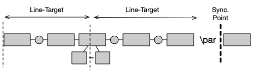

# Shipout

---

[**REMARKS**]

TeX uses the term "shipout" for the subroutine of completing a document-page and
writing it out on file (in print format). The shipout procedure collects vertical
material until the page box is (more than) full, then freezes the material and
puts it to the `output routine`.


## Local vs global Optimization

TeX does global optimization for paragraph breaks, but not for pages. In modern
times, documents fit into memory easily and we may think about solutions for
document-wide (or chapter-wide) optimal page-breaks. "Shipout" for global optimization
would then mean the output of a series of pages at once.

We will leave the decision about local or global pagination open for now, but we
will collect arguments for and against it in this document.

### Types of Media

For belletristic books, single page decision for breaks is usually good enough, as 
there is not much variety from page to page in terms of typesetting. For our intended
template-based page-layout this is not necessarily the primary target. Layout templates
would lend themselves well for magazines or scientific papers.


## Pagination Strategy

We will call locations in the document where a forced page-break sits "synchronisation
points". Examples may be chapters or the document end.

[**Revised**]
"Global optimization" means optimizing the selection of page-templates. Placing 
flow-material on a page is not subject to global optimization. The task of
the page-breaker is as follows:

- Find sequences of page-templates for a pagespan, in a dynamic search tree
- Each branch of the search owns a local copy of the flow-material registers
- A branch may split if more than one template is feasible when looking for the next one
- A trial consumes the flow-material and fills a page with a local paradigm
- Page-templates will be tried out with page construction, possibly creating a candidate page
- If a candidate page is created, append it to a sequence of page-templates (of this search tree branch)

Synchronisation points will force a decision for the best pagespan-result.
The sequence of pages will be shipped out.

When a trial fills the frames of a single page, the decision where to cut of the flow-material
is local. The decision will depend only on the current quality of the constructed page.
Measuring the quality of trial-results will be called "minimizing a loss function".
It may regard (for example):

  - Fitting / filling of text to frames
  - Distance of float material referenced on the page and their final location
  - Sizing factor for images
  - Widows / clubs

Deciding the cut-off is independent of the decision on successive page-templates.
There is not global (multi-page) decision about flow-material cut-offs to reach some
kind of best-fill optimum.

Each single candidate-page therefore carries a loss-factor. The optimization tasks is
to find the sequence of candidate-pages will the minimum loss-sum (sum of loss-factors).

For local optimization (one page per trial run) the decision point is always the current
page. (Global optimization: For very long books without forced page-breaks at chapters, an
artificial intermediate decision point would need to be introduced, if too much memory would
be consumed. Disregarded for now.)

### Paragraph-Breaking vs Page-Breaking

Horizontal material gets broken into line-boxes.
Material gets collected until a line is full, then broken apart. Remainder (e.g. the suffix of a
discretionary) stays with the material queue. This is done until end-of-par is reached.
Global optimization: loss function over paragraph-wide penalties.



Vertical material gets broken into page-boxes.
Material gets collected until a frame is full, then broken apart. Remainder (e.g., bottom halve of
a vbox) stays with the material queue. Inner loop continues until all frames stemming from a region
on a page are full. Outer loop continues until synchronisation point is reached (end-of-pagespan).
References may refer to material in other flow-channels and their synching is part of a loss-calculation.
Global optimization: loss function over pagespan-wide losses.


| | Paragraph | Page |
| --- | --- | --- |
| **Source** | khipu | prepared boxes in register |
| **Material** | boxes, glue, penalties | recursive CSS boxes (nothing prevents us from adopting glue + penalty) |
| **Breakpoint** [**New**] | feasible breakpoint, i.e. a penalty location | feasible pagebreak, i.e. a location in the flow material |
| **Sync.-point** | paragraph | forced page break (CSS: `break-before: page`) |
| **Splitting** | discretionary | vsplit |
| **Local strategy** | first-fit | single page shipout (like TeX) |
| **Global strategy** | Knuth+Plass | pagespan shipout - optimal range of selected templates |


## Template Selection

It is yet unclear how trial select templates for consideration. Strategies could
include:

  - Number of suitable flow-target boxes on the template (aside, table, …)
  - Chapter / section headings
  - ToC or other special material pages

[**New Remark (Search Tree)**]
Similar to line-breaking, finding feasible breakpoints for pages operates along a dynamic
search tree. For line-breaking, branches of the tree are merged at identical feasible 
breakpoints (with different costs) and the tree becomes a DAG. A feasible page-break is
identified by a location in the flow-material. Two feasible page-breaks are identical, if
their breakpoints for every flow-channel agree.

I have a feeling that branches of the search tree will rarely land on identical feasible
page-breaks. The search-tree will therefore stay a tree until a synchronisation point is
reached, possible fanning out extensively.

A page-breaker will manage a set of (a multitude of) "active search branches". We will 
define an "active search branch" through the following properties:

  - a register bank
  - cut-off material from the last page-break
  - a running loss sum
  - a sequence of selected page-templates
  - data-structures to reflect vsplit positions between frame-continuations per page
  - (possibly other information)

If feasible page-breaks indeed will turn out to be rare, then we will introduce a heuristic
to keep the number of branches in check. Just consider a text flowing over 100 pages, with
a fan-out of 2 page-templates. The number of "active search branches" will become very high
very quickly. We should therefore do something like the following heuristic
("cut our losses"-heuristic): Wie carry the most optimistic loss scalar and the most pessimistic
loss scalar through the process. Every "active search branch" which is in the lower percentile
(to be defined, e.g. in the lower 50%) will be abandoned at every iteration, i.e. we
consider them to be lost causes.
[**End of New Remark (Search Tree)**]

## Concurrency

[**Outdated**] Trial runs for sequences of pages offer a natural opportunity for concurrency.
Synchronisation points will collect goroutines and their trial-results. Then
the next bunch of trial-goroutines would start.

[**Revised**]
Line-breaking (K&P) is effectively a dynamic tree search. The same is true for searching a
globally optimal sequence of page-templates. We will postpone the idea of concurrency.
If anything, the pagespan optimization could be handled by a pool of workers.

---

## Design discussion: pagination and shipout

SHIP-07 implementation update (2026-11-26): `PaginationSearch` now selects one
complete current pagespan with the settled default-32 unfinished beam. Complete
depth rounds extend all retained paths through catalog-ordered eligible templates;
successors rank by summed loss and lexicographic template ordinals. Completed
incumbents stay outside the beam, and later completions may replace them. Safe
pruning uses the positive minimum page cost with strict greater-than; equality
remains eligible. Width truncation and safe pruning have separate counters.
No merging, progress beam tie, guessed remaining cost or automatic widening occurs.

The working eligibility baseline is exposed as optional
`PaginationConfig.Eligible func(State, *template.Template) (bool, error)`.
It receives immutable state and an independent template handle, filters without
reordering, and must be deterministic. Errors abort search; callback reentry is
rejected. Explicit PageAttempt remains unfiltered. Already-complete input selects
zero pages/loss. Success selects an immutable Sequence with its exact drained
final state; errors may retain a completed incumbent, explicitly unselected.
Stats distinguish completed rounds, attempts, NoFit edges, completions and both
pruning kinds. Finite graph and exhaustive page-fixture tests cover the policy,
and real-font proofs retain selected rendering after session closure. Public span
transitions/delivery remain SHIP-08. Eligibility, scoring and numerical limits
retain their working-hypothesis status. Author remarks are unchanged.

SHIP-06 implementation update (2026-11-26): `PageAttempt` now selects complete
multi-channel arrangements with authoring-order FIFO heads, exact checkpoints
and transitive activation from actually placed owner material. Same-page targets
may appear above owners or in earlier-visited channels. Text activation consumes
the typography adapter's rendered event associations; structural activation
checks retained boundary material. Ordinary references and unplaced owners do
not activate targets. Future-span heads remain untouched and may obstruct
draining; copied NoFit queue facts expose that condition without reordering.

Frames expose ordered branch fragments and total composed occupancy. Frozen
interiors remain contained while core flow rules collapse adjacent root margins;
final physical bounds are checked after composition. Only derived successors
pop complete heads, and all channel advances/activations publish together.
Entry participation, once-per-target carry, missing-main and secondary-only
draining follow the existing factual scorer. Tests cover exact transitive losses,
FIFO obstruction, several/partial heads per frame, empty/split owners, margins,
late failures and real-font none/manual rendering after session closure.
SHIP-07 supplies search; public span delivery remains SHIP-08. Scoring and numerical caps
remain working hypotheses. Author remarks are unchanged.

SHIP-05 implementation update (2026-11-26): `Pagination.PageAttempt` now builds
main-only pages from compiled template frame chains. It compares complete local
arrangements, including shorter prefixes and unused frames, and publishes one
frozen page with loss, progress and exact successor. Partial branches keep their
original head and matching fitting checkpoint. Stops inside main and empty
material are handled without metadata-only pages. The typography-neutral output
contract supplies line counts; real-font tests retain none/manual rendering and
atomic interiors after session/execution collection. SHIP-06 extends this to
secondary placement and activation; SHIP-07 supplies search and public span delivery remains later work.
The scoring formulas and numerical caps remain working hypotheses. Author remarks
are unchanged.

SHIP-04 implementation update (2026-11-26): content now provides a reusable,
source/preparation-qualified fitter and transactional finite-height fitting.
The typography bridge uses retained `none`/`manual` preparations, exact paragraph
checkpoints and matching atomic interiors. Distinct fragment occurrence IDs keep
multiple pieces of one source group separate. Frozen bundles retain copied CSS
geometry, source paint, decoded/processed/cluster mappings and owning-anchor
affinities, without execution handles. Real-font and GC tests prove retained
rendering across changed-width continuation and session closure. Structural
source-plan stops are supported; page-state advances and event activation remain
the page layer's responsibility. SHIP-05 now connects main-only page construction.
Scoring/limits remain working hypotheses; author remarks are unchanged.

BOX-SHIP-03 implementation update (2026-11-26): css-box-layout now fits used
fragment geometry through its existing width/intrinsic/flow rules, including
signed/empty margin collapse within a receiver. Only containers crossed by a
split omit the corresponding top/bottom edges; final bottom edges fit with the
last content. Source styles remain unchanged. Copied geometry and retained edge
facts support fragment paint. Atomic interiors are completed before outer
paragraph fitting; consumed interiors stay frozen across width changes and only
suffix atomics are re-realized. Neutral tests cover exact edge/margin geometry,
nested/auto/replaced atomics, oversized retry, invalid output and retained
snapshots. SHIP-04 now supplies the content/preparation fitting bridge.
Scoring and numerical limits remain working hypotheses; author remarks are
unchanged.

TYPE-SHIP-02 implementation update (2026-11-26): typography now accepts manual
paragraph checkpoints and finite-height prefix selection through the existing
trial API. Exact selected replacement tails, original source splits and consumed
atomic geometry survive equal/changed-width resumes; later authored alternatives
can shape lazily without base re-preparation. ReplacementCoverage reports each
rendered pre/post half as one indivisible original source partition, never using
replacement-local cluster offsets as original positions. Silent output retains
logical carry but has no rendered coverage. Failed services publish no trial and
permit retry. Lifetime and real-font tests retain rendering after working handles
are collected. Automatic continuation remains unsupported; StartFlow keeps its
separate `none` profile. BOX-SHIP-03 now supplies CSS atomic interiors;
SHIP-04 connects those snapshots to paragraph geometry and HTML/event mapping.
Page fitting/search and working scoring/limits are unchanged. Author remarks are preserved.

KHIPU-SHIP-01 implementation update (2026-11-26): khipu now certifies manual
(`ExplicitHyphenation`) prefixes and first-fit resumes with the exact selected
post-break replacement, including empty spelling and zero-width material.
Accepted geometry, alternatives and consumed atomic advances remain fixed;
later authored opportunities may discover replacement pairs lazily. Failed
services publish no plan and leave earlier checkpoints/output reusable. Source
conservation, repeated changed-width resumes and release of working handles
are tested. Automatic continuation remains unsupported. Typography admits
`none` and `manual` through its fragment/checkpoint surface after TYPE-SHIP-02. Scoring and numerical limits remain
working hypotheses; author remarks are unchanged.

TYPE-SHIP-01 implementation update (2026-11-26): typography now supplies all
fitting whole-line prefixes for `none` through `Trial.FitPrefixes`, with explicit
selection of a matching frozen fragment, checkpoint and accepted atomic geometry.
Logical byte/knot progress and rendered cluster coverage remain separate; source
ranges inside ligatures attach to the whole cluster, independently of bidi visual
order. Selected output survives changed-width suffixes and release of preparation.
BOX-SHIP-03 supplies used CSS fragment geometry, and SHIP-04 supplies the content
bridge. SHIP-05/06 supply page construction and SHIP-07 supplies search. Scoring and numerical limits
remain working hypotheses. Existing author remarks are unchanged.

BOX-SHIP-02 implementation update (2026-11-25): css-box-layout now enumerates
finite-height structural alternatives over nested auto-width, zero-edge blocks.
Neutral paragraph callbacks provide shorter prefixes with matching frozen output
and exact opaque checkpoints. Results preserve open-container obligations,
logical progression, occupied extents and selected continuations across changed
receiving widths. Exhaustion, voluntary interruption and errors/limits are
distinct. BOX-SHIP-03 now supplies fragment geometry/paint, nonzero edges/margins
and atomics; TYPE-SHIP-01/02 supply paragraph-prefix services, connected by
SHIP-04. SHIP-05/06 supply multi-channel page construction; SHIP-07 supplies search.

SHIP-03 implementation update (2026-11-25): initialization now binds immutable
state to a source/plan, preparation and execution context. Checked loss algebra,
factual scoring, local/sequence comparators and page/search publication contracts
are implemented. Scoring and numeric caps remain working hypotheses. SHIP-05/06
integrate checkpoints, pages and secondary activation/draining; SHIP-07 supplies
search. Initialization itself creates no pages.

SHIP-02 implementation update (2026-11-25): `pagelayout.Plan(document)` validates
ownership and main-only breaks, and returns copied source-qualified branches,
anchors and spans without advancing queues. Content propagates source events
through normalized provenance and processed paragraph coordinates. Initial and
coincident boundaries coalesce; the terminal drain is represented explicitly.
SHIP-05/06 supply page fitting and placement activation; SHIP-07 supplies search.

BOX-SHIP-01 implementation update (2026-11-25): css-box-layout now provides
`BuildLayoutTreesWithProvenance`, returning detached source endpoints, retained
occurrences and ordered structural boundaries alongside unchanged trees. Omitted,
empty and suppressed endpoints are explicit. Pagination affinity, ownership and
prepared-text mapping remain SHIP-02; structural ordinals are not legal cut points.

Implementation status (2026-11-25): SHIP-01 now publishes default main as the
existing residual tree and captures detached original-source ID, owning-link
and normalized forced-break records through `content.Document.SourceEvents`.
These are source facts, not placed markers: ownership validation, first-child
propagation and normalized/prepared boundary mapping remain subsequent work.


Discussion recorded on 2026-11-23 and revised through 2026-11-25 against the
author's remarks, preserved verbatim above, within this discussion and in the
closing answers. This revision also incorporates the subsequent clarification
that owning anchors establish placement relationships and never close pagespans.
It also incorporates the adopted source-order rule, fragment edges, out-of-band
markers, template-order tie preference and initial beam search without merging.
The latest SHIP-00 adoption settles the operation/state, source-marker, fitting,
enumeration and output contracts below, building on the settled within-template
tie rule and 32-candidate beam policy. Scoring and numerical execution limits
remain working hypotheses. Supporting Go declarations remain implementation work.
Global optimisation here means choosing a sequence of page templates within a
pagespan; flow-material cut-offs are selected locally during page construction.
The earlier recommendation to expose cut-off alternatives to global search is
superseded.

Three statuses are used throughout this discussion:

- **Settled:** an agreed design rule, including previously adopted decisions.
- **Working hypothesis:** the adopted provisional approach to develop and test;
  it may be revised in light of concrete examples. It is not an unchosen option.
- **Open:** a detail still needing specification or a hypothesis needing further
  validation. Deferred work is identified separately.

These statuses describe design, not implemented pagination capabilities. The
four domain names are adopted API vocabulary; concrete Go declarations remain
open. The latest adoption does not downgrade previously settled rules.

### Agreed requirements

- Synchronisation points delimit **pagespans**, the optimisation spans. Each
  point closes the span since the preceding point, or since the document start
  for the first span. Forced page breaks, authored as `break-before: page`, and
  document end supply these boundaries.
- **Forced page-break variants of `break-before` are equivalent to `page`**
  for this profile, including `recto` and `verso`. Each requests a forced page
  break and synchronisation point. Their page-side distinctions are disregarded;
  they impose no parity constraint and do not request blank pages.
- **The default flow channel is `main`.** Residual content belongs to that
  stream, and body-text frames receive it through `flow-from: main`. After
  routing validation, a valid `flow-into: main` is redundant and is ignored as
  an extraction instruction. It does not create a separately ordered branch.
- **Owning links are explicit:** `<a href="#target" data-flow-anchor>` supplies
  a placement relationship; ordinary cross-references do not. Ownership is not
  inferred from the earliest ordinary link or the target's source position.
  Relationships may be transitive through separately routed material.
- **A flow anchor does not close a pagespan or force a page break.** Its target
  may be deferred with loss. Pagespan synchronisation points retain the distinct
  obligation to drain all related material before completing the span.
- **Missing receivers incur loss, not a mandatory-participation failure.**
  Requiring particular channels on every page is deferred. This does not waive
  material-progress or pagespan-completion requirements.
- **Registers retain authoring order.** Ownership references do not reorder
  material or permit skipping an unconsumed earlier item. The resulting delays
  affect loss; the typesetter does not repair the author's ordering.
- **Markers are out-of-band metadata.** Forced-break boundaries and owning-anchor
  positions do not introduce synthetic boxes or penalties into the material.
- **Split fragments retain their original outer edges.** The first fragment
  keeps top edges, the last keeps bottom edges, and middle fragments keep neither;
  left/right edges remain. The rule applies to boxes actually crossed by a split.
- **Page construction selects flow-material cut-offs locally**, using the
  quality of the current page. It does not choose a cut-off because of a
  prospective successor template or a better later-page fill.
- **Global optimisation searches template sequences for a pagespan.** Each
  search branch owns independent flow-material state and extends its sequence
  with the page candidate produced by a local construction attempt. Alternative
  cut-offs for the same input state and template are not global search branches.
- Each page candidate carries a scalar **page loss**. The pagespan objective is
  to select a complete feasible sequence with the **minimum sum of page losses**.
- Reaching a synchronisation point in the main flow is insufficient on its own.
  **All related material in other flows must be drained** before the point is
  complete. This is a requirement, not an optional policy allowing that material
  to spill into the next span.
- The overall phase order is fixed: **box tree -> preparation -> render tree**.
  These phases do not run concurrently. All page attempts and pagination
  searches start with prepared flow registers; they do not wait for a producer
  to load or prepare more source material concurrently.
- **API terminology is settled:** Page attempt, Page candidate, Pagination
  search and Pagination candidate name the distinct activities and results.
- **Local construction is deterministic**, including ties: identical state,
  template and policy produce the same selected candidate. Ordinary infeasibility
  remains distinguishable from operational errors.
- **Equal-loss choices between page templates prefer the earlier template** in
  template order. Equal-loss sequences use lexicographic template-ordinal order.
- **Within one template, ties prefer greater logical progress:** first in
  `main`, then in secondary channels in first-occurrence source order, then the
  first arrangement in deterministic frame/breakpoint enumeration.
- **The initial beam retains at most 32 unfinished candidates by default,**
  configurable, pruning after each complete page-depth round. Rank by accumulated
  loss then template sequence, with no remaining-cost estimate and no merging.
  Retain the best completed span separately and do not stop at first completion.
  Tests should establish whether future merging would meaningfully reduce work.
- **Page-breakpoint identity is a vector of material positions**, one for each
  flow channel. Two page breakpoints agree when every channel position agrees.
  Whether their full search states can safely be merged is a separate question.
- **Evaluation retains a component breakdown** for go/no-go criteria and can
  produce one scalar assessment at any point. Loss has feasible nonnegative
  finite values and an absorbing blocked value. Every feasible value ranks
  ahead of blocked; ordinary floating-point infinity ordering is not used.
- **The initial score includes a positive page cost, normalized underfill and
  explicit break penalties.** Numeric coefficients, representation and final-page
  treatment now have working hypotheses below; their calibration is provisional.
- **Carry-over charging starts on the owning-anchor page** when the target
  cannot be fully placed, and recurs on each following carrying page. The
  initial unit is one charge per distinct pending target per page; partial
  placement leaves the target pending. Ordinary references do not multiply
  charges. It is not deferred until the eventual placement page.
- **Concurrency is deferred.** A search branch is a logical candidate, not a
  goroutine. A worker pool may be considered later without overlapping the fixed
  overall phases.

The responsibility split below is adopted. Local enumeration and publication
are settled by SHIP-00 alongside the tie/beam rules; scoring, numerical limits
and the existing template-eligibility baseline retain their stated provisional
status. Concrete supporting APIs remain implementation work. The meaning of
global optimisation and its sum-of-page-losses objective are specified above.

"Prepared flow registers" describes the readiness of their material. It does
not require replacing register payloads: the existing `content.Box` handles
remain source identities, with prepared metadata and execution resources held
separately. Preparation completes before the render-tree phase begins. Fitting,
line breaking, atomic sizing and candidate page construction belong to that
render-tree phase; their dependence on receiving geometry remains unchanged.

### Responsibilities

| Responsibility | What it does |
| --- | --- |
| **Fragment fitting** | Supplies legal fragments and exact continuations to the local page constructor. |
| **Page construction** | Applies one template, selects cut-offs using current-page quality, and returns a page candidate, successor channel state and page loss. |
| **Pagination search** | Explores template sequences and selects a completed pagespan with minimum accumulated page loss. |
| **Shipout** | Delivers the selected, frozen pages to an output consumer. |

Under this decomposition, shipout starts with selected pages. It does not choose
breaks or mutate flow registers. Selection can deliver one page or a sequence;
output format and rendering backend need not determine the search strategy.

The adopted ownership contract is that `css-box-layout` owns structural box
fitting and fragmentation, with paragraph fitting supplied by an adapter.
Typography/khipu own paragraph breaking and continuation. `pagelayout` owns
frame traversal, channel coordination, template choices and page-sequence
selection. This extends the existing division without introducing another box
layout engine in the scheduler.

### Settled terminology

The following four names are agreed API vocabulary. Their Go declarations and
the particular supporting types or method signatures are not yet fixed.
[**Remark**] Let's consider these terms agreed and settles for API names.[**End of Remark**]

| Term | Meaning |
| --- | --- |
| **Page attempt** | One local construction attempt for a given pagination state and template. It may examine several cut-offs internally and selects a result using current-page loss. |
| **Page candidate** | The selected result of a successful page attempt: page fragments, successor state, scalar page loss and its component breakdown. |
| **Pagination search** | The operation that explores template sequences within a pagespan. |
| **Pagination candidate** | One competing, possibly incomplete page sequence, with its current state and accumulated sum of page losses. |

Thus a pagination search extends pagination candidates by making page attempts.
A page candidate can be attached to a sequence without being selected for
shipout. Its cut-offs are fixed within that candidate; the search may retain or
discard the candidate sequence, but does not reopen those cut-offs to improve
successor pages. Competing templates can still produce different cut-offs because
their receiving geometry differs.

Terminology is **settled**. These names describe responsibilities and results
without prescribing the deferred concurrency strategy. An active search branch
is a live Pagination candidate managed by the Pagination search, rather than
another competing API name.

### Pagination as a search over immutable states

The conceptual page-construction operation used by either template-selection
strategy is:

```text
pagination state + template + local construction policy
    -> chosen page candidate + successor state + page loss
    or infeasible / error
```

Cut-off selection is inside this operation. The pagination search invokes it
for eligible templates; it does not supply future-page objectives or request
alternative cut-offs as additional successors for one template.

**Settled:** local selection is deterministic, including ties, so the same
state, template and policy produce the same selected candidate.
Infeasibility under the local policy must remain distinguishable from an
operational error. [**Remark**] Agreed to the recommendation [**End of Remark**]
The within-template rule is now settled: compare logical progress in `main`,
then secondary channels, then deterministic enumeration order. The template-order
rule separately compares candidates from different templates. Concrete outcome
types are implementation details under the adopted SHIP-00 reporting contract below.

A pagination state needs more than a register bank. A branch may be only partly
placed, and later decisions can depend on page position. Conceptually it includes:

- A persistent bank state for the remaining whole branches.
- Per-channel continuation state for unfinished material, identifying the
  source branch and exact remaining position.
- The current optimisation span and progress towards its synchronisation point.
- Page number/parity and any other context that affects eligible templates or
  future costs, such as running-heading state when repetition is supported.

The candidate sequence retains its page results and accumulated loss alongside
that state. Pending referenced material contributes the state needed to assess
carry-over on the current page. Source positions or delay age are needed only
where the chosen component policy uses them. The precise representation remains
open; float placement remains outside the first fitting work.

The persistent registers already support independent derived banks sharing
immutable material. Copying a bank does not copy prepared trees or mean that a
partially consumed branch can be represented by an ordinary whole-box `Take`.
Continuations therefore remain separate from unchanged `content.Box` payloads.
The unchanged-box-plus-continuation model is adopted; concrete continuation
types, inspection and cross-module interfaces still need specification.

An attempt reads one state and returns another. It does not modify the starting
state, source styles, compiled template geometry or earlier page candidates.
Rejecting a candidate leaves competing candidates usable. Selecting a sequence
publishes its pages and final channel state together, so consumption of a
heading or note cannot escape from a page sequence whose body placement fails.
This is compatible with the functional-data-structure discipline.

### Active search branches

The author's active-branch property list specifies the logical contents of a
Pagination candidate. Its concrete representation and ownership details remain
open. The proposed mapping is:

| Branch property | Place in the candidate |
| --- | --- |
| Register bank | Current immutable pagination state. |
| Cut-off material from the last page break | Exact unplaced remainder, represented by the bank and its continuations; no duplicate mutable copy of source boxes. |
| Running loss sum | Accumulated page loss for the selected sequence so far. |
| Selected page-template sequence | Retained Page candidates, from which template identities are obtained. |
| Frame-continuation / `vsplit` positions | Split records in retained page results, with the resume cursor in the successor state. |

**Settled in SHIP-00:** retain frozen Page candidates rather than only template
IDs, so earlier layout choices and output need not be reconstructed. Use an
immutable predecessor chain to share their common page sequence. This is output
prefix sharing, not search-state merging. The
search state needs the information required for future construction; historical
frame placements belong to retained output, not to a growing mutable resume
workspace. The interface for split records and sequence retention remains open.

### Default main flow and explicit owning anchors

**Settled (2026-11-25):** ordinary body material belongs to `main`. A body-text
receiver uses `flow-from: main`; this names its channel, not its HTML ID. A
template used to drain secondary material may omit a main receiver.

A valid `flow-into: main` is superfluous. Validate routing declarations first,
including the prohibition on nested flow sources, then leave this material in
the default stream instead of extracting it. Ignoring the declaration must not
hide an otherwise-invalid nested route. Its original position, ancestry and
resolved styles remain intact. There is no separate main/residual interleaving
policy to choose: the earlier ordering concern arose only from extracting main
branches and then attempting to recombine them.

The current [router](../content/route.go) treats all nonempty flow names as named
routes and rejects nested routes, including identical names. The current
[`Document`](../content/document.go) also exposes residual content separately.
Implementing the adopted main semantics requires changes to that integration;
these decisions do not describe an already implemented default channel.

**Settled authoring convention:** mark an owning link with `data-flow-anchor`.
The author's example distinguishes it from an ordinary cross-reference:

```html
<p>
    An ordinary reference to
    <a href="#note-17">Note 17</a>.
</p>

<p>
    The passage that introduces the note
    <a href="#note-17" data-flow-anchor>17</a>.
</p>

<aside id="note-17">
    The actual note text ...
</aside>
```

CSS independently assigns the target to a channel, for example:

```css
#note-17 { flow-into: notes; }
```

The attribute's presence identifies the owning link; `href` identifies its
target. The annotation does not extract the target or choose its channel.
Ordinary links neither establish ownership nor activate placement or carry-over
charges. The author's numbering choice, such as generating "Note 17", remains
separate and deferred. Ownership must be supplied by the author; proposals to
choose the earliest ordinary reference or manufacture an anchor from extraction
position are superseded.

The distinction between the two kinds of coordination is settled:

| Marker | Effect |
| --- | --- |
| Flow anchor (`data-flow-anchor`) | Establishes the target's placement relationship. Deferral with loss is permitted; no forced break, pagespan closure or immediate draining barrier is implied. |
| Pagespan synchronisation point (`break-before: page` or document end) | Closes an optimisation span and requires all related secondary material to drain before completion. |

An owning anchor in an aside may refer to a separately routed figure. This is
a transitive placement relationship, not nested source routing. Ordinary
descendants of a routed branch remain allowed; a descendant declaring another
named route is still rejected. Main-flow boundaries govern pagespans; secondary
flows need no independent markers to establish their span membership.

**Settled in SHIP-00:** require one active explicit owner per active secondary
branch, targeting a unique same-document branch-root ID, with acyclic chains
reaching main. Ordinary xrefs do not participate. Suppressed/inert owners do not
activate; an active target without an active owner is a missing-owner error, and
an active owner targeting suppressed material is an inactive-target error.
Diagnose unresolved/duplicate targets, duplicate ownership and non-root targets
with source provenance. The [adopted contract](#owning-anchors-affinity-and-source-mapping)
fixes non-visible-marker affinity without requiring printed reference text.

**Settled:** every register retains source authoring order, including secondary
material. Do not derive reordered queues from owning anchors or skip an earlier
unconsumed item to reach a later target. Source order expresses the author's
intention; disagreement with reference order is not itself malformed input.

For a register containing `[A, B]`, B's owning anchor may occur before A's.
The register still yields A before B. If B remains pending while earlier material
prevents its placement, the ordinary carry-over loss reflects that delay. No
automatic repair or sorting takes place. If the ordering and other placement
constraints prevent a span from draining, report that failed completion; do not
reorder or silently consume material reserved for a later span to make it succeed.

**Settled in SHIP-00:** a target may be placed on its anchor page or later,
including geometrically above that anchor on the same page. A visible link
activates once on the first placed fragment containing its rendered content,
using source coverage across indivisible shaping clusters. Empty/whitespace-only
links attach to following retained material within their block, otherwise to
preceding retained material there, otherwise to the block's structural position.
Following-material affinity crosses into the new span at a forced boundary;
preceding-material affinity remains in the closing span. Process terminal events
before final draining. Metadata alone never creates a page.

Transitive activation follows placement: a target owned from an aside becomes
eligible when the relevant part of the aside is placed. Its span affiliation
follows the ownership chain back to `main`. Earlier unconsumed material in the
same register still blocks later targets; under this contract, an earlier item
whose anchor has not been reached waits for that anchor rather than being placed
early. None of this changes the settled source order.

An already prepared future target must not incur carry-over loss merely because
its box is present in a register. Its
pending status follows the owning relationship. Missing-receiver loss for due
material is settled. The working score uses the existing carry-over charge for
secondary targets without a second penalty, and a separate missing-main charge
when main material remains. Coefficients and detailed scoring facts are specified
as working hypotheses below. A page must still advance material, and a span
cannot complete while related material remains unplaced.

### Completing an optimisation span

The draining requirement applies to material **related to the closing span**,
not to every later item in every register. Since preparation precedes pagination,
registers may already contain material for subsequent chapters. That future
material must remain available for the next span.

Once the main flow reaches its boundary, the candidate must finish any remaining
related secondary material before admitting main-flow material from the next
span. Depending on permitted templates, that may require pages carrying only
secondary material. If the permitted templates cannot place it, the candidate
cannot complete the span; silently carrying it across the boundary or dropping
it would violate the draining requirement. At document end, all participating
material must be exhausted.

The remarks identify `break-before: page` as the authoring mechanism for a
synchronisation marker. **Decision (2026-11-24):** normalize all forced page-break
variants, including `recto` and `verso`, to the same effective `page` marker.
The rule applies to forced page-break values. Side-specific behaviour is deferred:
these values neither constrain the next page's side nor insert blank pages to
reach it. The resulting marker closes a pagespan and requires related material
in other flows to drain under the same rules as `break-before: page`.

The current [content CSS profile](../content/profile.go) does not admit
`break-before`. Admitting the property, applying this normalization and retaining
the effective marker through source styling, routing and preparation are
pagination prerequisites; recording the decision does not implement them.

Explicit owning relationships supply the basis for assigning secondary material
to the closing span; channel names and ordinary cross-references do not. The
draining obligation includes material related transitively through other
secondary branches, even if its own anchor will only be encountered while those
branches drain. Reaching a flow anchor alone never ends the span.

**Settled in SHIP-00:** honor forced breaks on block-level main material outside
inline atomics; active secondary/ordinary-inline/atomic-interior forced breaks
are unsupported. Coalesce boundaries, propagate a first in-flow child's break to
its container, create no leading blank page and append the terminal drain.
Admit auto and the five forced page values plus initial/inherit/unset; avoidance,
column/region values, rollback and legacy aliases remain unsupported. Source
mapping remains implementation work; its affinity/suppression contract is fixed.

Reaching the same source boundary does not necessarily make two successor
states interchangeable. Sequences with different page counts may leave different
parity, numbering or template context for the next span. Draining secondary
material removes one source of cross-span dependencies but does not remove
these others. **Settled transition contract:** select the lowest-loss completed
span using the settled sequence tie rule, then carry its exact next page number,
registers and other context into the next span. Do not reset numbering or reopen
the selected span to improve a later chapter's parity. Concrete carried-context
types remain open. The objective is pagespan-wide template optimisation; it does
not claim a document-wide optimum across those boundaries.

[**Remark**]
The paged-media approach would be something like:

```CSS
.chapter {
    break-before: page;
}
```

and the corresponding HTML:

```HTML
<section class="chapter">
    <h1>Chapter 1</h1>
    ...
</section>
```

The page break "marker" in the box-tree is a CSS property. We have to decide whether
to mark it in-band or out-of-band. And in-band solution would be a kind of fake-box
representing a marker or a new penalty type (similar to khipus). And out-of-band marker
would be a separate list of box IDs as synchronisation point markers.
[**End of Remark**]

**Settled:** use out-of-band immutable metadata for effective break-before
boundaries and owning-anchor positions. The earlier in-band marker/penalty
alternative is not selected. The ordinary material sequence receives no
synthetic layout boxes for these markers.

**Settled position contract:** the fitter supplies an ordered logical boundary
vocabulary for branch, structural and paragraph positions. Inspection identifies
the snapshot, branch ordinal and logical boundary within the branch, with source
correspondence. The opaque continuation separately retains open-container state,
paragraph checkpoints and accepted atomic geometry. Equal inspection positions
do not imply interchangeable continuations.

**Open:** specify concrete types and the mapping from source to normalized and
prepared positions. A bare numeric BoxID is insufficient because it is tree-local;
a boundary also needs a position such as "before this box" and source provenance.
Inline and non-visible anchors require positions that survive normalization and
splitting. Implement the adopted affinity, suppression and propagation rules;
concrete private position encodings remain to be chosen.
The effective CSS property remains the origin of forced-break metadata, and
explicit owning links remain the origin of placement metadata.

### Local cut-off selection and fragment fitting

Local means the **whole current page**, including its frame chains and related
channels. It need not mean independently taking the longest prefix that fits
each frame. A page constructor may compare legal cut-offs across that page and
select them using current-page loss, without evaluating successor templates or
later-page fill.

**Settled enumeration contract:** expose and enumerate the supported legal
fragment combinations across the current page, respecting register order, frame
chains and owning anchors. Evaluate complete arrangements and choose by page
loss and the settled tie rule below. This supplies a reference for later local
optimisation; beam width does not bound the work inside a Page attempt.

If a configured work limit interrupts local enumeration, report a limit outcome,
not `NoFit` or a claimed minimum. SHIP-00 adopts synchronous callback enumeration
with exhausted/stopped/error completion, channel/source and frame-chain ordering,
further-progress prefixes first and an explicit legal empty placement. Numeric
work caps remain hypotheses; exact supporting Go declarations remain open. Local
alternatives do not become separate successors for one template in global search. The selected
cut-off remains fixed even if another could have improved a later page.

#### Within-template tie rule (settled)

For complete arrangements under one template, compare in this order:

1. Lower page loss.
2. Further logical material progress in `main`.
3. Further progress in secondary channels, compared lexicographically in their
   first-occurrence source order.
4. The first arrangement in deterministic frame-placement and breakpoint
   enumeration, if all end positions agree.

Progress means later logical material positions, not line count, occupied height
or numeric BoxID. Different widths can produce different line counts for the
same placed prefix. When `main` is already at its span boundary, secondary
positions decide the progress tie. No future page is examined. This rule does
not supersede earlier-template preference when comparing different templates.

#### Resumable fitting and fragment edges

The main missing foundation is **finite-height, resumable box fitting**.
Whole-subtree layout at a width is available, but does not yet supply partial
box fragments or their exact continuations. Fitting must respect each actual
frame's dimensions and legal breaks; summed frame heights are insufficient.
Continuing into a different width must reflow only the unplaced suffix while
preserving accepted fragments and their matching atomic interiors.

Paragraph continuation facilities already provide useful building blocks.
The integration must also carry open-container and box-boundary state, retain
source identity, and associate paragraph fragments with their output. The adopted
model uses opaque continuations and explicit progress/exhaustion outcomes.
The initial scope is ordinary block sequences and paragraph breaks between
lines, with indivisible inline atomics and an explicit non-fit outcome for
oversized indivisible material. **Open:** specify the fitting interfaces and
detailed boundary rules before the scheduler relies on them. The remarks' `vsplit`
analogy requires an exact structural remainder, not a geometric clipping of an
already laid-out box.

**Fragment-edge omissions are settled.** The author confirmed that top and
bottom were reversed in the closing answer preserved below. The corrected rule
retains original outer edges and omits edges at artificial cuts:

| Fragment of a split box | Top margin/padding/border | Bottom margin/padding/border |
| --- | --- | --- |
| First | Retain | Omit |
| Middle | Omit | Omit |
| Last | Omit | Retain |

The table is adopted; the earlier remark remains verbatim as discussion history.
Left/right edges remain. Apply the rule only to
boxes actually crossed by a legal split; a child contained wholly in one fragment
keeps its own edges.

**Settled margin contract:** use the existing core rules within one frame and
do not collapse margins across frame boundaries. Surviving margins, padding and
borders count against receiving space; determine those used edges before
declaring a fragment to fit. Concrete edge sizing, boundary-state representation
and paint interfaces remain open. Unsupported fragmentation is an explicit error;
oversized indivisible material is non-fit for that receiving configuration.

### Feasibility, page loss and pagespan loss

Evaluation distinguishes go/no-go criteria from the quality of acceptable
results. Lost or duplicated material or an illegal break cannot be compensated
by another component's favourable loss. Missing a receiver for pending material
contributes loss; mandatory per-page channel participation is deferred. A completed
pagespan must still satisfy the draining requirement; an incomplete search branch
can still have pending related material. Component evaluation may identify a
no-go result, while operational failures remain errors rather than loss values.

The specified objective for a completed candidate sequence is:

```text
pagespan loss = sum(page loss for every page in the candidate sequence)
```

Aggregation across accepted pages and the within-template tie rule are settled.
Component functions, weights, thresholds and final-page treatment have working
hypotheses in the [page-loss contract](#loss-representation-and-scoring-hypotheses). They still
need calibration against examples. The named components include unused
vertical space, clubs, widows, and whether referenced material fits on the page
or must move. Further components may be added. The threshold between a no-go
and a weighted preference must be explicit for each applicable rule. The initial
model now includes a positive per-page cost, normalized underfill and explicit
break penalties. The provisional coefficients below do not change that objective.

**Settled:** retain the component-wise evaluation for go/no-go decisions and
explanation, with conversion to a scalar assessment available at any point.
The page constructor and pagespan evaluator use a consistent definition. The
fitter supplies geometry and legal fragments without embedding the complete
scoring policy.
[**Remark**]
Yes, we should keep component-wise evaluation for go/no-go criteria.

  - unused vertical space
  - clubs
  - widows
  - reference to other flow-material is on same page or has to move
  - (probably others to find)

However, we should be able to convert our component-wise breakdown to a single
loss scalar at any point.
"no-go"s become infinity loss (-∞). When adding up, $-∞ + l = -∞$ for any l,
even for $l = +∞$.
[**End of Remark**]

#### Loss algebra (settled)

The author's acceptance of the loss proposal settles the algebra: feasible
losses are nonnegative and finite; no-go has a distinct blocked value. The
earlier `-∞` notation can denote that blocked state, but it is not an ordinary
floating-point value ranked by numeric minimum. The preserved remark's absorbing
meaning is implemented by explicit loss operations.

**Settled:** the loss operations have these semantics:

```text
Blocked + anything = Blocked
Finite(a) + Finite(b) = Finite(a + b), with checked arithmetic

For minimisation, every feasible finite loss ranks ahead of Blocked.
```

NaN, an invalid finite cost or unrepresentable arithmetic is an operational
calculation failure, not a no-go result. The abstract domain and ordering are
settled. **Settled in SHIP-00:** use tagged blocked/finite uint64 units at one
million units per point. Round each complete weighted component once, nearest
unit with ties to even, then add with overflow checks and compare exactly.
Inspection exposes exact units and a blocked tag; decimal points are presentation.
Concrete declarations and error plumbing remain implementation work. Scoring
formulas/coefficients remain hypotheses, distinct from this arithmetic contract.
The earlier finite-`float64`-only assessment proposal is superseded. No raw
infinity comparison or addition may replace the explicit blocked semantics.

#### Carry-over charging (settled timing)

Carry-over is charged on the owning-anchor page once it is clear that the target
cannot be fully placed there, and again on each subsequent page that must carry
the material onward. The previous proposal to wait for eventual placement before
charging is superseded. At the closing synchronisation point, draining related
material remains a hard completion condition, separate from these page losses.
[**Remark**] The loss is charged on the current page, i.e. the one where the
reference sits and it becomes clear that the target will not fit. It will further
be charged on every following page where left-over material cannot be placed,
but has to be carried over.[**End of Remark**]

For a target whose owning anchor is on page 10, still pending after page 11, and
fully placed on page 12:

| Page | Carry-over component for that target |
| --- | --- |
| 10 | Charge initial deferral. |
| 11 | Charge continued deferral. |
| 12 | No carry-over charge for that target. |

The candidate page's loss is complete without waiting for future placement or
revising an earlier page. Charges belong to the selected candidate, not to every
failed exploratory fit inside its construction.

**Settled initial accounting:** charge once per distinct pending target per
page. A partially placed target remains pending until complete, and additional
ordinary references do not multiply the charge. The placement anchor does not
impose immediate draining or close a pagespan.

**Working score hypothesis:** charge one cost point per pending target per
carrying page. An absent secondary receiver causes this charge, not an additional
penalty for the same deferral. Missing `main` has its own provisional charge.
The concrete pending-state representation remains open. A constant charge needs
pending status and the exact remainder; earlier delay has already been paid. Age or origin-page
position is needed for future evaluation only if a later formula uses it.
Concrete owning-link validation and transitive association follow the adopted
SHIP-00 contract above. Float implementation remains deferred.

### Template search and the meaning of optimality

The global objective is the minimum-loss template sequence **under the chosen
local page-construction policy**. It does not include sequences that could only
be obtained by replacing that policy's cut-offs with globally preferred ones.
If a locally selected result eventually leads to an infeasible sequence, the
search can reject that sequence and try other templates; it does not reopen
the local cut-offs as another search dimension.

The pagespan search manages an active frontier of Pagination candidates and
extends them through page attempts with eligible templates. **Settled initial
strategy:** retain at most 32 unfinished candidate sequences by default, with a
configurable positive width, pruning after each complete page-depth round.
Rank by accumulated loss and then template sequence; do not estimate remaining
cost or merge states. Exhaustive small fixtures provide a reference for measuring
beam quality and possible future merge savings; compare widths such as 8, 32 and
128. These are planned checks, not claims that pagination tests already exist.

The objective remains minimum summed loss under the local construction policy.
Heuristic beam pruning does not guarantee that minimum. A round compares
unfinished sequences with the same page count, but they may have consumed
different amounts of material. Accumulated loss is the settled initial baseline;
its progress bias is a known limitation to measure against exhaustive examples.

#### Template-order tie preference

**Settled:** when equally scored page choices from the same starting state use
different templates, prefer the earlier template in template order. The catalog
already exposes definition order through `IDs()`. Keep that preference stable
when filtering eligible templates; evaluation order or a search heuristic must
not silently replace it.

**Settled sequence rule:** equal-loss sequences compare template ordinals
lexicographically. For example, `[first, third]` precedes `[second, first]` at
their first differing position. Use this rule both for beam ranking and for
completed spans. Within one template, use the separate logical-progress rule
above. Neither rule reopens cut-offs as another dimension of pagespan search.

#### Breakpoint identity and safe state merging

**Settled:** a feasible page breakpoint is the vector of material positions in
all flow channels. Two such breakpoints are identical if every channel position
agrees, within the same source/search context. This is a material-position
identity, not a page number, template identity, used height or register length.
[**Remark**]See the new entry in the table at the top, for "feasible breakpoint"[**End of Remark**]
Safe state merging asks an additional question: from that shared breakpoint,
do the candidates admit the same future choices and costs? Their full state may
also contain page context, pending-reference metadata and continuation details
inside unfinished boxes. Matching material positions is necessary, but does not
by itself establish that all of those future effects agree. If merging is later
introduced, an equivalent future state could allow discarding the candidate
with higher accumulated loss.
[**Remark**]See the new remark on "search tree" above[**End of Remark**]

The adopted logical-position vocabulary above supplies inspection/test identity;
its concrete types and source mapping remain open.
Full future-state equivalence and merge dominance are **deferred**, because the
initial search performs no merging. Continuation tokens must not be
compared merely by pointer identity or bare tree-local BoxIDs. With a constant
carry fee, already-paid delay need not be retained solely for future scoring;
an age-sensitive formula would require that age in the state.

The remark anticipates rare identical breakpoints. **Settled:** start without
state merging. Tests should measure whether equivalent states recur often enough
for merging to reduce search work; matching breakpoint vectors alone are not
proof of equivalent future state. A later merge implementation needs both that
evidence and a precise equivalence/dominance contract. The initial search must
not depend on merging for scalability.

#### Bounded beam search (settled initial policy)

The bounded-frontier proposal is adopted as beam search. The earlier
"cut our losses" heuristic explains the motivation, but its percentage-based
form is not the chosen size bound. Several distinctions affect the policy:

- For finite losses under minimisation, discard the **highest-loss** candidates.
  "Lower percentile" must mean lower quality, not lower numeric loss.
- Best and worst observed losses describe a range, not a percentile. Rank-based
  pruning and a threshold within that numeric range are different policies.
  Observed extrema are not automatically bounds on completed-sequence cost.
- Keeping a fixed fraction is not a general frontier-size bound. With average
  fan-out `b` and retained fraction `r`, size changes roughly by a factor `b*r`
  per iteration, before other filtering.
- With exactly two successors per branch, keeping half immediately from one
  starting branch leaves one survivor each round. That collapses template
  selection to a greedy path rather than retaining competing sequences.

**Settled procedure:**

1. Start with the initial state and an empty sequence.
2. Extend every active candidate using every eligible template. Each successful
   Page attempt contributes its one locally selected result.
3. Separate completed spans from unfinished successors. Retain the best completed
   span independently; it occupies no unfinished beam slot.
4. After the complete page-depth round, rank unfinished successors by accumulated
   page loss, then lexicographic template order. Keep at most the configured
   width, **32 by default**. Apply no additional percentile pruning.
5. Repeat until no retained unfinished branch can produce a better completed
   result, including a preferred equal-loss sequence.

Do not stop at the first completed span. Later completions from retained branches
may be cheaper. An already complete initial span requires no extra page.

With the settled nonnegative losses and positive page cost, an unfinished branch
that needs another page has this safe bound:

```text
minimum possible final loss >= accumulated loss + minimum cost of one more page
```

The minimum must be valid for every possible next page under the fixed policy;
it is not a guessed remaining-page estimate. Discard a branch when that bound is
**strictly greater** than the best completed loss. Equality may still improve
the template-sequence tie, so it must not be discarded by this cost bound alone.
This is bound-based pruning, not state merging.

No estimated remaining cost enters the initial ranking. Accumulated loss can
favour a branch that has consumed less material; same-depth rounds mitigate some
comparability problems but do not remove that limitation. Measure the effect
before adding another heuristic. Completed spans always use actual summed loss.

**Settled reporting policy:**

- Completed results report whether heuristic beam truncation occurred. Safe
  bound-based pruning is distinguished from dropping candidates to meet width.
- If no completed result exists, exhaustion without heuristic pruning or
  interrupted enumeration can establish infeasibility under the chosen template
  and local-construction policies.
- With no completed result, exhaustion after heuristic pruning reports search
  exhaustion, not proof that no feasible sequence exists. It is distinct from
  one Page attempt's `NoFit`.
- Limits and cancellation have explicit outcomes. Do not automatically widen
  the beam or retry in the initial policy.

SHIP-00 fixes interruption semantics: a search report may retain a previously
completed incumbent as explicitly unselected, never automatically committed or
shipped. Local interruption publishes no page. Result declarations remain
implementation work; numerical limits remain working hypotheses (100,000 local
steps, 1,000,000 attempts and 10,000 depth rounds, configurable).

The initial search selects a completed pagespan from the beam's candidates.
Alternative greedy or look-ahead modes are not required by this decision.
SHIP-00 adopts separate delivery of selected frozen pages and reporting of
completed deliveries/the failing page on consumer error. Selecting a completed
span delivers its chosen sequence as described in the remarks.

Template selection should likewise remain a distinct policy over the catalog
and pagination state. Eligibility may depend on page parity, span position,
headings and pending channels. Template order supplies the agreed tie preference;
it must remain observable even if evaluation is scheduled differently. A
working eligibility hypothesis considers every catalog template in definition
order, with an optional deterministic predicate over pagination state that
filters without reordering. SHIP-07 implements this baseline as
`PaginationConfig.Eligible func(State, *template.Template) (bool, error)`;
its error aborts search. Explicit PageAttempt remains unfiltered.
Mandatory per-page channel participation is deferred. An absent receiver can
increase loss without excluding an otherwise progressing page, but the selected
sequence must eventually drain all material related to its span.

Progress must be observable across channels. A page draining secondary material
can make progress even when the main flow has reached its boundary. Endless
empty pages must be rejected; deliberate blank pages need a bounded rule, such
as an explicit scheduler request. The normalized `break-before` variants do not
request them. A search that cannot place pending indivisible material should
report the material and receiving constraints rather than loop forever.

### Fixed phases and deferred concurrency

Concurrency is explicitly **deferred**, as stated in the revised remarks.
Sequential search can establish page construction, loss accounting and pagespan
selection without a worker/session-forking contract. Logical search branches
remain independent of how they might later be scheduled.

The fixed phase order establishes a preparation barrier: **every search begins
with prepared material**. There is no concurrent pipeline of box construction,
preparation and pagination. A later worker pool would operate within the
render-tree phase and would preserve this ordering.

Immutable source material, catalogs, bank states and completed results can be
shared. Logical independence of candidates nevertheless does not establish that
all execution resources are safe to share concurrently. The current
`PreparationSession` and borrowed font/shaping services require serialized use;
copying either its wrapper or a register bank does not create isolated execution
state. Geometry-dependent work and lazy discovery can still use mutable state
after base preparation has completed.

**Deferred/open:** if parallel evaluation is introduced, specify how completed
preparation is shared while worker execution state is isolated or shared services
are safely coordinated. That later integration must preserve the fixed phases
and must not require redoing source preparation for each page attempt. No session
forking API or concurrent-execution guarantee is implied by the current design.

Worker granularity, cancellation, cleanup and preservation of deterministic
selection are deferred questions. A synchronisation point is a document and
optimisation boundary; it does not imply a goroutine join or one worker per
search branch.

### Output ownership

**Settled in SHIP-00:** publish complete candidates atomically, share immutable
page predecessors and identify page-local fragment occurrences separately from
source boxes. Frozen pages retain geometry/paint/source and stable rendering
resources without abandoned search workspaces. Closing preparation prevents
resumption but not rendering while borrowed font resources remain valid.
A selected span publishes its sequence and exact final state together. Shipout
consumes selected pages separately; report delivery progress on failure rather
than promising rollback of external effects. Concrete payload/consumer types
remain implementation work. These rules also apply to sequential evaluation.

### Decisions after SHIP-00

SHIP-00 is complete as a contract-and-fixture slice. No pagination runtime is
implemented by that status. Its [adopted contract](#adopted-page-construction-contract-ship-00)
settles identity/state, default-main integration, ownership and marker affinity,
restricted break/fitting profiles, enumeration, loss representation, outcomes and
publication. The author remarks remain verbatim; later corrections/adoptions
above and below identify the current contract.

| Area | Current status | Remaining work |
| --- | --- | --- |
| State, marker positions and ownership | Settled behavior and ownership. | Implement qualified types, source mappings and validation against the fixtures. |
| Fitting and page construction | Settled scope, edges/margins, enumeration order and ties. | Add structural/paragraph continuation and the page constructor. |
| Loss algebra/representation | Settled nonnegative finite/blocked algebra, uint64 units, nearest-even quantization and checked sums. | Implement typed arithmetic and inspection. |
| Scoring | Working hypotheses, including entry-state participation, final-main-tail exemption and coefficients. | Validate/calibrate the explicit scoring expectations; do not silently promote them. |
| Search | Settled default-32 beam, ties, safe strict bound and outcome distinctions. | Implement the scheduler; numerical execution caps remain working hypotheses. |
| Eligibility | Existing all-templates-in-order/optional-filter working baseline. | Define the predicate API and validate fixtures. |
| Span publication and output | Settled atomic selection, exact transition, separate delivery and lifetime contract. | Implement frozen payloads/consumer declarations and lifetime proofs. |
| Deferred | Concurrency, state merging, floats and broader profiles. | No implementation required for the initial milestone. |

The [implementation plan](SHIPOUT-PLAN.md) assigns remaining declarations and
proofs to later slices. [Preparation ownership](PREPARATION.md#11-registers-prepared-snapshots-and-functional-ownership)
continues to apply. Earlier single-page commit proposals in DESIGN must be read
alongside selection of a complete span and its exact state here.

## Adopted page-construction contract (SHIP-00)

Adopted on 2026-11-25. SHIP-00 fixes the contracts below and supplies
[fixtures and expected results](../testdata/pagination/README.md). This completes
the design/fixture slice, not pagination implementation. The scoring rules and
numerical execution limits remain **working hypotheses**. The loss algebra,
numeric representation, interruption distinctions, tie rules and default-32
beam policy are settled. Exact exported supporting type spellings are mechanical
implementation work; the agreed ownership and behavior must not change with them.

### Public operation and inputs

**Settled:** compile an immutable span plan from loaded content, separately from
a serialized execution object binding that plan to the catalog, completed
preparation, session, neutral fitter and fixed options. The agreed API shape is:

```go
plan, err := pagelayout.Plan(document)
run, err := pagelayout.NewPagination(config)

state := run.InitialState()
attempt, err := run.PageAttempt(ctx, state, templateID)
report, err := run.PaginationSearch(ctx, state)
```

`Plan(document)`, `NewPagination(config)`/initial state, multi-channel PageAttempt
and one-span PaginationSearch are implemented. `config` supplies the plan,
catalog, matching PreparedSnapshot/PreparationSession, fitting adapter and
options. `PaginationSearch` searches one pagespan. A document-level operation
may repeatedly select complete spans and advance their boundaries.

The execution object holds no mutable current pagination position. Each operation
reads an explicit immutable state and returns a successor. Borrowed preparation
services require serialized use; the object does not own or close borrowed fonts
or services. Preparation is complete before construction begins. Failure may
warm permitted backend caches but cannot change observable source, state or output.

The template ID selects one compiled template from the bound catalog. Use its
content rectangles, paint and frame-chain order directly; attaching content does
not recascade styles. Span boundaries restrict consumption independently of
whether a register is empty. Policy, preparation and context remain fixed for a
search. Cancellation/deadlines enter at orchestration boundaries and do not imply
preemption inside a synchronous borrowed service call.

### Identity, main integration and exact remainder

**Settled:** use opaque source, preparation and execution-context identities.
A state belongs to its originating context, even when another context has
apparently identical configuration. Validate identity before backend calls.
Keep `content.Box` as the source handle. Add a stable plan-local branch ordinal,
an opaque ordered logical position and a page-local fragment occurrence number.
The latter is distinct from source identity: one source box can occur several
times on one page.

Logical positions cover structural boundaries and paragraph material, including
discretionary carry when needed. Numeric BoxIDs, line counts, heights and lone
text offsets do not establish progress. Inspection returns copied descriptions;
equal positions do not establish continuation interchangeability or safe merging.
Core fitting owns structural continuation; the paragraph adapter owns checkpoints
and accepted atomic realizations. The scheduler treats both as opaque.

`Document.Bank()` includes the existing residual root in `main` when it exists.
`Channels()` lists main first, then secondary channels in first-occurrence source
order. `Branches("main")` describes that same tree; `Residual()` remains an
inspection alias. Residual source classification may retain its provenance while
its channel becomes main. There is no duplicate tree, queue or preparation pass.
An absent main register represents an empty channel; the generic bank stores
only nonempty registers. A fully suppressed body therefore supplies no main item.
Validate original routing directives before ignoring a redundant valid main route.

Keep an unfinished branch at its register head, with one continuation beside it:

```text
input:     [A, B, C], beginning of A
placed:    all of A and a prefix of B
successor: [B, C], continuation within the unchanged B
```

An absent continuation means the head's beginning; an empty register has no
continuation. Remove completed heads and clear their cursors together. Untouched
channels are unchanged. The opaque state prevents clients combining B's cursor
with C's head. Placed material followed by its remainder equals the input in
order, without loss or duplication. Keep accepted fragments and matching atomic
interiors fixed while a changed receiving width reflows the unplaced suffix.

### Owning anchors, affinity and source mapping

**Settled:** require one explicit active owner per independently scheduled active
secondary branch, a unique same-document branch-root target, and an acyclic
ownership chain reaching main. Diagnose missing/duplicate owners, unresolved or
duplicate targets, inactive targets, non-root targets and cycles. Ordinary xrefs
do not supply ownership, activation or extra charges. Ownership does not reorder
queues; a different anchor order is not by itself malformed input.

A visible link activates on the first placed fragment containing any of its
rendered content, once even if the link spans lines/pages. Shaping clusters remain
indivisible; use source coverage, not bidi visual order. An empty or whitespace-
only link follows this affinity rule within its containing block:

1. Attach to following retained material, if any.
2. Otherwise attach to preceding retained material in that block.
3. With neither, preserve an event at the block's structural position.

An end-of-paragraph marker therefore stays with that paragraph. Events attached
to following material at a forced boundary belong to the new span; those attached
to preceding material belong to the closing span. Process terminal events before
the terminal drain completes. Structural metadata alone never requires a page.
Preserve source bytes, processed bytes, normalized positions and glyph/cluster
coverage as separate mappings; emit no synthetic boxes, text or penalties.

Suppressed/inert owners do not activate targets. An active owner pointing to
suppressed material is an inactive-target error; an active secondary branch
without an active owner is a missing-owner error. Retain both locations where
available. Existing declaration auditing still checks excluded material.

Placement is allowed on the anchor page or later, including above the anchor on
that same page. Transitive activation follows actual placement of the owning
fragment; span membership follows ownership back to main. Validate eligibility
against the complete page arrangement, independently of cross-channel frame
visitation order. An earlier inactive register head still blocks a later target.

### Forced-break and fitting profiles

Implementation status: DOM-SHIP-01 now supplies checked break-before metadata,
parsing and cascade resolution in w3c-dom, preserving all Level 3 keyword values.
The content loader's narrower admission/normalization and source marker mapping
are implemented by SHIP-01/02. SHIP-05/06 supply multi-channel finite-height page
construction and draining. SHIP-07 supplies sequence search; public span
transitions/delivery remain subsequent work.

**Settled initial profile:** admit `break-before: auto`, and normalize `page`,
`left`, `right`, `recto` and `verso` to the same forced page boundary. Resolve
`initial`, `inherit` and `unset` through the shared CSS service. Avoidance,
column/region values, cascade rollback (`revert`/`revert-layer`) and legacy
`page-break-before` remain unsupported initially. Check losing/nonmatching
declarations as well as effective values; never silently substitute auto.

Honor effective forced breaks on block-level main material outside indivisible
inline atomics. Forced breaks on active secondary material, ordinary inline boxes
or inside atomics are unsupported. Suppressed boxes contribute no active boundary.
Retain first-in-flow-child propagation to the container so its opening edges move
with the first child; coalesce coincident boundaries. An initial boundary creates
no blank page. These are restricted client rules based on
[CSS Fragmentation's break vocabulary and propagation](https://www.w3.org/TR/css-break-3/#break-between),
with the previously adopted omission of page-side distinctions.

Keep the current auto-height/unconstrained-min-max-height content profile.
Support nested ordinary blocks, sibling-block and paragraph-line boundaries, and
indivisible inline atomics. Resolve existing widths, percentages, margins and
padding in each actual fragment's containing geometry. Core margin rules apply
within a frame; do not collapse margins across frames. Retain top edges only on
the first fragment, bottom edges only on the last and side edges throughout;
unsplit descendants retain their own edges. Closing edges must fit with the last
content fragment, not be silently discarded or emitted as an artificial cut.

Paragraph fitting initially uses explicit FirstFit, normal line height and the
existing bridge's bottom-margin-edge atomic alignment. Retain admitted `none`
and `manual` hyphenation policies; KHIPU-SHIP-01 and TYPE-SHIP-02 implement the
paragraph checkpoint/prefix contracts. SHIP-04 connects the implemented content bridge.
Existing unsupported preparation cases remain explicit. Oversized lines
or atomics are non-fit for that configuration; unsupported fragmentation is an
error. Do not clip, shrink or change source policy to manufacture a fit. Real
zero-height items can advance logical material; marker handling/page numbering
alone cannot justify a page.

### Alternative enumeration and local selection

**Settled:** use synchronous callback enumeration with exhausted/stopped/error
completion, conceptually `Enumerate(request, yield)`. Requests carry receiving
constraints, starting continuation and optional stop boundary. Each alternative
contains immutable fragment data, logical end position, exact continuation,
occupied geometry and progress/completion facts. Retained alternatives must not
borrow mutable callback scratch. Stopping early is not exhaustion.

Order channels main first, then secondary source order; frames in chain order;
and prefixes by further progress first. Include one explicit empty placement
where leaving a frame unused is legal. Order governs trial combinations, not
eligibility: validate transitive owning relationships against the complete page.
Compare all supported complete arrangements with the settled local comparator
and return one result. An interrupted local enumeration returns no selected page.
No alternative cut-off becomes an extra global successor.

### Loss representation and scoring hypotheses

**Settled representation:** private tagged blocked/finite `uint64` cost units,
one million units per point. Blocked is distinct from all finite values. Express
coefficients in units; quantize each complete weighted component once to nearest
unit, ties to even; use checked sums and exact comparisons. Nonfinite calculations
and overflow are errors. Retain component facts and quantized contributions.
Inspection/serialization exposes exact units and a blocked tag; decimal points
are presentation. Require positive page cost and nonnegative coefficients. Use
the validated fixed policy's minimum page cost for the strict search bound.

**Working scoring hypotheses:** page cost 1 point; underfill up to 1 point;
10 points per one-line split-paragraph fragment; carry 1 per distinct pending
target/page; missing-main charge 1 while main remains in the current span.
The already settled carry timing/counting rule is unchanged by calibration.

Fix underfill participation at attempt entry, after immediately due boundary
events: include main frames if main remains in the span, and a secondary channel's
frames if it already has pending material. Other secondary frames are excluded
for this attempt. A target newly activated on the page incurs carry immediately
if incomplete, but its channel enters underfill on the next attempt. This choice
keeps participation identical across arrangements; it remains a hypothesis.

Use the area-weighted mean of squared unused-height fractions. Occupancy is the
fitter's furthest allocated block extent, including surviving spacing/edges,
excluding incidental glyph-ink overhang. No participating frames means zero
underfill. On main's span-ending page, exempt unused space in the finishing frame
and later main frames; earlier gaps still count. Keep the original participating
area denominator, including exempt frames with zero contribution. Out-of-bounds
geometry is rejected before scoring, not hidden by an underfill clamp.

Charge a one-line penalty once per one-line fragment of a genuinely split
paragraph, including frame-to-frame splits on one page. An unsplit one-line
paragraph is exempt. Consecutive internal pieces of one paragraph in one frame
count as one fragment. Secondary missing receivers incur carry only; there is no
duplicate missing-receiver charge. These factual scoring conventions and their
coefficients are provisional and have explicit calibration fixtures.

### Outcomes, interruption and limits

**Settled:** normal Page attempt outcomes are Constructed (one complete page,
successor, loss and progress), NoFit (completed enumeration found no acceptable
progressing page) and SpanComplete (input already complete, no new page).
Invalid state, unsupported behavior, backend/arithmetic failure, cancellation
and limits return errors with no page or successor. A page that completes a span
is Constructed, not SpanComplete. Missing receivers alone do not imply NoFit.

Search reports completion, infeasibility under fully explored policies, or
heuristic exhaustion. Heuristic beam truncation and safe bound pruning remain
distinct. On interruption, a report may retain a previously completed incumbent,
explicitly unselected; do not commit or ship it automatically. An incomplete page
or incomplete span is never a usable incumbent. Operational failure aborts search
by default; ordinary NoFit drops one template edge. Preserve original causes
through `errors.Is`/`errors.As` and include template/frame, channel, qualified
source and continuation position where known.

**Working numerical limits:** 100,000 local enumeration steps per Page attempt
(partial arrangements count), 1,000,000 Page attempts per span and 10,000 page-depth
rounds per span. Make these configurable. No implicit wall-clock deadline; callers
may supply one. Checks occur between work units and before/after synchronous
backend calls. Interruption is explicit, never NoFit/proven infeasibility; no
automatic retry or widening. These provisional caps do not alter the settled
default-32 unfinished beam policy.

### Publication, output and shipout

**Settled:** publish a complete Page candidate atomically with its exact successor,
component/scalar loss and per-channel progress, including origin identity. Its
page has template identity, dimensions, compiled frame paint and ordered placed
fragment occurrences, with page geometry in CSS pixels. No source-only box map
can identify all fragment occurrences.

A successful search selects a complete immutable sequence with its final exact
state. Advancing the span is validated, requires complete transitive draining and
preserves numbering; it cannot reset or reopen earlier selections for later
parity. Share immutable page predecessors, not merged future search states.

Shipout separately consumes selected frozen pages, without mutable registers or
pagination decisions. Keep geometry, paint, source references and stable rendering
resources alive independently of rejected alternatives and execution workspaces.
Closing preparation prevents further resumption, but frozen pages remain usable
while borrowed font resources remain valid. Consumers use the matching output
adapter; no concrete font dependency is introduced into content or the CSS core.

On delivery failure report completed deliveries and the failing page. Selection
remains valid; that failing page may already have external partial effects. Later-
span failure similarly preserves earlier selected spans with explicit incomplete-
document status. Do not send speculative pages or interrupted incumbents to output.

### Remaining implementation decisions

| Area | Status after SHIP-00 | Remaining work |
| --- | --- | --- |
| Public API/state/identity | Ownership, operation shape and immutable-state behavior settled. | Exact supporting Go declarations, private identity/cursor layout and diagnostics in SHIP-01/03/04. |
| Markers/anchors | Affinity, suppression, strict ownership, propagation and activation settled. | Source/normalization/preparation mapping in DOM-SHIP-01, BOX-SHIP-01 and SHIP-01/02. |
| Fitting | Initial profile, edge/margin rules and enumeration contract settled. | Structural/paragraph APIs and implementations in BOX/TYPE/KHIPU-SHIP slices. |
| Loss | Algebra, uint64 units, quantization and error handling settled. | Scoring participation, occupancy, penalties/weights remain working hypotheses; validate the recorded expectations in SHIP-03/06/09. |
| Search | Tie/beam policy and interrupted-incumbent behavior settled; SHIP-07 implements execution, config, reports and checks. | Numerical-cap calibration and broader search-quality proofs remain open. |
| Eligibility | All-templates-in-order/optional-deterministic-filter working baseline retained; SHIP-07 implements Eligible and its fixtures. | Calibration of eligibility policies remains open; no mandatory channel participation. |
| Output | Atomic span selection, separate delivery and lifetime contracts settled. | Concrete frozen payload/consumer declarations and proofs in SHIP-08/09. |
| Deferred | Floats, concurrent workers, state merging, broader fragmentation and automatic hyphenation remain deferred. | No additional abstraction is implied by SHIP-00. |

## Comments to the questions you presented

### Open question 1:
How do we represent synchronisation points and associate material with them?

We were talking to often about the main flow, as if such a register would always
exist. I think it makes sense to in fact esablish the term: The main flow of the
HTML documents will flow into a flow-channel called "main". Many page-templates
will have frames for the body-text, and we should require them to be named as
participating in "main".

The reference mechanism will be similar (in kind) to the following HTML/CSS link
mechanism:

```HTML
<figure id="fig-architecture">
    
    <figcaption>System architecture</figcaption>
</figure>
```

and

```HTML
<p>
    See <a href="#fig-architecture">Figure 3</a>
    for an overview.
</p>
```

We will decide later how the figure counter ("Figure 3") is created (deciding between
modern CSS `target-counter()` and a solution based on an extension language).

In theory, that should enable us to track the xref location and the xref target for
flow-material like footnotes, figures, tables, etc. However, it is useless for flow-material
like `aside`, or other custom flow-channels. Are flow-sources allowed in other flow-sources?
I lost track of that. We could require a kind of pseudo-link for every flow-material,
which serves as a location. Or we could somehow derive the pseudo-link from the position in
the input text. The secondary flow-channels would need no break markers.

The main channel dictates desirable positions for other channels via (pseudo)xref.
This may be transitive (e.g, an aside xrefs a figure).

### Open question 2: Which material must a template receive?

Residual content without a named channel is always part of channel "main" (see question 1).
If a template has not frame for a pending channel, then this adds to the loss for this
page candidate.

For now, I would not distinguish between frames on the page receiving material (and therefore
resulting in lower loss) and a mandatory rule for a region to have frame(s) on the current
page. This is an idea for the future.

### Open question 3: What exactly can be split, and what does the remainder contain?

I agree to your proposal. The handling of padding, borders and margins is difficult
to imagine at this point, but I would go with the following first idea:

Splitting cuts horizontally through nested boxes. For the top halve of the split, we
keep all padding, borders and margins except the padding-, border-, margin-bottom.
For the bottom halve, the reverse is true: we omit the `-top` items.
For the case of a middle segment (which might occur with 3 frames of the same region
on a single page), we omit `-top` and `-bottom`. 
I don't know if this is workable, and it might produce strange outcome for borders,
but it may work as a first draft.

