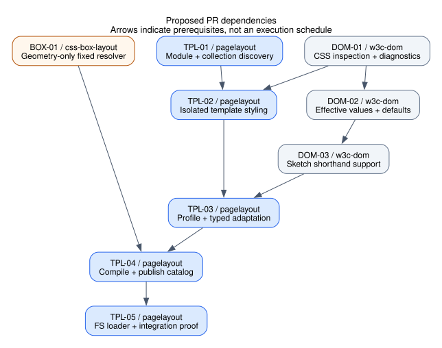

# Template loading: package proposal and PR plan

Date: 2026-11-22. Status: TPL-01/02 and upstream DOM-01/02/03 implemented; remaining milestones proposed.

This note details the template-loading part of [DESIGN.md](DESIGN.md). TPL-01/02
and upstream DOM-01/02/03 have been implemented at the author's request. They preserve the distinction
between template definitions, prepared content and page trials. Later APIs,
profile choices and PR boundaries below remain proposals for discussion.

The current implementation is private within the `template` subpackage:
[source parsing](../template/source.go),
[structural validation](../template/validate.go) and
[diagnostics](../template/diagnostic.go), followed by
[active documents](../template/active.go) and [styling](../template/style.go).
It uses Go 1.25.6 and `golang.org/x/net` v0.49.0, plus the sibling `w3c-dom` DOM-01
reporting APIs. See [ReadMe.md](../ReadMe.md) for development dependencies and
reviewed revisions. The public APIs sketched below are not implemented.

## 1. The first deliverable

Load one HTML/CSS collection into an **immutable catalog of fully compiled page
templates**. Every template has a page box, ordered frame boxes, resolved
geometry, paint and flow bindings. Compile all definitions before publishing
the catalog; a bad definition makes the load fail even if no caller has selected
that template yet.

The loading milestone is complete when a small Go client can load the two-template
collection from [SKETCH.md](SKETCH.md), inspect either template and obtain each
flow's receiving frames in document order. Selection and repeated inspection
must require no parsing, CSS cascade or geometry calculation.

Content loading, paragraph preparation, frame fitting, page scheduling and
rendering remain separate consumers. In particular, this milestone needs no
typography callback: the template frames are empty, and their geometry must be
resolvable without future content. See [PREPARATION.md](PREPARATION.md) for the
content-side phase.

## 2. Package shape and public boundary

**Decision:** encapsulate template loading in package `template`, imported as
`github.com/npillmayer/pagelayout/template`. This package owns discovery, source
identities, styling, profile validation, geometry compilation, diagnostics and
the eventual compiled catalog. Its tests and fixtures live under `template/`.

The root package `pagelayout` is reserved for broader page composition and will
consume the compiled catalog. Keep dependencies directed from page composition
to `template`; the latter must not import the root package. It may depend on the
appropriate sibling DOM and box-layout services. Keep the loading stages private
within this one package rather than adding separate public parser, CSS adapter
or compiler packages.

An illustrative public surface in package `template` is:

```go
// PROPOSED API; implementation and final type names remain open.
type LoadOptions struct {
    SourceName string // Diagnostic label, not a resource-fetching base URL.
}

func Load(r io.Reader, opts LoadOptions) (*Catalog, error)
func LoadFS(fsys fs.FS, name string) (*Catalog, error)

func (c *Catalog) IDs() []string
func (c *Catalog) Lookup(id string) (*Template, bool)

func (t *Template) ID() string
func (t *Template) Page() PageInfo
func (t *Template) Frames() []FrameInfo
func (t *Template) FramesForFlow(name string) []FrameInfo
```

Callers would use `template.Load`, `template.Catalog` and `template.Template`.
These names remain proposals; the package boundary is decided and implemented.

`Catalog` and `Template` have private fields and no mutation methods.
Returned slices are copies; descriptions contain value data, not mutable DOM,
CSSOM or layout-tree pointers. An empty flow lookup returns an empty slice.
Template lookup is exact and case-sensitive; a missing ID returns `false`.
Document order determines `IDs()`, `Frames()` and filtered frame chains.

The description types should expose:

| Value | Contents |
| --- | --- |
| `PageInfo` | Positive page width/height, page paint and a source reference. The page-local origin is zero. |
| `FrameInfo` | Template-local frame identity, flow name, border and receiving content rectangles, effective edges, paint and a source reference. |
| Paint values | Resolved background color and supported border styles/colors. No CSS strings requiring another cascade or renderer-specific objects. |
| Source reference | Collection name, template ID and stable source-node path; optional CSS rule/declaration information for diagnostics. |

Use `css-box-layout` rectangle/edge values, or public aliases of them, initially.
Their numeric unit is **CSS pixels**, not typography DU or big points. Resolve
author units with checked conversion at compilation. Colors and other paint
descriptions should be immutable values; widths in geometry and paint must
agree. Exact exported description fields should be reviewed before publication.

Internally, a template retains the logical hierarchy `page -> frames` and an
index of frame positions per flow. It is a compiled box description, not merely
a bag of unrelated rectangles. It need not expose normalized empty inline
groups or preserve a `LayoutNode` solely to represent that hierarchy.

Do not add public intermediate parsed/styled states or a caller-supplied geometry
engine initially. Keep those boundaries private so sibling API changes do not
force public migrations. The file-system helper opens only the collection file,
sets its source name and delegates to the reader API.

### Suggested files

```text
doc.go                          root package purpose and composition boundary
template/doc.go                 loading package purpose, units and ownership
template/catalog.go             catalog, template and description accessors
template/load.go                reader/FS entry points and publication boundary
template/source.go              HTML parsing, discovery, source identities
template/active.go              isolated active documents and source mappings
template/style.go               active documents, stylesheet registration, cascade
template/values.go              effective CSS -> typed box and paint values
template/validate.go            template profile and source-aware diagnostics
template/compile.go             geometry resolution, frame chains, final catalog
template/diagnostic.go          structured load failures
template/testdata/templates/    self-contained collections and invalid fixtures
```

Tests live beside the behavior they verify in `template/`. Further internal
packages or a shared adapter can follow when another real consumer justifies them.

## 3. Loading and compilation stages

### A. Parse and discover

Read the HTML once using the parser underlying `w3c-dom`, then use its styled-tree
and CSSOM facilities. Do not immediately use a convenience operation that styles
the entire collection and recursively extracts every embedded sheet: stored
template contents need controlled extraction and a different active ancestry.

HTML parsing constructs a tree and may repair malformed markup. Validate the
resulting collection structure; do not advertise this API as an HTML conformance
checker. Verify the chosen parser's representation of template contents with a
fixture rather than assuming a browser's `HTMLTemplateElement.content` API exists
on the Go node type. [Go HTML parser documentation](https://pkg.go.dev/golang.org/x/net/html).

Proposed initial collection profile:

- Page definitions are direct body children named `<template data-type="page">`.
  They have nonempty, whitespace-free, unique IDs. Diagnose marked definitions
  in unsupported nested locations instead of silently losing them.
- Each definition contains exactly one page DIV. Its element children are frame
  DIVs; frame interiors contain only comments or formatting whitespace. The
  `.page` and `.frame` classes are useful conventions, not required role markers:
  structure identifies the boxes.
- Zero frames can describe an intentional blank page. The later scheduler owns
  whether such a page may be emitted. An entirely empty template catalog is an
  input error.
- Head metadata and direct head styles are accepted. Inline style attributes on
  the active html/body/page/frame elements participate in styling. Template-local
  sheets, external sheets, imports, conditional rules and other resource-dependent
  features are outside the first profile and receive explicit diagnostics.
- Non-page templates may be ignored as inert storage. Other body content is an
  error in this collection format. Scripts are not evaluated; unsupported active
  markup is diagnosed by the profile.

These are proposed authoring policies, not restrictions imposed by sibling APIs.
Assign stable source identities before cloning. A compiled frame identity is
local to its template and independent of HTML IDs or CSS class names. If HTML IDs
are used, validate uniqueness within each active styling document; repeated
frame classes are encouraged.

### B. Collect CSS once; construct one active document per definition

Extract accepted head sheets in document order. Preserve declarations and their
provenance for validation, including declarations that later lose the cascade.
Reject sheet extraction errors rather than using the successful subset.

For each definition, clone the page and frames into:

```text
html (collection attributes)
  body (collection attributes)
    page DIV
      frame DIVs in source order
```

The template storage element and other templates are absent. Copy attributes
without sharing mutable slices, preserve the correct HTML tag atoms, and maintain
a map from cloned nodes to original source identities. Structural selectors are
evaluated independently in this context for every definition. A selector such
as `template .frame` has no storage ancestor to match.

The implemented path first calls `cssom.InspectStylesheet` once per accepted head
sheet, retaining its source-ordered rules/declarations and usable `Sheet`.
`InspectInlineStyle` checks the active html/body/page/frame attributes before the
cascade; wrapper and ignored-template attributes are excluded. Any inspection
diagnostic rejects the collection. Unsupported at-rules, non-CSS types,
conditional media and scoped style elements are reported explicitly. Empty or
`all` media and empty or `text/css` types are accepted. These checks do not yet
implement the full property/value profile in TPL-03.

Use `cssom.NewCSSOM`, ordered
`AddStylesForScope(nil, sheet, cssom.Author)` calls and `Style` as the first
integration route. Create a fresh CSSOM per definition because styling registers
node-specific inline declarations. Parsed sheets may be reused as read-only
inputs; neither sessions nor their mutable caches should leak across templates.
See [the current CSSOM](../../w3c-dom/style/cssom/cssom.go) and
[DOM-01 inspection](../../w3c-dom/style/cssom/inspect.go).

The preferred future API separates a reusable compiled stylesheet program from
per-document styling sessions. That optimization should preserve this exact
context and result; it need not delay a correct loader using isolated CSSOMs.

### C. Validate source declarations and effective styles

Validation has two jobs. Inspect source CSS to catch syntax or unsupported
features the styling engine could otherwise discard. Then inspect effective
properties to validate the actual page and frames after cascade/defaulting.
Use `css.GetProperty` and `css.GetDisplay`; local property maps are not complete
effective-style snapshots.

Recommend a strict initial profile: unsupported selectors, rules and declarations
in the accepted stylesheet inputs are reported even if they would not match the
current template. Do not infer successful support from a nonmatching rule or a
silently discarded declaration. This is a deliberate compiler policy, stricter
than ordinary browser recovery; permissive loading would be a later explicit
option. Source validation must use the CSS layer's parsed information rather
than a second regex-based CSS parser in `pagelayout`.

The initial geometry/paint profile should follow the proposal in DESIGN:

| Area | Proposed first supported form |
| --- | --- |
| Page | Static block/flow DIV, positive absolute width and height, zero margin/padding/effective border. |
| Frames | Direct fixed block/flow DIVs, content-box sizing and zero margins. No hidden or suppressed receivers. |
| Sizes/insets | Absolute lengths or valid unitless zero; explicit positive content sizes or opposing-inset stretch. At least one definite inset per axis. |
| Edges | Nonnegative absolute padding and effective borders; `none`, `hidden` or solid border styles. |
| Paint | Solid colors and transparency, including correctly resolved initial/current-color behavior for the supported properties. |
| Bindings | Each frame has one non-`none` `flow-from` identifier. Decode through CSS value handling; record names case-sensitively. |
| Additional effects | Transforms, clipping, images, generated content, unsupported min/max sizing and other unsupported geometry/paint effects receive diagnostics. |

Ordinary shorthand forms used by the sketch, including `border: 0` and
`background: #fff`, should work by completing the relevant `w3c-dom` support.
Expansion must preserve omitted-component resets, source order and `!important`;
recognizing a shorthand as an alias for one longhand is insufficient.
[CSS shorthand semantics](https://www.w3.org/TR/css-cascade-5/#shorthand).

The current property registry is incomplete and includes renderer color
sentinels. Define the relevant CSS defaults and typed-value behavior upstream;
do not freeze accidental sentinels into the catalog. `flow-from` already has
metadata in [the registry](../../w3c-dom/style/defaults.go). Default-channel
syntax remains a separate decision: the loader should not invent one or require
a channel named `body`.

Percentages, font-relative lengths and border-box sizing are subsequent profile
extensions, not architectural exclusions. The geometry API can support a wider
typed domain than the first authoring profile. No content font services should
be required by the absolute-length milestone.

### D. Resolve fixed geometry and build the compiled tree

Construct typed box constraints using the core's default constructors; zero-value
lengths are not equivalent to `auto`. Resolve the positive page size first, then
each frame against the page's zero-origin viewport.

The preferred route is the proposed `ResolveFixedGeometry` service in
`css-box-layout`. It must share the existing fixed-axis equations and return
border and content rectangles without DOM nodes, normalized trees, inline
callbacks or intrinsic measurement. Content-dependent sizing is an explicit
failure. Its signature and existing-API fallback remain described in
[DESIGN.md](DESIGN.md#preferred-service-proposed-geometry-only-api).

Keep `BuildLayoutTrees` / `FixedLayout` with a checked empty-group adapter as a
documented fallback if the upstream change is delayed. Do not implement both
production routes speculatively, and never use empty content to recover from a
content-dependency error. No new fixed-position equations belong in `pagelayout`.

Validate finite positive receiving rectangles. Initially propose rejecting
out-of-page border boxes and positive-area overlaps, while allowing touching
edges. Use one documented, solver-precision-aware comparison tolerance; do not
scatter arbitrary epsilon values through the loader. Bleed, decorative overlap
and clipping policy remain open extensions.

Store both border and content rectangles in page coordinates. The content origin
already includes the frame's position and edges; do not add the border origin
again. Store paint and source references beside the logical box hierarchy.

Build flow chains by filtering frames in source order. Do not sort by x/y,
selector-list order, class name or map iteration. Channel names need no matching
content document at load time; later integration checks receiver availability.

### E. Publish once, then select cheaply

Build definitions and indices privately. Return a catalog only after all
definitions succeed; return `nil` with a structured error otherwise. A caller
replacing a catalog keeps its old one until the new load succeeds.

Once all required values and source references have been detached, parsed and
styled working trees can be released. Do not retain them merely to recascade a
later page. Catalog accessors should need no mutable styling services.

Loading creates an active DOM once per **definition** for styling. Later page
instantiation selects the compiled template and allocates trial/output state.
It shares read-only geometry and paint and does not clone/reparent the source
DOM, restyle frames or rerun fixed sizing. A public `Page`/`Instantiate` API can
wait for the page-trial design; the loading milestone should not settle it.

## 4. Diagnostics and ownership

Return structured diagnostics containing stage, stable code, source name,
template ID when known, node path, property/rule information and wrapped cause.
Useful distinctions are invalid collection structure, unsupported CSS/profile,
invalid geometry and content-dependent geometry. Include rule/declaration order
when available; promise line/column positions only when the parser supplies
reliable locations.

Collect independent per-template failures in deterministic source order. A fatal
input or shared stylesheet failure may prevent later stages; avoid cascading
secondary errors from missing prerequisites. Public callers should not need
concrete `w3c-dom` nodes to understand a failure.

Read-only publication does not mean callers receive mutable slices into internal
storage. Tests should mutate returned descriptions and confirm the catalog is
unchanged. Repeated page instances must be able to share a template safely while
keeping placement, content and cursors elsewhere.

## 5. Proposed PR sequence

There are **five pagelayout PRs and four upstream PRs**. Each PR should carry its
own focused tests; the final integration PR does not postpone basic correctness
checks. The identifiers below are planning labels, not existing PRs.



[Graphviz DOT source](diagrams/template-loading-prs.dot)

### TPL-01 — Module, collection discovery and source model

Repository: `pagelayout`. Dependencies: none.

**Implemented:** the private source stage and its tests are in `template/`. It validates
the parsed HTML structure, preserves original nodes and source order, assigns
collection-local source IDs and template-local frame IDs, and publishes no
partial model on failure. ID and formatting-whitespace checks use HTML ASCII
whitespace rules. Element ID uniqueness includes the future html/body context,
but excludes template storage wrappers and other definitions. TPL-02 adds CSS
inspection/styling; the public loader remains for a later milestone.

- Establish the Go module, `template` package and documented loading contract. Align the Go
  baseline with the sibling modules; record dependency versions used for the work.
- Implement private HTML parsing, eligible-template discovery, structural
  validation, source paths and deterministic definition order.
- Introduce the private catalog/description model and diagnostic envelope as
  needed. Do not expose a `template.Load` stub that cannot compile templates yet.
- Test the two-definition skeleton, duplicate/missing IDs, nested marked
  definitions, nonempty receivers, zero-frame pages and parser repair behavior.

Exit: parsed definitions and source diagnostics are usable by the next stage;
there is no claim of styled or sized templates.

### DOM-01 — CSS inspection and diagnostic reporting

Repository: `w3c-dom`. Dependencies: none; can proceed alongside TPL-01.

**Implemented:** `cssom.InspectStylesheet` and `InspectInlineStyle` provide source
inspection, diagnostic codes, rule/declaration ordinals, CSS line/column locations
and wrapped parser causes. The stylesheet result includes an engine-compatible
sheet and retains duplicate/invalid declarations before reduction. Unsupported
at-rule text is retained as an opaque rule and reported. Inspection checks syntax
and the existing `display` grammar, not all property value grammars. Inline
styling shares the inspected declaration handling; legacy callers remain permissive.

- Expose source-ordered rules/declarations and sufficient provenance before
  invalid or losing declarations disappear from effective-property views.
- Surface selector parse failures and declaration/rule parse failures to callers,
  including the inline-style path. Preserve existing permissive callers through
  an explicit reporting/inspection API rather than globally imposing page policy.
- Test malformed selectors, unsupported rule forms, inline syntax, duplicate
  declarations and deterministic diagnostic/source association.

Exit: a consumer can implement a strict profile without re-parsing CSS or
scraping log output. Template-specific policy stays in `pagelayout`.

### DOM-02 — Effective values and defaults needed by empty page boxes

Repository: `w3c-dom`. Depends on DOM-01.

**Implemented:** the property registry now supplies box-sizing/writing-mode
metadata and concrete print-UA color defaults (black, transparent and
currentcolor borders). `style.NormalizeDeclaration` validates supported values
before duplicate reduction and cascade selection; DOM-01 reports invalid source
declarations even when they lose or do not match. Existing edge shorthands are
validated atomically; the selected border/background forms are supplied by DOM-03.

Checked APIs are `style.ParseBoxLength`, `ParseColorValue`, `ParseFlowName` and
`ParseBoxKeyword`, with `css.GetBoxLength`, `GetColor`, `GetFlowName`,
`GetBoxKeyword` and `GetBorder` for styled elements. Absolute lengths use checked
DU conversion; percentages remain fractional and unclamped, and relative values
remain unsized. The page-layout adapter must convert DU to CSS pixels. Effective
borders are zero for none/hidden, including inherited computed widths. See
[the upstream contract and supported scope](../../w3c-dom/doc/architecture.md#checked-box-values-and-defaults-dom-02).
Opaque math/substitutions and cascade rollback still require later evaluation;
typed accessors report them instead of fabricating geometry or colors.

- Complete the relevant metadata/defaults for box sizing, writing mode and paint;
  define the supported initial/current-color behavior instead of leaking renderer
  sentinels into compiled templates.
- Provide checked parsing/access for the initial profile's dimensions, edges,
  solid colors and flow identifiers. Reuse existing conversions such as
  `dimen.ParseAbsolute`; avoid a parallel unit parser in `pagelayout`.
- Validate supported values before they can incorrectly displace an earlier
  valid declaration. Diagnostics still allow the strict loader to reject bad input.
- Test inheritance/defaulting, invalid-value fallback in the CSS layer,
  non-inherited flow bindings, finite/range-checked units and effective zero
  borders when the border style is none/hidden.

Exit: the loader can obtain unambiguous typed inputs for the selected profile.
This is not a demand to implement all of CSS before page loading.

### DOM-03 — Complete the sketch's shorthand forms

Repository: `w3c-dom`. Depends on DOM-02.

**Implemented:** `border` and physical side shorthands accept the checked
width/style/color components in any order. Solid `background` accepts one color,
optional `none`, or `none` alone. Omitted components reset to initial values;
`border` includes the border-image reset-only properties. CSS-wide keywords and
importance propagate to every subproperty. Richer forms and deferred functions
are diagnosed before duplicate/cascade reduction, without partial expansion.
See [the upstream scope](../../w3c-dom/doc/architecture.md#border-and-solid-background-shorthands-dom-03).
Tests cover all three styling routes, cascade/reset interactions and source
diagnostics. The collection example from `SKETCH.md` is also an isolated-styling
regression in `template/sketch_test.go`; geometry compilation remains separate.

- Support the selected `border` and solid-background shorthand grammar, using
  correct reset semantics for their other components. Keep richer unsupported
  forms observable through DOM-01 diagnostics.
- Verify shorthand/longhand ordering, inline declarations, `!important`, omitted
  component resets and CSS-wide keyword handling for the supported forms.
- Use the actual sketch declarations as regression cases.

Exit: the collection's simple standard CSS can be used directly. This remains
a distinct PR from diagnostics and typed-value work because cascade expansion
has its own correctness obligations.

### TPL-02 — Isolated styling of each template definition

Repository: `pagelayout`. Depends on TPL-01 and DOM-01.

**Implemented:** each definition has an independently styled page/frame tree with
cloned html/body context, original source identities, fresh CSSOM state and shared
read-only inspected sheets. Failures return no partial styled collection. Tests
cover inheritance, specificity, source order, importance, structural selectors,
invalid/nonmatching selectors, source preservation and mutation isolation.
Working models remain private; no fixed geometry or public loader is published.

- Collect accepted head sheets once, then create a fresh active document and
  CSSOM per definition. Preserve source mappings and collection html/body context.
- Apply sheets in order and inline styles through the existing engine; keep the
  template storage wrapper out of selector ancestry.
- Test inheritance from the copied context, selector specificity, document-order
  ties, inline importance, structural selectors and isolation between templates.
- Show that an invalid selector is a load-stage diagnostic rather than a silent
  mismatch. This PR can use supported longhands while DOM-02/03 proceed.

Exit: every definition has an independently styled page/frame tree with usable
source provenance. No fixed geometry is published yet.

### BOX-01 — Geometry-only fixed-box resolution

Repository: `css-box-layout`. Dependencies: none of the loading PRs.

- Extract a shared typed fixed-sizing kernel and expose the proposed direct
  geometry service. Preserve the existing `FixedLayout` path and behavior.
- Return complete border/content geometry with explicit invalid-input,
  unsupported static-position and content-dependency outcomes.
- Test explicit sizes, opposing-inset stretch, right/bottom anchoring, edges,
  overconstraints, invalid values and content-dependent cases.
- Compare results to existing `FixedLayout` fixtures and verify that neither
  callback nor DOM/tree construction is required by the direct service.

Exit: `pagelayout` can compile empty frames without a paragraph adapter.

### TPL-03 — Template CSS profile and typed adaptation

Repository: `pagelayout`. Depends on TPL-02 and DOM-02/03.

- Implement source-level profile checks and effective page/frame validation.
- Adapt values to typed box constraints, paint and flow bindings; initialize
  core defaults correctly and attach diagnostics to original source identities.
- Test nonfixed or nested frames, hidden receivers, missing/invalid flow names,
  unsupported CSS effects, absolute-unit conversion and content-independent
  sizing prerequisites. Include CSS rules that fail the profile without matching
  a particular template.

Exit: validated compiled-input descriptions are ready for the geometry service.
No new cascade, shorthand expander or fixed solver is implemented here.

### TPL-04 — Compile and publish the immutable catalog

Repository: `pagelayout`. Depends on TPL-03 and BOX-01.

- Resolve each page and frame, retain the logical box hierarchy, check bounds
  and overlaps, and build flow chains in source order.
- Implement `template.Load` and catalog/template accessors, including atomic
  publication and deterministic failure aggregation.
- Verify one invalid definition rejects the whole collection; earlier catalogs
  remain usable. Check copies returned by accessors and repeated selection.
- Test the known 300px by 200px edge example from DESIGN, explicit/stretch
  equivalence, geometry tolerances, touching frames and source order that differs
  from visual left-to-right order.

Exit: the reader API returns a complete reusable catalog, with no dependency on
content preparation or rendering.

### TPL-05 — File loading, executable examples and integration proof

Repository: `pagelayout`. Depends on TPL-04.

- Add `template.LoadFS`, a package example and self-contained collection fixtures.
  Demonstrate lookup, page dimensions, receiving rectangles and flow-chain order.
- Exercise the two templates from SKETCH end to end, including their shorthand
  styles, paint and multiple receivers. Keep content `flow-into` rules with
  Cont-Doc in the executable examples; clarify the historical sketch's wording
  about applying collection styles together with supplied content styles.
- Add integration/lifetime checks that results survive later successful and
  failed loads, and that selection performs no styling or geometry work.
- Document the supported profile, diagnostics, units, ownership and limitations.
  Run package tests/vet and the relevant sibling regression suites against the
  recorded dependency revisions.

Exit: a documented, usable loading milestone. No public API should claim page
pagination or content rendering as a result of these PRs.

### Dependencies and review order

Start TPL-01, DOM-01 and BOX-01 independently. TPL-02 can follow DOM-01 while the
remaining CSS support is developed. TPL-03 joins styling with DOM-02/03; TPL-04
joins validated descriptions with BOX-01; TPL-05 completes the user-facing proof.

Use a Go workspace for joint development and record the tested revisions for
each cross-repository boundary. Consumer PRs should identify their upstream
prerequisites and use reproducible dependency versions when merged. Local
workspace paths are development plumbing, not part of the public loader API.

## 6. Follow-up PRs, outside the first loading milestone

- **Reusable CSS program and sessions:** an upstream API plus a small loader
  integration PR. Compare identical catalog results against isolated CSSOMs and
  test that inline declarations and nodes never leak between sessions.
- **Richer definite geometry:** percentages, font-relative lengths, border-box
  sizing and explicit font-context inputs, coordinated with the CSS adapter and
  geometry solver.
- **Additional resource/profile policies:** external stylesheets, conditional
  rules, template-local sheets, bleed, overlap and decorative unbound boxes.
- **Page instantiation and trials:** consume immutable templates alongside the
  prepared content model; define page identity, placements and register commits
  in that separate milestone.

Before implementation, review the public naming and description values, the
strict collection/CSS profile, zero-frame page handling, overlap policy and
diagnostic granularity. These are proposed choices; current sibling limitations
must not settle them accidentally.

## Diagram source

Regenerate the PR dependency preview from the repository root:

```sh
dot -Tsvg doc/diagrams/template-loading-prs.dot -o doc/diagrams/template-loading-prs.svg
```
